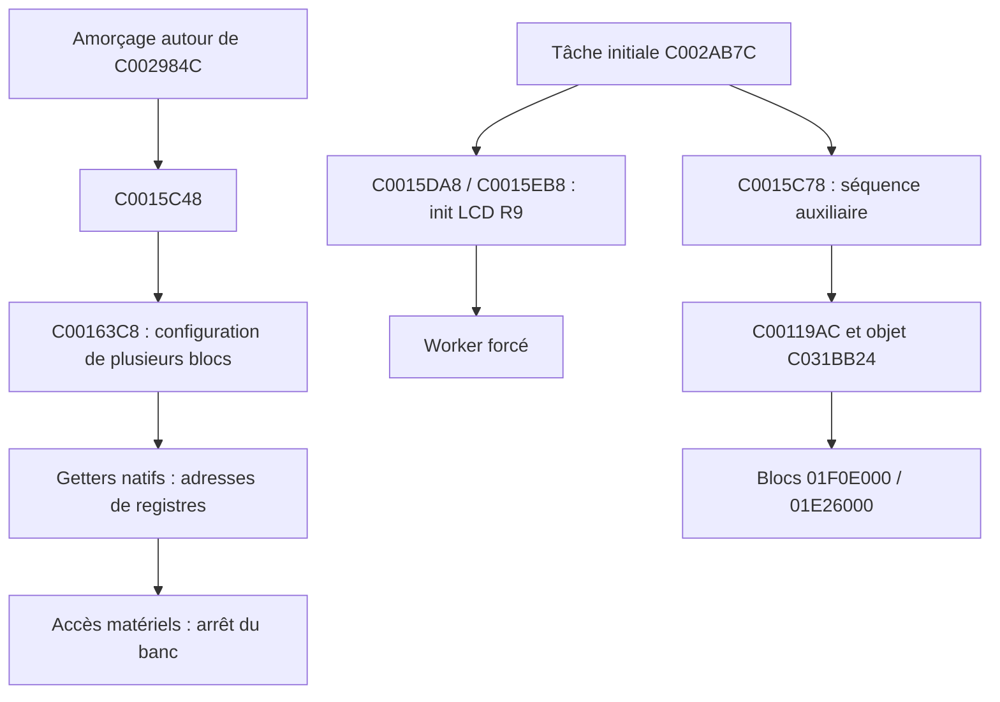
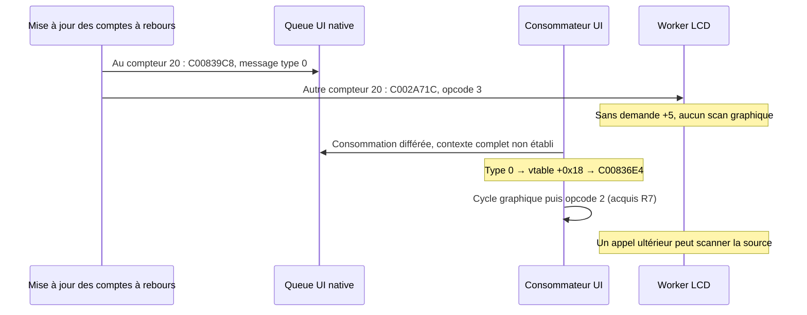

# Mercury Dust — R10 : initialisation native, cadence logique et erreurs LCD

3 novembre 2026 — `recovery/mercury-dust`, base R9 **43a57b986478992c7082e0615578e7a5c573c7d2**. **RESEARCH_ONLY : aucune intégration matérielle, aucune réponse périphérique simulée, aucun flash.**

## 1. Résultats et portée

R10 poursuit les trois priorités proposées après R9. La branche distante a été synchronisée et vérifiée avant les ajouts. R1–R9 sont conservés ; seuls bancs, outils, rapports et preuves R10 sont ajoutés.

Apports :

- Une **initialisation matérielle antérieure au constructeur LCD** est identifiée : C002984C → C0015C48 → C00163C8. Elle touche plusieurs blocs ; elle ne peut pas être remplacée par les seuls pointeurs du descripteur R9.
- Le calendrier logique comprend **deux comptes à rebours initialisés à 20** : publication UI par C00839C8 et lancement LCD par C002A71C. Les callbacks et leurs conditions sont exécutés nativement. **20 mises à jour n'est pas une preuve de 20 ms.**
- Le chemin d'erreur C00298BC utilise lui-même le LCD et finit, s'il atteint sa fin, sur la boucle **C00299F4**. Ce n'est pas une fonction de réessai qui retourne normalement. Son exécution complète reste bloquée par le contexte système absent.
- La zone **C031BB10..C031BB1F** est un rectangle graphique natif. Le premier octet après la shadow n'est donc pas une zone libre ni un canari universel.
- L'adaptateur natif C009A8C8 borne le paramètre LCD à **18..42** avant l'opcode 4 ; aucun paramètre artistique Mercury n'est modifié.

**26 scénarios ARM, treize par VSB**, ont les issues attendues : huit retours normaux et dix-huit arrêts diagnostiques de faute. Ces derniers confirment les frontières ; ils ne valident aucune configuration de périphérique. Les résultats de R9 restent des acquis vérifiés par leurs archives, pas des expériences refaites.

## 2. Initialisation : séparer les différentes couches



Le premier appel à C0015C48 apparaît dans l'amorçage avant le saut vers C0000110. C00163C8 appelle notamment :

1. C0016538 → C0019040 puis C0019184 ;
2. C0016710 → C0016A0C ;
3. C00165F8 → C00193C0 ;
4. C0016654 → C0018D24 ;
5. C00165C8 → C001932C ;
6. C00164D8 → C00190CC.

Ce sont des relations lues dans les instructions originales, **pas une séquence menée intégralement à terme sous QEMU**. Le premier accès matériel arrête l'appel global. Les fonctions suivantes sont donc aussi étudiées séparément avec leurs getters réels, sans mapper les registres.

### Registres et écritures prévues

| Fonction | Base native / première opération | Instructions suivantes utiles | Validation réelle |
|---|---|---|---|
| C0019040 | 01F0D000, lecture +0x20 | Efface les bits 0xC0, puis écrit +0x20 | Faute **01F0D020** dans l'initialisation globale |
| C0019184 | Même base, écriture +4=1 | +0x24=5, +0x18=08F0D17F, +0x20=0x80, +0x44=2 | Faute **01F0D004** ; valeurs suivantes seulement désassemblées |
| C0016A0C | 68000000, écriture +0x10=00200101 | Autres valeurs locales dans le corps | Faute **68000010** ; rôle physique du bloc non affirmé sans spécification matérielle |
| C0018D24 | SPI 01C41000, écriture +0=0 | Délai, remise à 1, +4=3, +0x14=0x601, +0x18=1, format indexé 0x11D08, puis activation d'un bit haut | Faute **01C41000** avant ces étapes ; aucune fréquence SPI déduite |
| C001932C | 01C42000, écriture +0x34=1 | +0x0C=0x80, valeurs dérivées de 100 à +0x24/+0x20, autres contrôles | Faute **01C42034** ; classification du bloc et résultat matériel non validés |
| C00190CC | 01C21000, écriture +4=1 | +0x24=11, +0x18=016E35FF, +0x20=0x80, +0x44=3 | Faute **01C21004** |

Les noms fonctionnels « configuration », « compteur » ou « SPI » ne transforment pas les constantes en une preuve d'horloge, de broches ou de débit. Le banc ne fournit aucun état de disponibilité et ne laisse réussir aucune de ces écritures MMIO.

### Objet auxiliaire après l'initialisation LCD

C00119AC initialise deux mots à C031BB24 : **01F0E000** et **01E26000**, obtenus par les getters C00166B4 et C0016568. Cet appel est exécutable sans périphérique : il écrit des adresses dans la RAM de l'objet, pas des registres matériels.

C0015C78 appelle C0011A04 puis C0011A5C sur cet objet. Le premier descend vers C0018E90, dont la première opération écrit à la base 01F0E000 : faute exacte conservée. Le rôle externe de toute cette séquence auxiliaire, ses effets physiques et sa temporisation ne sont pas validés. R10 ne la déclare pas « reset LCD réussi ».

## 3. Cadence logique du worker

### 3.1. Objets et callbacks

C002A8D4 construit deux objets de seize octets. À +4 se trouve le compteur courant, à +8 sa valeur de rechargement, à +12 le callback. Les deux valeurs initiales de compteur/rechargement sont **20**. Les callbacks sont :

- objet du gestionnaire à +8 : **C00839C8**, producteur d'un message UI de type 0 ;
- objet à +12 : **C002A71C**, qui transmet directement l'opcode 3 à C0015DD0, descripteur C031BB2C.

C002A7EC décrémente le compteur ; s'il reste strictement positif, il retourne. Sinon, il recharge depuis +8 puis appelle le callback. Un rechargement nul provoque donc un appel à chaque mise à jour, au lieu d'être rejeté. Ce dernier état est un contrôle contradictoire de fixture, pas une recommandation de configuration.

La structure des objets est lue dans le constructeur ; **le constructeur général C002A8D4 n'est pas exécuté**. Le banc fournit les quatre mots de ces objets, puis exécute leur véritable méthode de mise à jour et les callbacks originaux.

### 3.2. Chaîne UI / LCD distincte



Le dispatcher C00834FC dirige le type 0 vers le slot +0x18. La table UI C00E4C50 y contient C00836E4. **Publier un événement n'est donc pas exécuter immédiatement le tick graphique.**

C002A818 met à jour les deux objets, dans cet ordre local : publication UI, puis worker LCD. Il appelle aussi d'autres comptes à rebours et services. La variante C002A8AC met à jour les deux premiers objets avant un autre traitement d'entrée. Les boucles C002A7AC/C002A7CC appellent C00007AC puis la méthode virtuelle +0x0C de leur objet ; les tables C00A45E0/C00A45C8 les relient à ces variantes.

C00007AC consulte des états de noyau, le bit IRQ du CPSR et des objets de tâche. **Ces instructions ne sont pas reproduites comme un ordonnanceur fonctionnel par Linux user-mode.** Le nombre de passages par seconde, la priorité réellement appliquée et les possibilités de préemption ne sont pas démontrés. Les entrées de tâche C002AA34 et C002AB7C figurent dans les données de démarrage ; les mots voisins sont archivés sans attribuer arbitrairement une unité ou une signification à tous les champs.

L'ordre local publication/worker ne permet pas de conclure que le worker est toujours en retard d'une période : un consommateur UI pourrait intervenir entre les deux selon l'ordonnancement réel. Il prouve seulement que la publication n'est pas une barrière de dessin ou une preuve d'affichage.

### 3.3. Expérience de compte à rebours

Le cas 8 utilise la vraie queue, les constructeurs de messages et le publisher natifs, avec un manager UI actif de fixture :

1. Après dix-neuf mises à jour : compteurs=1, aucun message.
2. Vingtième mise à jour du timer UI : un message publié, compteur rechargé à 20, +5 LCD toujours nul.
3. Vingtième mise à jour du timer LCD : le callback worker revient sans scan, car +5 reste nul.
4. Extraction native C0070B10 : le message contient bien le type 0.
5. **Coupure explicite du banc :** le dispatch/dessin complet n'est pas rejoué ; cette chaîne est déjà démontrée R7. Le banc appelle l'opcode 2, puis change la source.
6. Après vingt autres mises à jour du timer LCD : le vrai worker copie la page modifiée et atteint la faute GPIO 0xBC.

Cette expérience reproduit une chaîne logique de callbacks. Elle n'exécute pas une tâche Korg complète et ne mesure pas une période matérielle.

## 4. Erreurs : arrêt fatal et dépendances de diagnostic

C00298BC commence par C0000040, qui lit le CPSR puis tente de positionner le bit 0x80. Il efface/dessine une information d'erreur via les primitives graphiques, consulte un identifiant de tâche par C0001480, prépare un texte, demande le LCD par opcodes 2/3, manipule des contrôles GPIO, puis branche sur lui-même à **C00299F4**.

Conséquences bornées :

- Le chemin n'offre pas un retour normal de « réessai terminé ».
- L'affichage d'une erreur dépend du LCD et d'autres états. Il ne constitue pas un mécanisme indépendant de récupération d'une panne LCD.
- Les fonctions SPI C00183CC/C001851C peuvent appeler ce diagnostic ; celui-ci peut appeler à nouveau le worker. Le graphe présente donc une dépendance cyclique. Le comportement matériel exact — arrêt, attente, nouvelle erreur — reste inconnu.
- Une branche du formatage lit explicitement l'adresse zéro à C0029980. Elle n'est pas automatiquement atteignable en exécution native : si C0000040 positionne effectivement le bit IRQ en mode privilégié, C0001480 retourne -25, et C0029940 sélectionne l'autre branche de formatage. Le pointeur nul passé à C0001480 est alors compatible avec ce retour anticipé. La lecture de zéro ne constitue donc pas une preuve de bogue matériel atteignable ; le mode CPU et les vecteurs d'exception doivent être établis. R10 ne fournit aucun contenu fictif à zéro.

L'appel direct du cas 11 atteint **C06A2894**, consulté par C0001480, et s'arrête sur faute de RAM système absente. Aucun identifiant de tâche synthétique ni stub RTOS n'est introduit pour franchir cet obstacle. **La boucle terminale est une preuve statique ; elle n'est pas atteinte dans cette exécution.**

Le passage à travers C0000040 dans QEMU user-mode ne valide pas le masquage d'IRQ sur instrument. Ce contexte n'est ni le mode privilégié Korg, ni une simulation de ses IRQ/FIQ. L'absence de SIGILL n'est pas une preuve d'exclusion réelle.

## 5. Zone après la shadow : responsabilité mémoire précisée

C001531C transmet une description de rectangle à C0015428 avec destination **C031BB10**. C0015468 écrit ses quatre mots aux offsets 0,4,8,12. La zone C031BB10..C031BB1F est donc utilisée par le code graphique natif et jouxte immédiatement la shadow.

Le loader R9 pose un octet de diagnostic C5 à shadow+1024 pour ses chemins LCD restreints ; R9 vérifie sa stabilité dans ces cas précis. **Cette position ne peut pas être généralisée à un canari de tout chemin graphique.** Le premier essai de diagnostic d'erreur a modifié cet octet ; l'analyse a identifié les écritures légitimes du rectangle, sans les présenter comme un débordement.

Dans le cas 11 final, le rectangle est initialisé par C0015374 et le graphisme par C003F0D4 avant le diagnostic. L'en-tête conserve la valeur observée de ce mot, sans prétendre protéger cet objet natif. La garde source−1 reste contrôlée. Dans les autres cas, le contrôle restreint hérité R9 demeure applicable. Aucune région libre de RAM n'est déduite des espaces entre objets.

## 6. Matrice ARM : treize cas par VSB

| Cas | Expérience native | Résultat attendu sur les deux originaux |
|---:|---|---|
| 0 | C0015C48, configuration globale | Faute 01F0D020, première lecture de configuration |
| 1 | C0019184 avec getter natif | Faute 01F0D004 |
| 2 | C0016A0C avec getter natif | Faute 68000010 |
| 3 | C0018D24 avec getter SPI natif | Faute 01C41000, avant activation du SPI |
| 4 | C001932C avec getter natif | Faute 01C42034 |
| 5 | C00190CC avec getter natif | Faute 01C21004 |
| 6 | C00119AC, objet auxiliaire RAM | Deux bases natives vérifiées ; retour sans accès MMIO |
| 7 | Séquence C0015C78 après cet objet | Faute 01F0E000 |
| 8 | Comptes à rebours, publication/extraction native puis demande et worker | Déclenchement après 20 mises à jour ; type 0 vérifié ; copie puis faute 0xBC |
| 9 | Rechargement nul, trois mises à jour | Trois messages UI ; pas de demande ni de sender LCD |
| 10 | Adaptateur C009A8C8 avec -1,100,24 | Paramètres bornés à 18,42,24 ; indicateur +12 positionné |
| 11 | Diagnostic C00298BC, graphisme initialisé | Faute C06A2894 avant la fin ; rectangle natif observable ; pas de retour de diagnostic validé |
| 12 | Timer LCD pendant 45 mises à jour, source=shadow, demande active | Deux déclenchements logiques, compteur final 15 ; retour sans sender ; demande persistante |

Les dumps reprennent le format R9 de 2 112 octets : en-tête, source, shadow. Le handler SIGSEGV Linux enregistre l'adresse puis termine avec 88 ; il ne rend pas l'accès périphérique réussi. Les adresses fautives, étapes et effets de queue sont exigés par l'orchestrateur. Les deux flux sont comparés exactement.

## 7. Hypothèses et décisions

| Hypothèse | Conclusion |
|---|---|
| Initialiser seulement les champs du descripteur R9 configure le LCD | Rejetée : une configuration de blocs antérieure et des séquences auxiliaires existent |
| La valeur 20 prouve 20 ms ou 50 Hz | Non démontrée : seuls vingt appels de mise à jour sont prouvés |
| L'événement UI produit exécute immédiatement le dessin | Rejetée dans le banc : il reste dans la queue, +5 n'est pas modifié par sa publication |
| Le worker dépend seulement de l'appel direct du tick graphique | Rejetée : callback périodique C002A71C distinct ; autres appels synchrones, dont progression C006038C |
| Le chemin d'erreur fournit une reprise qui retourne | Rejetée pour la fin désassemblée C00299F4 ; exécution intégrale encore inconnue |
| L'octet après la shadow est une RAM libre | Rejetée : rectangle graphique natif de seize octets |
| Le paramètre LCD peut prendre toutes les valeurs via son adaptateur natif | Rejetée : bornage 18..42 par C009A8C8 ; le setter bas niveau reste distinct |

L'architecture R9 doit donc tenir compte d'un producteur UI et d'un consommateur LCD pouvant être découplés, de plusieurs appels synchrones et d'un diagnostic utilisant la même chaîne matérielle. La phase de protection ne doit pas être rattachée au seul callback de dessin. Aucun verrou effectif, aucun budget temporel et aucun propriétaire exclusif sur instrument ne sont ajoutés par R10.

## 8. Reproduction et preuves

```bash
export PATH=/workspace/mercury-tools/bin:$PATH
bash tests/run_recovery_r10.sh 'custom.VSB' 'backup.VSB'
```

- [Résultats](reports/recovery_r10/results.json), [journal](reports/recovery_r10/validation.log), records et traces compressés dans le même répertoire.
- [Audit statique](reports/recovery_r10/static_audit.json), [désassemblage](reports/recovery_r10/native_disassembly.txt) : dix-sept plages identiques entre VSB, callbacks, slot UI et candidats d'appels.
- [Provenance et relecture des archives](reports/recovery_r10/provenance.json).

Les deux VSB de 0x200100 octets sont exigés par les mêmes SHA que R9 et contrôlés avant/après. Le loader, les syscalls, les snapshots et le handler de faute de R9 sont réutilisés **sans modification de leurs sources**. Les objets de compte à rebours sont des structures de fixture décrites ; aucune initialisation générale de noyau n'est revendiquée. Les routines Korg sont originales, la copie d'image est RX et aucun MMIO n'est mappé. Les traces `in_asm` n'indiquent pas le nombre de chaque exécution ; les compteurs/étapes sont vérifiés par assertions et snapshots.

Le moteur V30, huit presets, douze paramètres, quatre mini-LFO au total, sources historiques et IFX sont préservés. Aucun binaire installable n'est produit ; seuls des ELF Linux de laboratoire restent dans build/ hors Git.

## 9. Blocages et suite

R10 est achevée comme recherche bornée sur les trois priorités. Restent non validés : configuration réelle des blocs et des broches, horloges et unités de temps, fonctionnement du noyau, appelant effectif du dépilement UI dans le système complet, interaction des tâches, chemins d'exception et politique de récupération, bus LCD, cache/MMU/DMA, RAM/piles et coexistence audio/IFX.

Suite recommandée, sans flash : **R11, contexte des tâches et récupération indépendante du LCD**. Identifier le consommateur réel de la queue UI et les conditions de réveil ; qualifier les unités du compte à rebours par des preuves du noyau ; cartographier l'erreur sans supposer que son écran pourra être utilisé. Deux pistes ensuite peuvent avancer séparément : acquisition des commandes physiques et observation des événements musicaux, chacune sans transformer les fixtures actuelles en preuve matérielle.

## 10. Explication simple

Mercury sait dessiner et naviguer avec plusieurs routines Korg dans le laboratoire. R10 montre que préparer l'écran et lui envoyer des images sont deux activités qui peuvent être déclenchées séparément. Elle précise aussi plusieurs réglages matériels qui doivent exister avant l'envoi.

Ce qui manque encore n'est pas une nouvelle image : ce sont les preuves que les périphériques sont correctement configurés, que les tâches se coordonnent et qu'une panne peut être récupérée sans dépendre de l'écran en panne. R10 rend ces obstacles plus précis ; elle ne rend pas l'Electribe prête à être flashée.
