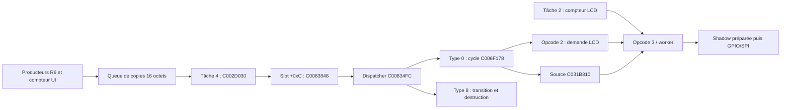

# Mercury Dust — R11 : tâches Korg et récupération indépendante du LCD

3 novembre 2026 — branche exclusive `recovery/mercury-dust`, base R10 **2d58ac8a5df4528c052fa287d5d792b34e981a11**. **RESEARCH_ONLY : pas de flash, pas d'instrument, pas de firmware installable.**

## 1. Résultat et décision

R11 reconstruit une partie vérifiable du contexte natif jusque-là manquant :

- **Tâche 2, C002AA34** : attente de réveil, compteurs logiques, publication UI et appel synchrone du worker LCD.
- **Tâche 4, C002B144** : attente de démarrage, sélection d'un gestionnaire, attente temporisée de valeur 4 puis **C002D030 → gestionnaire virtuel +0xC → C0083848**, le consommateur UI recherché.
- Une entrée cyclique native de **période logique 2** appelle C002572C et réveille les tâches 2 et 10 ; un bit mémorise au plus un réveil supplémentaire. Les réveils ne sont pas un compteur sans perte.
- Les configurations de tâches et le code du noyau établissent des **priorités initiales**, des listes de prêts et une commutation différée en sortie d'IRQ. La priorité initiale 1 de la tâche 2 passe avant la priorité 4 de la tâche UI. Un réveil LCD pendant un dessin est donc un risque permis par le graphe.
- La sortie de tâche est distincte de la destruction graphique et de la restauration Korg. Les chemins d'arrêt inspectés ne démontrent aucun reset matériel ou watchdog indépendant.

**64 scénarios ARM, 32 par VSB : 50 terminaisons normales et 14 fautes attendues**, avec snapshots identiques entre originaux. Vingt-sept plages de code/données et les dix enregistrements de tâches sont identiques. Les premières fautes et une fixture incohérente sont conservées, sans substituer de noyau ou de réponse périphérique.

**GO pour poursuivre la recherche logicielle R12. NO GO pour une récupération sûre démontrée, l'intégration matérielle ou le flash.** Le manque de preuve de reprise est un résultat de R11, pas une autorisation implicite de contourner les routines natives.

La [carte technique détaillée](documents/RECOVERY_R11_TASK_MAP_FR.md) contient les tables, structures, diagrammes et contrats d'interface. Le présent rapport décrit la méthode, les expériences, les contre-exemples et la décision.

## 2. Reprise, dépendances et conservation

Le dépôt a été synchronisé par fetch et avance rapide sur la seule branche autorisée. La tête locale et distante était R10 avant les ajouts. Les rapports R8, R9, R10 et l'architecture R9 ont été lus intégralement dans la continuation de recherche. Les dépendances pertinentes sont :

| Acquis conservé | Sources et preuve utilisés | Ce que R11 ne refait pas |
|---|---|---|
| R1–R3 : pixels, pages, destruction, restauration | tests/recovery_r2/lifecycle.c, rapports et transitions natifs | Rendu V30, validation des presets, fabrique de pages |
| R4–R6 : événements, queue, services d'entrée | tests/recovery_r4/events.c, C0083FE8/C0083848/C00834FC, rapports R6 | Attribution des boutons physiques ou reproduction complète de la réception |
| R7 : cycle graphique complet | tests/recovery_r7/cycle.c, traces R7, C006F178/C00836E4 | Les 32 images et cycles de restauration |
| R8 : destruction pendant draw et réentrée | Rapport, scripts, traces et snapshots R8 | Les injections coopératives séquentielles déjà prouvées |
| R9 : shadow avant envoi, GPIO/SPI et propriété | tests/recovery_r9/lcd.c, outils, traces et architecture R9 | Transport LCD, modèles de buffers, statistiques d'entrelacements |
| R10 : configuration, timers, erreur LCD | tests/recovery_r10/native.c, audit/traces, rapport R10 | Accès MMIO fautifs, callback compteur20 et diagnostic graphique |

Les deux VSB sont ouverts en lecture et exigés avant/après expérience à **0x200100 octets** :

| Original | SHA-256 |
|---|---|
| user_custom (2).VSB | `81b62467490fd25fd154ffe02298886bfdd6e9cf9bda897cde41ee65201ffd03` |
| user_backup.VSB | `06becf76750f0dce7d3e40d476e4a78524a53730ba61b9b9752dfb170745b052` |

`src/`, la référence artistique et les preuves R1–R10 restent identiques à R10. Le moteur V30 Groove, huit presets, douze paramètres, quatre mini-LFO au total et IFX personnalisés sont préservés. Aucun fichier de firmware original ou modifié n'est publié par R11.

## 3. Carte des tâches : ce qui devient prouvé

### 3.1. Structures et priorités

La configuration C00A37A8 et les TCB C06A24E4 utilisent tous deux un pas de 32 octets, mais sont des objets distincts. C00002B4 relie configuration et TCB. C00003B0 copie la priorité initiale vers TCB+0xD ; C00003D8 prépare la pile avec la taille et la base de configuration. Les mots auparavant laissés non interprétés par R10 peuvent donc recevoir un sens précis.

C00018F0 insère un prêt dans la liste du rang, positionne son bit dans C06A2898 et compare son rang au TCB sélectionné C06A2924. Un rang numérique inférieur passe devant. C0002114 choisit à partir du bitmap. Les cas 25/26 exercent cette insertion sans commuter de tâche.

C0001760 sauvegarde SP/PC dans le TCB courant puis charge ceux du sélectionné. C0001560 et C0001844 montrent une voie de changement de contexte à la sortie d'IRQ, selon C06A28A0 et l'état du dispatch. **C'est une preuve statique d'une capacité de préemption**, pas son exécution fidèle sous Linux user-mode. Aucun état SPSR, pile d'IRQ, CP15 ou contrôleur matériel n'est émulé ici.

### 3.2. Réveil natif et unité de temps

L'entrée IRQ de table 0x15 vaut C0025798. Ce handler traite son périphérique et finit par C0000454, qui traite les échéances et avance les compteurs de temps logique. Le record cyclique C00A36C0, unique selon C00A36D4, contient attribut2, argument0, callback C002572C, période2, phase initiale0. C0001394 prépare le record actif et C000143C le réarme avant d'appeler le callback.

C002572C appelle C0000A00 pour les IDs lus à C00F9328 et C00F932C : **2 et 10**. Le service mémorise un réveil si la tâche n'attend pas, ou la rend prête et demande un réordonnancement différé si elle attend. Un deuxième réveil déjà mémorisé renvoie −43 ; le callback ignore ce retour.

Le compteur UI/LCD à 20 de R10 compte des mises à jour de la tâche 2. Sa relation avec le temps dépend des réveils servis, des réveils fusionnés, des autres tâches et des appels bloquants. La période logique 2 n'autorise aucune conversion en millisecondes, aucune fréquence SPI et aucun budget temps CPU.

### 3.3. Attentes et retours d'erreur

Les deux boucles C002A7AC/C002A7CC appellent C00007AC puis le slot +0xC de leur objet. Elles ne testent pas le retour de C00007AC. Les tests 18/19 montrent trois appels de callback malgré un refus d'attente −25, avec un callback de fixture qui arrête ensuite le processus. **Le callback remplace seulement le slot de l'objet de laboratoire ; aucune instruction de boucle ou de noyau n'est patchée.** Cela démontre le contrôle de flux, pas trois cycles graphiques natifs complets ni un scheduler défaillant sur instrument.

C000085C traite une durée : valeur 0 sans réveil donne −50 ; −2 donne −17 ; un réveil mémorisé donne 0 même avec durée4. La tâche UI utilise précisément 4. Une durée positive sans réveil conduit à C0001BC8, une inscription d'échéance et C0001760. Le banc ne fournit pas de contexte commutable pour franchir cette frontière.

Le callback d'échéance C0001C7C est testable isolément : il écrit −50 dans le résultat, insère un TCB de fixture dans les prêts et pose une demande de réordonnancement. **Résultat prêt à être retourné ne signifie pas tâche effectivement reprise.**

## 4. Consommation UI et conséquences pour Mercury



Le lien tâche4→consommateur est confirmé par les instructions et les cas 20..23. La sélection initiale dépend du mode : C002B144 convertit le mode de service en mode UI, C002D07C sélectionne le gestionnaire. R11 n'affirme pas que tous les modes démarrent la vtable C00E4C50. Le wrapper+4 et le gestionnaire de référence sont fournis dans le banc ; le constructeur général reste dépendant des services et allocations.

C0083848 vérifie ui+112, construit un message local, dépile puis appelle le slot +0x10. Il recommence jusqu'à file vide, sans quota de consommation dans ce corps. Le publisher C0083FE8 ne fait qu'une copie vers la queue si le gestionnaire est présent/actif. Les producteurs d'entrée, navigation et compteur peuvent donc précéder le dessin sans l'exécuter immédiatement.

Implications pour les objets :

1. Dans une vidange séquentielle non réentrante, un callback de message retourne avant le message suivant ; une transition suivante n'interrompt pas spontanément le callback courant.
2. Cela ne supprime pas les voies de réentrée explicite R8, les appels synchrones au LCD hors compteur, ni les préemptions entre tâches.
3. Un type8 peut détruire la page et ses enfants ; tout pointeur Mercury conservé après ce dispatch doit être invalidé ou requalifié depuis son propriétaire.
4. Une demande de fermeture depuis draw doit être conservée et traitée après fin des emprunts, pas déclencher une vidange récursive. La queue seule ne fournit pas cette règle.
5. Le marqueur actif de page ne suffit pas : R8 montre qu'un cycle intérieur peut le remettre à zéro alors que le callback extérieur n'est pas terminé.
6. Les listes acceptent certaines mutations et doublons ; aucun verrou ni recensement complet d'observateurs n'est ajouté par R11.

### Deux tâches ne font pas une publication cohérente

La tâche 2 a initialement rang1 et l'UI rang4. Si ces priorités restent applicables, un réveil de tâche2 pendant draw peut la faire passer devant et scanner une image partielle. R9 prouve déjà qu'un changement de source entre pages peut produire une shadow mélangée ; R11 identifie une voie d'ordonnancement qui impose de prendre ce risque au sérieux. Il ne s'agit pas d'une nouvelle observation physique du mélange.

Inversement, la simple publication du message UI par la tâche2 ne permet pas à une tâche4 de priorité inférieure de la préempter immédiatement. L'ordre local « publier UI puis callback LCD » reste donc insuffisant pour exiger une nouvelle image avant l'envoi. Une longue attente périphérique dans la tâche2 peut aussi retarder le consommateur UI. Le caractère bloquant est natif ; la durée et l'impact réels restent inconnus.

La propriété doit couvrir **la source fixe**, ses auteurs Korg, les lecteurs LCD, la shadow et les appels synchrones annexes. Un double buffer privé Mercury ou une garde uniquement dans la tâche4 ne protège pas automatiquement le comparateur C0015AB4. Pas de sûreté IRQ/FIQ, DMA, multitâche, cache ou ordre mémoire revendiquée.

## 5. Erreurs, sortie et récupération

### 5.1. Graphe d'erreur pertinent

| Origine / chemin | Comportement établi | Récupération démontrée ? |
|---|---|---|
| Validation d'arguments/contexte de services noyau | Retours −17, −18, −25, −41, −43, −50 selon les branches exercées | Retours locaux, pas restauration UI automatique |
| C0001C7C, échéance d'attente | Écrit −50, rend prêt selon état, demande éventuellement réordonnancement | Préparation native vérifiée ; reprise de contexte non exécutée |
| C00183CC/C001851C, attente SPI en échec | Peut appeler C00298BC (acquis R9/R10) | Non ; diagnostic dépend du LCD |
| C0015CDC | Boucle de polling de disponibilité, sans borne locale observée | Non ; un délai coopératif dans le même appel ne peut progresser pendant la boucle |
| C00298BC | Masquage IRQ tenté, graphisme, service noyau, demande/envoi LCD, GPIO, boucle C00299F4 | Non ; ce chemin n'est pas une fonction de retour Korg |
| C000066C → C0001A24 | Retrait du TCB, état dormant, activation différée éventuelle puis dispatch | Sortie de tâche, pas destruction des pages/observateurs |
| C0000144 → C00001E4 | Désactivation dispatch, services d'arrêt, vecteurs, hook nul, boucle | Arrêt terminal inspecté, pas reset matériel validé |
| Vecteurs initiaux hors reset → C000007C | Boucle avant remplacements de vecteurs | Ni diagnostic indépendant ni récupération établie |

Le service de retour d'identité C0001480 nécessite une destination valide lorsqu'il est autorisé. Les cas 0/4 conservent respectivement la faute de contexte absent et l'écriture à zéro. Cela ne transforme pas l'appel du diagnostic R10 avec destination nulle en bogue matériel : son contexte privilégié avec bit I pourrait provoquer le retour anticipé −25, comme expliqué dans R10. R11 ne patch ni CPSR, ni vecteurs, ni gestionnaire d'exception.

La sortie C0170B60 de la tâche de démarrage rejoint C000066C ; les boucles de tâches2/4 étudiées n'ont pas de chemin de fermeture normal observé dans leur corps. Les destructeurs locaux de gestionnaire ne constituent pas une procédure de retrait de tous ses services. Quitter ou suspendre une tâche avec un pointeur d'attente sur sa pile est une opération dont il faut prouver le nettoyage, pas un raccourci vers la sûreté.

**Aucun watchdog matériel ni séquence de reset indépendante validés dans le périmètre inspecté.** R11 ne prétend pas avoir prouvé leur absence globale. Les gardes/watchdogs coopératifs historiques Mercury ne sont pas des mécanismes natifs de préemption ni une preuve qu'ils pourront tourner lorsque l'appel testé est bloqué.

### 5.2. Critères d'une récupération indépendante à démontrer

Ces critères sont des exigences de recherche ; aucun mécanisme nouveau n'est installé :

- Détecter l'absence de progression avec une source de temps et un contexte dont l'exécution ne dépend pas du worker ni du consommateur UI bloqué.
- Établir une autorité réelle pour interrompre/annuler ou contenir l'opération, sans libérer mémoire, pile ou objets encore utilisés.
- Conserver une commande de sortie et un diagnostic consultable sans l'envoi LCD défaillant ; le SIGSEGV Linux et le timeout du banc ne remplissent pas ce rôle sur Korg.
- Définir l'état du bus, du descripteur, de la source et de la shadow après erreur ; ne pas traiter la copie shadow comme un accusé de réception.
- Pouvoir revenir au cycle Korg avec emprunts terminés et références invalidées ; une fermeture demandée n'est pas une fermeture achevée.
- Borner mémoire, pile, temps CPU et effet sur audio/IFX ; qualifier aussi les cas d'IRQ masquée, échec du noyau et échec du diagnostic.

Sans ces preuves, la décision demeure **NO GO récupération sûre**.

## 6. Banc ARM : méthode et frontières

Le nouveau banc `tests/recovery_r11/native.c` charge les 0x200000 octets applicatifs originaux à C0000000 puis rend cette copie RX. Aucun mot de code natif n'est modifié. Il utilise les syscalls Linux et le start/linker des missions antérieures, pas les routines de démarrage Korg.

Mappings fournis : code original, RAM de services C0300000..C034FFFF, et selon le cas **seulement deux pages C06A2000..C06A3FFF** pour les données noyau. Le publisher du cas22 nécessite aussi une page C0691000. Les TCB, têtes de listes, globals et objets UI sont des fixtures privées expressément choisies. Aucune adresse MMIO n'est mappée ; aucune réponse périphérique n'est fabriquée.

Le handler SIGSEGV enregistre l'adresse et termine avec code88. Il ne reprend pas après la faute. Les tests positifs n'exécutent ni C0001760 comme ordonnanceur complet, ni la pile IRQ, ni les accès CP15 privilégiés. Les `msr CPSR` traversés dans les services ne constituent pas un masquage IRQ validé sous Linux user-mode.

Des sentinelles protègent les deux mots entourant le premier TCB, quatre mots après la queue et seize octets autour du début de la source. Elles restent intactes jusque dans les snapshots de faute. Elles ne surveillent pas toute la RAM ni toutes les piles. Le rectangle graphique après la shadow identifié R10 n'est pas utilisé comme canari universel.

### Matrice des 32 cas, exécutés sur chacun des deux VSB

| Cas | Appel / précondition | Issue exigée |
|---:|---|---|
| 0 | Identité sans RAM noyau | Faute C06A2894 |
| 1 | Identité, contexte interdit | −25 ; destination inchangée |
| 2 | Identité, premier TCB | 0 ; ID1 |
| 3 | Identité, dixième TCB | 0 ; ID10 |
| 4 | Identité autorisée, destination nulle | Faute 0 ; pas de validation implicite du pointeur |
| 5 | Attente C00007AC, contexte interdit | −25 |
| 6 | Même attente, dispatch nul | −25 |
| 7 | Réveil mémorisé dans flags A7 | Retour0 ; flags A5, seul bit2 consommé |
| 8 | Attente temporisée0, aucun réveil | −50 ; pas de changement de contexte |
| 9 | Durée −2 | −17 |
| 10 | Durée4, réveil déjà mémorisé | 0 ; bit consommé |
| 11 | Réveiller une tâche ayant déjà son bit | −43 |
| 12 | Réveil ID1 puis C00007AC | 0 puis0 ; flags2 puis0 |
| 13 | Réveil d'une tâche dormante | −41 |
| 14 | Réveil ID11, au-delà de la table10 | −18 |
| 15 | Attente sans réveil, liens de prêts absents | État10 écrit puis faute0 dans retrait C0001978 |
| 16 | Attente avec TCB courant nul | Faute0xE lors des flags |
| 17 | Durée4 sans réveil, liens absents | État10 puis faute0 ; ne pas prétendre échéance inscrite |
| 18 | Boucle C002A7AC, attente refusée | Trois callbacks de fixture malgré −25, arrêt explicite par le banc |
| 19 | Variante C002A7CC | Même résultat |
| 20 | Wrapper C002D030, UI inactive | Passe par C0083848, retourne sans dépiler |
| 21 | Même wrapper, UI active et queue vide | Retour normal |
| 22 | Publication native d'un type127 puis wrapper | Indices1/0 puis1/1 ; dispatcher natif ; pas de dessin demandé |
| 23 | Wrapper, UI active, queue nulle | Faute0 |
| 24 | Réveil ID0, qui désigne le courant | Bit2 puis consommation0 |
| 25 | Insertion prête rang4, sélectionné rang7 | Sélection remplacée par le TCB prêt ; liste et état vérifiés |
| 26 | Insertion rang4, sélectionné rang1 | Sélection rang1 conservée |
| 27 | Callback cyclique C002572C, contexte non tâche | Bit2 des tâches2/10 positionné |
| 28 | Deux appels du même callback sans consommation | Toujours un bit2 par tâche ; pas deux unités accumulées |
| 29 | C0000A00, tâche en attente, handle nul cohérent | Résultat0 ; état prêt1 ; sélection et demande de réordonnancement1 |
| 30 | Callback d'échéance C0001C7C, structure limitée | Résultat −50 ; prêt1 ; réordonnancement demandé ; aucune reprise simulée |
| 31 | Même voie de réveil, faux handle ABCDEF | Faute ABCDEF ; fixture incohérente conservée, pas de faux rétablissement |

Le cas31 vient d'une tentative initiale où le mot de résultat était traité à tort comme une simple sentinelle. C0001C30 le lit d'abord comme handle de temporisation. La fixture positive29 initialise ce mot à zéro ; la fixture erronée reste un contrôle négatif explicite. Cela précise le contrat du contexte d'attente plutôt que d'effacer l'échec.

Les traces `in_asm` montrent des blocs traduits, pas chaque passage dynamique. Les comptes de callbacks et modifications de mémoire reposent sur assertions et snapshots. Les adresses locales de pointeurs sur pile ne servent pas d'oracles matériels ; les deux exécutions QEMU utilisent la même disposition de banc.

## 7. Hypothèses confirmées, rejetées et ouvertes

| Hypothèse | Conclusion R11 |
|---|---|
| Le consommateur UI est introuvable hors appel manuel | Rejetée : tâche4 → wrapper → slot natif C0083848 identifié et exercé |
| Le compteur20 représente nécessairement une durée fixe | Rejetée : temps logique, réveils fusionnés et attente bloquante ; pas de conversion ms |
| Deux réveils donnent deux mises à jour assurées | Rejetée par les cas27/28 et les retours −43 |
| L'attente refusée empêche le corps de mise à jour | Rejetée pour les deux boucles, cas18/19 |
| Le worker est toujours exécuté dans le callback graphique | Rejetée : voie tâche2 distincte ; appels synchrones annexes R10 conservés |
| Le noyau comporte une sélection par priorité et une préemption à la sortie IRQ | Confirmée statiquement ; primitives de liste exercées, changement complet non émulé |
| Une garde locale UI suffit à protéger le framebuffer | Non démontrée et incompatible avec la couverture nécessaire du lecteur tâche2 |
| Une erreur locale de service est toujours fatale | Rejetée : retours locaux et résultat d'échéance existent ; leurs appelants peuvent néanmoins les ignorer |
| Terminer une tâche restaure l'interface Korg | Non démontrée : le chemin inspecté ne nettoie pas les ressources graphiques Mercury |
| L'écran d'erreur constitue une récupération LCD indépendante | Rejetée dans le graphe connu ; boucle terminale et dépendance circulaire |
| Il n'existe aucun watchdog dans tout le firmware | Non conclu : aucun mécanisme indépendant identifié dans les plages inspectées seulement |

## 8. Reproduction, traces et régressions

```bash
export PATH=/workspace/mercury-tools/bin:$PATH
bash tests/run_recovery_r11.sh 'custom.VSB' 'backup.VSB'
```

Clang19.1.7, cible `arm-none-eabi`, `-mcpu=arm926ej-s -marm -O2`, code freestanding ; ld.lld ; qemu-arm `-cpu arm926`, tracing `in_asm` et syscalls. Le lanceur attend les SHA exacts. Le mode `--explore` éventuel n'est jamais acceptable comme résultat final : le vérificateur exige `exploratory=false`.

Preuves publiées :

- [Résultats structurés](reports/recovery_r11/results.json), [journal ARM](reports/recovery_r11/validation.log), [audit statique](reports/recovery_r11/static_audit.json), [journal audit](reports/recovery_r11/audit.log).
- `reports/recovery_r11/{0,1}_{0..31}.trace.gz` et `.records.gz` ; `{0,1}_native_disassembly.txt.gz` pour les vingt-sept plages. Les routines originales sont archivées comme preuve désassemblée, pas comme firmware installable.
- [Provenance](reports/recovery_r11/provenance.json) : SHA des nouveaux fichiers, archives antérieures contrôlées et conservation des sources.
- Banc `tests/recovery_r11/native.c`, outils `tools/recovery_r11/run.py`, `audit.py`, `verify.py`, lanceur `tests/run_recovery_r11.sh`.

Chaque record R11 fait **160 octets, quarante u32 little-endian** : magic5231314B, cas, étape, résultat, auxiliaire, séquence, indicateur RAM mappée, appels ; huit mots du premier TCB ; contexte/bitmap/courant/sélection/dispatch ; deux gardes TCB ; indices queue, mot UI+112 ; quatre gardes queue ; quatre mots près du début de source ; six mots réservés zéro. Étapes0=initial,1/2=observation,10=callback de fixture,20=fin vérifiée,90=faute,99=assertion échouée. Les entiers négatifs sont encodés modulo2^32.

Le vérificateur relit indépendamment les 64 archives, les compare aux résultats, contrôle les résultats clés et les traces des chemins attendus, exige les mêmes snapshots entre VSB et vérifie les canaris. Les archives gzip R8–R10 sont décompressées pour intégrité CRC et hashées ; leurs arbres restent identiques au commit R10. **Ce contrôle d'archives ne prétend pas réexécuter les anciennes expériences.** Seule R11 est exécutée à nouveau. Aucun test historique n'est modifié.

## 9. Limites et blocages priorisés

| Priorité | Blocage restant | Preuve recherchée |
|---:|---|---|
| P0 | Récupération indépendante non démontrée | Détection et autorité capables de progresser hors worker/UI, annulation sûre ou confinement, état après panne ; pas simple délai coopératif |
| P0 | Lecture LCD pendant composition UI possible | Carte complète des lecteurs/auteurs, appels synchrones, primitives noyau et exclusion sur source fixe ; pas seulement une phase Mercury |
| P0 | Initialisation/transport matériel incomplets | Horloges, broches, GPIO/SPI, polling et conditions de fin ; aucune réponse fictive pour franchir la frontière |
| P1 | Durée de vie et réentrée | Emprunts, observateurs, fermeture différée, invalidation, génération et panne pendant fermeture |
| P1 | Ordonnanceur partiellement cartographié | Corps des autres tâches, changements de priorité, unités d'horloge, charges, appels depuis IRQ/FIQ et état réel du dispatch |
| P1 | Admission/consommation de file | Couvrir tous les producteurs, refus après changement d'état, capacité255, absence de quota et progression sous charge |
| P1 | Mémoire/piles/cache/MMU/DMA | Carte occupée et attributs, marges, cohérence, visibilité ; les réservations de pile ne sont pas du RAM disponible |
| P2 | Commandes et musique physiques | Amont des paquets, attribution panneau, flux musicaux et contexte d'observation ; décodage R6 seul insuffisant |

Les points P0 interdisent de transformer la réussite graphique QEMU en sûreté sur instrument. Le chemin natif fatal peut masquer IRQ et utiliser le périphérique en panne ; un hypothétique superviseur de priorité élevée ne suffit pas sans preuve de sa capacité d'exécution et d'action.

## 10. R12 proposée, sans intégration matérielle

**R12 : primitives de synchronisation, fermeture et autorité de reprise.** Objectifs précis :

1. Rechercher les services natifs qui peuvent protéger une ressource entre tâches2/4, leurs contextes autorisés, ordre de priorité et dépendances IRQ ; tester leurs branches bornées, sans scheduler factice.
2. Recenser les appels au worker et les écritures de source atteignables depuis les autres tâches, callbacks et IRQ ; distinguer une protection complète d'un verrou local.
3. Suivre les structures d'attente/temporisation, retrait, timeout et sortie ; conserver les handles périmés et doubles retraits comme contrôles négatifs. Ne pas annuler arbitrairement une tâche possédant des emprunts.
4. Auditer les candidats d'arrêt/reset/surveillance avec leur configuration réelle et leurs dépendances ; si aucune autorité indépendante n'est prouvée, maintenir NO GO et nommer la frontière.
5. Formaliser et éprouver dans un modèle borné les conditions de fermeture Mercury : pas de réentrée, pas de destruction sous emprunt, progression extérieure nécessaire. Rapporter le coût mémoire et les hypothèses ARM926.

Critère de passage : une carte de couverture et des contre-exemples reproductibles permettant de choisir une architecture de banc. Il ne s'agit pas de rendre R12 « GO matériel » par construction. Aucun démarrage, vecteur, protection, ordonnanceur ou routine LCD ne doit être patché pour obtenir un résultat positif.

## 11. Explication simple

Mercury sait déjà dessiner ses images et utiliser plusieurs mécanismes graphiques et de navigation Korg dans le laboratoire. R11 identifie maintenant les deux activités qui s'en occupent : une tâche prépare l'interface, une autre peut essayer d'envoyer son image à l'écran. Elles ne sont pas automatiquement synchronisées.

Le risque est qu'un envoi lise l'image pendant sa préparation, ou qu'une panne bloque une tâche dont dépend le retour à Korg. La copie intermédiaire n'indique toujours pas que l'écran a reçu l'image, et l'écran d'erreur utilise lui-même le LCD.

Pour avancer, il faut prouver comment ces tâches se protègent, comment tous les objets restent valides, et comment reprendre lorsque l'écran ou son envoi ne répond plus. **La recherche logicielle peut continuer ; la fiabilité sur la véritable Electribe et une récupération sûre ne sont pas encore démontrées.**
