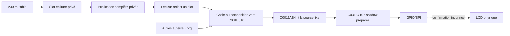

# Mercury Dust — R12 : réutilisation du triple buffer et synchronisation Korg

3 novembre 2026 — `recovery/mercury-dust`, base R11 **f565a58b198fe317dc84fd6ea2123c3e64412b0c**. **RESEARCH_ONLY : aucun flash, instrument, hook installé, réponse périphérique simulée ou firmware installable.**

## 1. Réponse à l'objectif

**Un triple buffer peut protéger des images privées Mercury, sous contrat de publication et d'emprunt sérialisés. Il ne garantit pas à lui seul une image cohérente entre les tâches Korg 2 et 4.** Le comparateur original lit toujours C031B310, et une copie de 1 024 octets vers cette adresse peut être observée au milieu. Les autres dessins Korg écrivent eux aussi à cette adresse.

R12 apporte :

- Un inventaire vérifiable : **transcription MD53–MD54 retrouvée, sources et archives historiques non retrouvées**. Pas de prétendue restauration de fichiers absents.
- La réutilisation du modèle de rôles R9, porté en **banc ARM uniquement**, avec remplissage complet, emprunt, fermeture, handles de génération, refus de réentrée et épuisement sans rebouclage.
- **52 scénarios ARM sur les deux VSB**, dont 48 sorties normales et quatre fautes attendues ; les snapshots et résultats sont identiques entre les deux originaux. Les 32 images V30 traversent la publication privée, la source fixe et le comparateur natif sur chaque VSB.
- Des contre-exemples natifs : échange de pointeur sans effet sur la source fixe ; shadow composée de deux images ; mélange à l'intérieur d'une page ; lecteur brut écrasé ; lecture/écriture Korg malgré sémaphore pris ; première page préparée avant faute GPIO.
- L'identification de **sept sémaphores binaires configurés**, de leurs services et de leurs limites. Aucun identifiant libre ou protocole graphique partagé n'est prouvé.
- Une précision de priorité : C00006A0 accepte des priorités API1..16 et les convertit en rangs internes0..15 ; API0 restaure la configuration. Le passage du démarrage par API1 signifie rang0, précision supplémentaire par rapport à R11. La relation initiale tâche2 rang1 > tâche4 rang4 reste inchangée.
- Des coûts ARM32 mesurés et une [architecture de raccordement](documents/RECOVERY_R12_TRIPLE_BUFFER_ARCHITECTURE_FR.md) qui sépare protection privée, composition native, lecture LCD et récupération.

**GO poursuite logicielle. NO GO garantie globale de cohérence sur Electribe, récupération indépendante sûre et intégration matérielle.** Les protections encore nécessaires sont nommées ; elles ne sont pas supposées installées.

## 2. Reprise et inventaire MD53–MD54

La branche distante a été lue puis synchronisée en avance rapide via FETCH_HEAD ; local et distant partaient de R11. Les empreintes des deux VSB ont été contrôlées avant les expériences et à nouveau après chaque série :

| Original, 0x200100 octets chacun | SHA-256 exigé |
|---|---|
| user_custom (2).VSB | `81b62467490fd25fd154ffe02298886bfdd6e9cf9bda897cde41ee65201ffd03` |
| user_backup.VSB | `06becf76750f0dce7d3e40d476e4a78524a53730ba61b9b9752dfb170745b052` |

Recherche effectuée avant le nouveau banc : fichiers suivis de R11, historique des chemins sur toutes les références Git locales, existence de l'objet `4c1ec01`, objets non atteignables, archives de l'espace `/workspace` jusqu'à profondeur5 hors `.git/build/work`, pièces jointes et répertoires de fichiers disponibles. Les branches distantes annoncées à ce moment sont `main` et `recovery/mercury-dust`, sans branche `experiment/md53-triple-buffer` annoncée ni tag observé. `main` n'est pas modifiée et aucune branche expérimentale n'est créée.

| Élément recherché | Résultat vérifié | Statut utilisable |
|---|---|---|
| `research/md53_frames.c`, `tests/run_md53.sh`, `MD53_RAPPORT_FR.md` | Absents de l'arbre R11 ; aucun historique de ces chemins dans les refs locales | Pas de code MD53 récupéré |
| `research/md54_scan.c`, `tests/arm/md54_abi.S`, `MD54_RAPPORT_FR.md` | Même résultat | Pas d'adaptateur MD54 récupéré |
| Commit historique `4c1ec01` | Pas un objet commit local valide | Aucun contenu reconstruit à partir de ce nom |
| Archives ZIP/tar/bundle accessibles dans le périmètre décrit | Aucune trouvée | Ne signifie pas que l'ancien volume est détruit ; il n'est pas accessible ici |
| `documents/RECOVERY_DOSSIER_MD46_MD87_TRANSCRIPTION.md` | Présent, lu ; décrit MD53, MD54 et contre-exemples ultérieurs | Mémoire documentaire, pas sources ni traces originales |
| `tools/recovery_r9/models.py` | Présent : rôles publié/lecteur/écriture, lecteur retenu, double et triple | Base réelle réutilisée |
| `tests/recovery_r9/layout.c` et `reports/recovery_r9/arm_layout_costs.json` | Présents : layouts ARM32 | Référence de coût réelle |
| Composants historiques de `src/` | Mux, pont V30 et adaptateurs md18/md30/md31 présents | Contrats/limitations examinés ; sources conservées |

[Inventaire structuré et SHA](reports/recovery_r12/inventory.json). La recherche n'établit pas l'absence des fichiers sur tout stockage extérieur au périmètre. Aucun code nouveau n'est renommé `md53_frames.c` ou présenté comme l'original disparu.

## 3. Ce qui est réellement réutilisé

### 3.1. R9 et les composants présents

Le helper `shared` de `tools/recovery_r9/models.py` est importé directement pour un contre-exemple de raccordement fixe ; l'ancienne énumération de 12 870 ordres n'est pas refaite. Le nouveau pool de banc reprend la règle R9 : choisir un slot qui n'est **ni publié ni retenu par le lecteur**. Les coûts R9 de 24 octets de métadonnées et de 2 072/3 096 octets restent une comparaison, pas le coût prétendu d'un code MD53 absent.

Les composants graphiques existants ont des rôles distincts :

- `md15_bridge` produit `image_raw` et `image_fx`, qu'il peut réécrire au rendu suivant. Les déclarer slots publiés immuables sans changer leur usage serait incorrect.
- `lcd_source_mux` sélectionne une source puis gère une shadow de simulation et des callbacks de transfert. Il ne redirige pas le comparateur natif. R9 a déjà montré ses limites si le callback modifie la source ; cette expérience n'est pas recommencée.
- `md18_lcd_abi` / `md31_lcd_comparator` proposent historiquement une substitution de comparateur et des écritures vers la shadow. Sans interception installée, le worker original continue d'appeler C0015AB4. Ce n'est pas un mécanisme acquis de publication vers C031B310.
- `md30_lcd_gate` distingue déjà demande de restauration et observation de copies shadow ; ses commentaires ne les qualifient pas d'événement SPI complet. Ses gardes et watchdogs restent coopératifs.

Aucun de ces fichiers n'est modifié. R12 conserve V30, les huit presets, douze paramètres, quatre mini-LFO au total, IFX et tous les travaux R1–R11.

### 3.2. Extension explicitement nouvelle du banc

`tests/recovery_r12/pool.h` est une extension R12 de laboratoire : un producteur, un lecteur retenu, deux ou trois slots logiques, remplissage séquentiel de 1 024 octets et commit seulement complet. Les handles associent slot et génération. Les opérations refusent une seconde écriture ou un second emprunt actif ; fermer interdit de nouveaux travaux et attend abort/release avant de déclarer le pool fermé.

La génération u32 ne reboucle pas : à sa valeur maximale, begin refuse. Cela évite un ABA par rebouclage dans cette session de pool, sans résoudre une réinitialisation arbitraire avec anciens pointeurs externes. Les appels supposent **une sérialisation extérieure de chaque transaction de métadonnées**. Le C du pool n'implémente ni atomiques ni verrou et n'est pas une API multithread installable.

## 4. Pourquoi le triple privé ne suffit pas



Quatre expériences encadrent la conclusion :

1. **Cas3 :** publier un nouveau pointeur privé, sans copie vers C031B310, ne change ni la source Korg ni sa shadow après le scan original.
2. **Cas4 :** copier les trois premières pages d'une image complète privée, appeler le comparateur sur les huit pages, puis terminer la copie : le premier scan contient **384 octets nouveaux et 640 anciens**. La source et la shadow sont alors égales, tout en représentant une image mélangée.
3. **Cas24 :** copier seulement 64 octets puis comparer la première page donne **64 octets nouveaux et 64 anciens dans cette page**. L'atomicité de page supposée pour certains modèles R9 est bien une simplification.
4. **Cas17 :** le même mélange est obtenu après prise du sémaphore1 de fixture. Le comparateur original ne le consulte pas ; le sémaphore n'est pas un verrou graphique implicite.

Le cas18 complète cette preuve : C0015988 écrit une page native pendant que le sémaphore est pris ; C003F104/C003F108, appelées aussi dans le test, sont des `BX LR`. Aucune interdiction n'apparaît par magie avec un sémaphore détenu dans un autre protocole.

Protéger seulement la copie de publication laisse une autre fenêtre : scanner les pages0..2 de A, publier intégralement B sous le verrou, puis scanner les pages3..7 de B reste possible si le lecteur ne participe pas. Le modèle garde ce contre-exemple. La protection doit couvrir le **plein intervalle lecteur**, pas seulement une écriture atomique de métadonnées ni une page.

Enfin, le rendu Korg se fait déjà dans la source fixe pendant le parcours UI. Une copie finale de Mercury ne protège pas les étapes Korg précédentes. Copier un plein écran privé dans le banc n'est pas une preuve que l'ordre des widgets, overlays ou pages secondaires de l'instrument sera respecté.

## 5. Synchronisation native et autres acteurs

### 5.1. Sémaphores Korg

C0000C4C initialise sept objets de seize octets à C06A2474 depuis les sept configurations C00A3728 : attribut1, initial1, maximum1 ; leur nombre est à C00A377C. C0000D80 décrémente un compteur disponible et retourne0. À zéro, il appelle C0001D14, passe la tâche à l'état50, la retire des prêts et prépare une attente avant C0001760. C0000CA8 remet un jeton ou réveille un attendant selon la liste ; sur compteur déjà maximal, il retourne −43.

Les cas12..16 exercent les branches bornées et la frontière d'attente. La seconde prise du cas16 aboutit à la faute0 dans le retrait de liste, car les liens du TCB de fixture ne sont pas initialisés. **Le banc ne simule pas un scheduler pour obtenir un réveil réussi.** Le snapshot montre état50 et compteur0 avant la faute.

Ces services peuvent être candidats pour des contrats coopératifs entre tâches. Mais :

- aucun ID disponible n'est prouvé ; les IDs1 et2 ont déjà des utilisateurs explicites dans le code original, archivés dans l'audit ;
- les objets n'enregistrent pas dans ces chemins les garanties d'un mutex récursif avec propriétaire et héritage de priorité ; l'ordre d'attente par priorité ne prouve pas un héritage ;
- le chemin de prise étudié ne fournit pas de durée maximale ; attendre en tenant une autre ressource peut bloquer la progression ;
- les branches complètes de réveil/commutation et la bonne restauration après erreur ne sont pas exécutées comme un noyau Korg ;
- les routines graphiques/LCD ne participent pas à un nouveau protocole de verrouillage tant qu'aucun raccordement couvrant leurs appels n'est établi.

Le schéma natif C0024BF4 combine prise de sémaphore et sauvegarde IRQ autour de certaines opérations de queue. Il montre un usage réel de primitives, pas une autorisation de transposer son protocole à toute la composition UI ou à l'envoi LCD.

### 5.2. IRQ et priorité

C0000040/C0000050 sauvegardent et restaurent le bit I du CPSR. Elles ne démontrent pas une exclusion contre FIQ, DMA ou réentrée, et leur passage en Linux user-mode ne valide pas une section critique privilégiée. Masquer IRQ sur tout un cycle de dessin ou un worker potentiellement bloquant n'est pas déclaré acceptable.

Le cas25 précise C00006A0 : sur un TCB de fixture en état non prêt2, API1 écrit le rang0 ; API0 recharge le rang8 de sa configuration ; API17 est refusée avec −17. Ce test évite le chemin de commutation, non émulé. Cela précise la mention R11 du changement de priorité au démarrage : la tâche1 demande API1, donc rang0. Cela ne change pas les rangs initiaux respectifs de tâche2 et tâche4.

Un plafond de priorité peut empêcher certaines préemptions de tâches si tout le contexte est maîtrisé ; il ne sérialise pas les IRQ/FIQ, ne fige pas les autres auteurs et ne garantit pas la restitution en cas d'appel bloqué. Il reste une option à étudier, pas une correction installée.

### 5.3. Carte bornée des lecteurs et écrivains

| Acteur / primitive | Accès établi | Contextes et limites |
|---|---|---|
| C0015804 | Effacement1024 source | Appel depuis l'initialisation LCD et le graphisme C003F0D4 ; pas seulement Mercury |
| C0015824 | Lecture/modification/écriture d'un octet pixel et rectangle dirty | Primitives graphiques, widgets ; appels directs depuis C003F154 et C0071EE0/C0073034/C00730EC |
| C0015988 | Écriture de plage d'octets0/FF dans la source | Rectangle C003F55C ; 74 candidats directs vers le rectangle dans le scan aligné |
| C0015900 | Lecture d'un pixel source | Appel C0071EC8 ; cas21 voit un pixel nouveau et un ancien pendant copie partielle |
| C0015AB4 | Comparaison puis copie128 vers shadow | Appelé depuis le worker à C0016084 ; pas de lecture du pool privé ni du sémaphore de fixture |
| C0015A40 / C0015A60 | Effacement shadow / pointeur vers page shadow | Initialisation et envoi natifs ; shadow ne vaut pas confirmation physique |
| UI tâche4 | Parcours C006F178 via tick C00836E4 | Composition primaire/secondaire et widgets ; opcode2 après dessin ; écrit dans la source fixe |
| Tâche2 | Timer C002A71C, opcode3 et worker | Priorité initiale supérieure à UI ; peut lire une composition interrompue |
| Progression C006038C | Rectangle, opcode2 puis opcode3 synchrones | Le corps est explicite dans l'audit ; contexte de tous ses appelants non reconstruit |
| Diagnostic C00298BC | Dessin, demande/envoi LCD, GPIO, boucle terminale | Chemin exceptionnel ; exclusion et récupération indépendantes non établies |
| Démarrage C002AB7C | Initialisation LCD et demandes | Hors cycle UI courant ; configuration matérielle R10 conservée |
| Chemin C00833E8 | Opcode2 après un autre traitement graphique | Demande additionnelle ; tous les contextes du constructeur/objet non attribués |
| C0038BC4 / C009A8F0 | Opcodes7 /4 | Contrôle LCD et paramètre, pas nouvelles preuves d'image reçue |

L'[audit statique](reports/recovery_r12/static_audit.json) conserve tous les candidats directs pour les cibles choisies : douze vers le dispatcher LCD, deux vers le worker, un vers le comparateur, et les littéraux source/shadow. Le scan peut décoder des données comme instructions ; il n'est ni un graphe indirect exhaustif ni un recensement de tous les contextes. Les cinq mots alignés égaux à C031B310 ne prouvent pas l'absence d'accès par pointeur calculé.

## 6. Résultats privés, réentrée et durée de vie

Le cas0 retient l'image initiale pendant **128 publications V30** : aucun des nouveaux slots écrivains ne l'écrase. Le cas1 montre la différence du double : après publication d'une nouvelle image, ancien lecteur et publié occupent les deux slots ; begin refuse jusqu'à release. Il s'agit de backpressure correcte, pas d'une corruption à « réparer » par vol de slot.

Les cas2/8/9/10/11/22 vérifient image incomplète non publiée, refus d'un second écrivain/lecteur, fermeture différée, double release et handles périmés refusés, génération épuisée et ancien handle écrivain rejeté. Ces refus sont des propriétés de l'exécution séquentielle du banc. Ils ne rendent pas atomique une opération native interrompue entre deux instructions.

Les contrôles négatifs le montrent : cas7, un pointeur non retenu vers le slot0 est réutilisé et voit une autre image ; cas23, le banc décompose volontairement acquire en chargement, publications puis pose tardive de retenue. Le slot0 passe de génération1 à3 avant la retenue. **Ce dernier cas injecte explicitement un ordre entre opérations C ; il n'exécute pas une vraie IRQ au milieu de `r12_acquire`.** Il identifie la condition manquante de sérialisation de cette opération.

Le modèle de rôles explore jusqu'à quatre publications, avec transactions de métadonnées supposées atomiques : **76 états/161 transitions** pour deux slots et **1 148 états/2 696 transitions** pour trois. Aucun slot retenu n'est modifié sur ces transitions légales. Trois états bloquent le nouvel écrivain pour le double, aucun pour le triple dans ce modèle à un lecteur. Le modèle n'établit pas la progression si le lecteur ne retourne jamais, ni plusieurs lecteurs/écrivains.

Une autre famille de 1 025 coupes de copie, de0 à1 024 octets, donne deux images homogènes et1 023 mélangées si le scan observe cette coupe. C'est une énumération abstraite de points de coupe, **pas une probabilité de panne ni une simulation du bus**. Le cas24 ARM en fournit un témoin concret à64 octets.

## 7. Mémoire et comparaison des architectures

| Structure ARM32 mesurée | Octets | Interprétation |
|---|---:|---|
| Métadonnées R12 | 40 | Rôles, fermeture, générations, progression de remplissage |
| Handle | 8 | Slot et génération |
| Layout double | 2 088 | Deux images + métadonnées ; layout séparé mesuré |
| Pool triple du banc | 3 112 | Trois images + métadonnées |
| Staging candidat | 1 040 | Une image + quatre mots de contrôle proposés, pas un raccordement global codé |
| md15_bridge existant | 4 348 | Inclut déjà deux images et son mux |
| lcd_source_mux existant | 1 060 | Inclus dans le bridge ; ne pas compter deux fois |

[Mesure ABI](reports/recovery_r12/arm_layout.json), issue des constantes de la section rodata d'un objet ARM926. Le pool physique du test réserve trois images même en mode double logique. Les 2 088 octets représentent bien le layout de comparaison à deux images, pas la consommation réelle du processus de ce cas.

Le triple coûte1 024 octets de plus que le double avec les mêmes métadonnées. Les seize octets supplémentaires par rapport aux candidats R9 proviennent du contrat R12 plus explicite, pas d'une nouvelle mesure de MD53. Le staging réduit le stockage mais ne dispense pas de protéger source/composition/intervalle lecteur. Les options détaillées et leur raccordement sont comparés dans l'architecture.

Aucune RAM libre n'est établie. Les deux images internes du moteur ne sont pas automatiquement réutilisables comme slots retenus. Aucun budget de cycles, marge de pile, latence audio/IRQ, cohérence cache/MMU ou DMA n'est mesuré. ARM926 ne doit pas recevoir des primitives ARMv7 telles que LDREX/DMB supposées disponibles. Le pool C séquentiel et les syscalls Linux ne prouvent pas les règles d'ordre mémoire du firmware.

## 8. Transport et récupération : frontière conservée

Le cas19 publie une véritable image V30, la retient, la copie entièrement vers la source, fournit les bases obtenues par les getters originaux, puis appelle le worker inchangé. L'activité du descripteur est fournie par la fixture ; l'initialisation GPIO/SPI complète n'est pas exécutée. Celui-ci prépare la première page shadow et s'arrête sur **01E260BC**, accès GPIO non mappé. Les sept autres pages shadow restent anciennes. Après enregistrement de faute, le handler Linux effectue seulement une comparaison diagnostique de la première page : résultat0, car elle est déjà copiée.

Ce signal Linux est un outil d'observation ; **ce n'est ni un gestionnaire d'erreur Korg, ni un réessai de transport, ni une récupération sur instrument**. Aucun registre n'est créé pour laisser continuer le worker, aucune réponse SPI/GPIO n'est fabriquée. Le cas20 vérifie séparément que comparer des pages déjà copiées ne provoque aucun envoi par ce seul comparateur.

Le triple introduit une obligation de durée de vie qui doit être maintenue en cas de blocage : le slot retenu ne peut pas être réutilisé tant que son lecteur n'a pas terminé. La fermeture du cas9 attend la fin de l'emprunt ; elle ne peut pas le forcer. Une protection globale conservée sur tout le worker peut rester détenue pendant la boucle C0015CDC. La libérer depuis un autre contexte sans preuve d'annulation ne rend pas les pointeurs et la source sûrs.

Cette analyse renforce les exigences de R11 : une détection indépendante, une autorité de confinement/annulation prouvée, un état mémoire connu et une restauration Korg réalisable sans le LCD en panne. Ni sémaphore, ni compteur de génération, ni watchdog coopératif ne fournissent ces quatre garanties. Le diagnostic natif dépend encore du LCD et peut masquer IRQ. Aucun reset/watchdog matériel indépendant supplémentaire n'est identifié comme validé par R12 ; le périmètre étudié ne prouve pas son absence globale.

## 9. Matrice ARM reproductible

Chaque cas ci-dessous est exécuté sur chacun des deux VSB, soit52 exécutions :

| Cas | Expérience | Issue vérifiée |
|---:|---|---|
| 0 | Triple, lecteur initial retenu pendant128 publications V30 | Lecteur intact ; dernière image publiée vers source/shadow correcte |
| 1 | Double, ancien lecteur retenu puis nouvelle publication | Begin refuse, puis réussit après release |
| 2 | Commit après384 octets puis fin du remplissage | Commit partiel refusé ; publié précédent intact ; commit complet accepté |
| 3 | Échange du publié privé sans copie fixe | Source et shadow natives restent anciennes |
| 4 | Copie fixe384, scan, fin de copie, rescan | Shadow mélangée384/640 puis homogène complète |
| 5 | Copie fixe complète avant scan | Image homogène ; pas de preuve de protection concurrente |
| 6 | 32 images V30 : publication, emprunt, copie fixe, scan natif, release | 32 SHA complets source/shadow égaux aux oracles R1 |
| 7 | Pointeur brut sans emprunt | Slot réutilisé ; ancien pointeur voit la nouvelle image |
| 8 | Second acquire/begin pendant emprunt/écriture actifs | Refus ; retrait normal ensuite |
| 9 | Fermeture avec écrivain complet et lecteur actifs | Commit/acquire/begin refusés ; fermé seulement après abort et release |
| 10 | Double release, réutilisation de slot, ancien handle lecteur | Libération périmée refusée ; nouveau handle accepté |
| 11 | Génération au maximum u32 | Begin refuse, sans rebouclage |
| 12 | Initialisation native, take/give libres | Compteur1→0→1, retours0 |
| 13 | Signal sur sémaphore au maximum | −43, compteur inchangé |
| 14 | Take en contexte interdit | −25 |
| 15 | Take IDs0 et8, hors sept sémaphores | −18 |
| 16 | Seconde prise sans contexte de liste valide | État50/compteur0, faute0 conservée |
| 17 | Sémaphore pris, copie fixe partielle et comparateur original | Même mélange384/640 ; libération normale ensuite |
| 18 | Sémaphore pris, stubs graphiques et écriture native C0015988 | Source modifiée malgré compteur0 ; shadow première pageFF |
| 19 | Image V30 privée publiée, worker natif avec getters réels | Première page préparée puis faute GPIO01E260BC ; comparaison diagnostique suivante0 |
| 20 | Image V30 déjà scannée puis comparaison de page | Retour0 ; comparaison seule sans confirmation d'envoi |
| 21 | Deux lectures pixel natives pendant copie partielle | Pixel haut nouveau0, pixel bas ancien1 |
| 22 | Abort puis réemploi écrivain ; ancien handle | Écriture/commit/abort périmés refusés |
| 23 | Acquire décomposé avec publications injectées avant retenue | Slot recyclé génération1→3 ; contre-exemple hors contrat sérialisé |
| 24 | Copie64 octets puis comparaison native page0 | Une même page contient64 nouveaux/64 anciens |
| 25 | Priorité sur TCB non prêt de fixture | API1→rang0, API0→configuration8, API17 refusée−17 |

Le loader et le format de snapshot R9 sont réutilisés sans changer R9. Le nouveau handler ajoute les contrôles du pool/sémaphores et les observations de faute. Code original copié puis rendu RX ; RAM de services et, pour les sémaphores, deux pages de RAM noyau privées fournies explicitement. Le champ de cas vaut100+cas R12 pour éviter toute collision avec le cas15 spécial du loader R9.

Canaris : avant/après le pool, avant la source et après la shadow dans ces chemins LCD restreints, avant/après la zone des sept objets sémaphores. Ils sont vérifiés aux fins normales et dans le handler de faute. R12 n'effectue pas les dessins pixel qui écrivent le rectangle dirty adjacent à la shadow ; la lecture pixel et l'écriture de plage choisies ne modifient pas ce rectangle. Les gardes n'établissent pas l'intégrité de toute la RAM ou de la pile native.

Les traces `in_asm` enregistrent des blocs traduits, pas un décompte exhaustif d'instructions. Les tests de « publications concurrentes » sont des entrelacements déterministes injectés et des modèles bornés ; aucun thread hôte concurrent, ordonnanceur Korg complet, IRQ/FIQ ou DMA réels n'est prétendu émulé.

## 10. Reproduction, archives et conservation

```bash
export PATH=/workspace/mercury-tools/bin:$PATH
bash tests/run_recovery_r12.sh 'custom.VSB' 'backup.VSB'
```

Le lanceur utilise Clang/ld.lld pour ARM926 ARM mode et qemu-arm `-cpu arm926`. Il régénère seulement les entrées V30 avec le générateur R1 inchangé et exige son SHA publié, sans rejouer R1. Il exécute R12, l'audit en lecture seule, les modèles et la mesure de layouts.

- [Résultats et hashes](reports/recovery_r12/results.json), [journal des exécutions](reports/recovery_r12/validation.log).
- [Audit original](reports/recovery_r12/static_audit.json), [désassemblage des vingt plages](reports/recovery_r12/native_disassembly.txt.gz), [inventaire](reports/recovery_r12/inventory.json).
- [Modèles et contre-exemples](reports/recovery_r12/models.json), [coûts ARM](reports/recovery_r12/arm_layout.json).
- [Provenance et conservation](reports/recovery_r12/provenance.json), traces et records `{0,1}_{0..25}.{trace,records}.gz` dans le même répertoire.
- Banc `tests/recovery_r12/native.c`, pool de fixture `pool.h`, mesure `layout.c` ; outils `tools/recovery_r12/` et lanceur `tests/run_recovery_r12.sh`.

Le vérificateur reparcourt les52 archives, recalcule les snapshots, exige les fautes exactes et les images des cas6/19/24, compare les VSB et réénumère les modèles de rôles. Tous les chemins suivis avant R12 sont comparés au commit R11 : **aucune modification permise**, y compris rapports et preuves historiques. Les archives R8–R11 sont décompressées pour intégrité et hashées sans réexécuter leurs expériences. Les originaux VSB sont lus uniquement et contrôlés par SHA avant/après.

## 11. Hypothèses, décision et protections manquantes

| Proposition | Décision étayée |
|---|---|
| Le dépôt contient encore le code MD53/MD54 | Non retrouvé ; seule transcription disponible dans le périmètre accessible |
| R9 contient déjà une base triple réutilisable | Confirmée : rôles et coûts présents, réutilisés explicitement |
| Trois slots évitent d'écraser un lecteur correctement retenu | Confirmé dans le contrat sérialisé à un lecteur, modèles et banc ARM |
| Deux slots sont intrinsèquement incorrects | Rejetée : le double avec backpressure protège aussi l'image ; il peut refuser un nouvel écrivain |
| Un nouveau pointeur publié redirige le worker Korg | Rejetée par cas3 et instructions originales |
| Une copie de publication complète suffit à protéger tous les scans | Rejetée sans participation des lecteurs et autres auteurs ; contre-exemples et contrat global manquant |
| Détenir un sémaphore rend les routines LCD automatiquement coopératives | Rejetée par cas17/18 |
| Des gardes de réentrée C fournissent une exclusion IRQ/multitâche | Non démontrée ; acquire décomposé fournit un contre-exemple au contrat atomique supposé |
| La shadow reflète une réception physique | Rejetée : cas19 et acquis R9/R10 |
| Le triple buffer rend la récupération indépendante possible dès maintenant | Non démontrée : lecteur/verrou peuvent rester retenus par une opération bloquée |

Protections prioritaires encore nécessaires :

1. **P0 — Couverture globale de la source fixe :** identifier des points extérieurs couvrant toute composition et tout intervalle lecteur, y compris progression, démarrage et diagnostic ; ne pas considérer seulement tâche2 périodique et Mercury.
2. **P0 — Progression et récupération indépendante :** résoudre le risque de verrou/emprunt conservé pendant une attente native non bornée, sans libération forcée non justifiée.
3. **P0 — Sérialisation réelle des rôles privés :** primitive/contextes adaptés ARM926, publication des octets avant métadonnées, acquisition atomique du slot, visibilité cache et ordre mémoire.
4. **P1 — Ressource noyau disponible et politique de priorité :** ne pas réutiliser arbitrairement un ID existant ; prouver tous les retours, l'attente, ordre des verrous et erreurs.
5. **P1 — Composition et durée de vie Korg :** préserver overlays/pages secondaires, différer destruction et fermeture, retirer tous les observateurs et références ; génération seule insuffisante.
6. **P1 — Budget réel :** RAM/piles, copies, CPU, IRQ, cache/MMU/DMA et coexistence audio/IFX ; aucun budget établi par les layouts.
7. **P1 — Transport :** configuration, disponibilité GPIO/SPI et confirmation indépendante toujours manquantes.

Le triple est un outil utile à conserver, mais **la protection du framebuffer fixe et la capacité de récupération sont les critères bloquants**, pas le nombre de slots.

## 12. Recommandation R13

**R13 — Couverture des accès graphiques et protocole de publication borné, toujours sans installation.**

1. Remonter les appelants des chemins graphiques/LCD de progression, modes secondaires et erreurs ; attribuer leurs contextes et produire une matrice « couvert / non couvert / inconnu ».
2. Rechercher un point de médiation extérieur permettant de différer un scan pendant composition sans supprimer un service critique ; s'il n'existe pas, documenter cette incompatibilité plutôt que modifier les routines pour forcer une réussite.
3. Étudier les sept sémaphores existants et leurs propriétaires fonctionnels, la disponibilité éventuelle d'un mécanisme de création et la politique d'attente ; conserver les voies bloquées comme limites.
4. Comparer sur le même contrat de source fixe double à backpressure, triple et staging, avec erreurs pendant copy/scan/close et préemption avant retenue. Ne choisir le triple que si sa progression supplémentaire est utile au calendrier de producteurs réellement identifié.
5. Qualifier l'autorité de reprise hors LCD et les conditions de restitution d'un emprunt ; maintenir NO GO tant qu'une opération bloquée peut empêcher le retour Korg ou conserver un lecteur indéfiniment.

Critère de réussite : choisir ou rejeter un protocole de banc sur une couverture explicite et des preuves bornées, avec limites mémoire/ARM926. Aucun GO matériel ne découle automatiquement de R13.

## 13. Explication simple

Le triple buffer permet à Mercury de préparer une image pendant qu'une autre reste disponible et qu'une ancienne est encore utilisée. R12 confirme ce fonctionnement dans le laboratoire en réutilisant les idées et modèles réellement conservés de R9. Les anciens fichiers MD53–MD54 n'ont pas été retrouvés ; nous ne prétendons pas les avoir restaurés.

Le problème Korg reste différent : l'Electribe lit une adresse d'image fixe. Même une image privée parfaite peut y arriver en plusieurs morceaux pendant que l'envoi LCD la lit. Il faut donc protéger aussi ce passage et les autres dessins Korg. Les sémaphores existent, mais les routines graphiques ne les utilisent pas automatiquement.

Mercury peut continuer à progresser en logiciel. Pour garantir l'affichage sur la véritable Electribe, il manque encore la protection commune de ces accès, la validation matérielle du transfert et un moyen de reprendre lorsqu'un envoi reste bloqué. **Aucun flash ni firmware prêt à installer n'est produit.**
