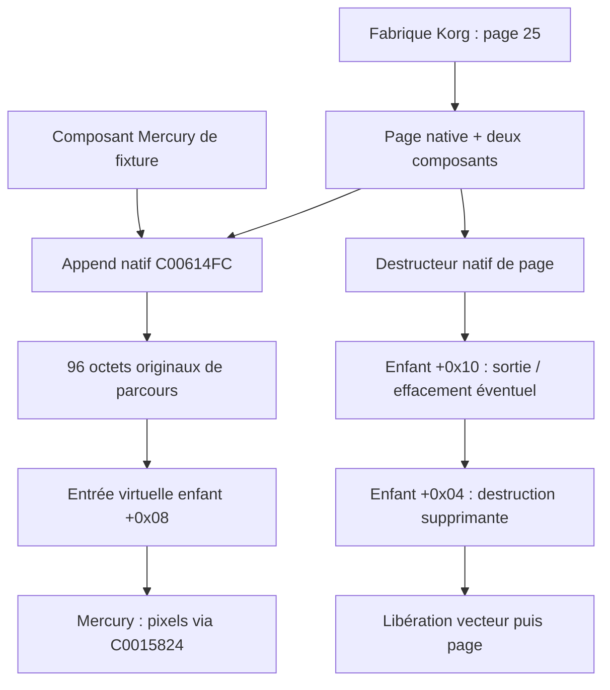
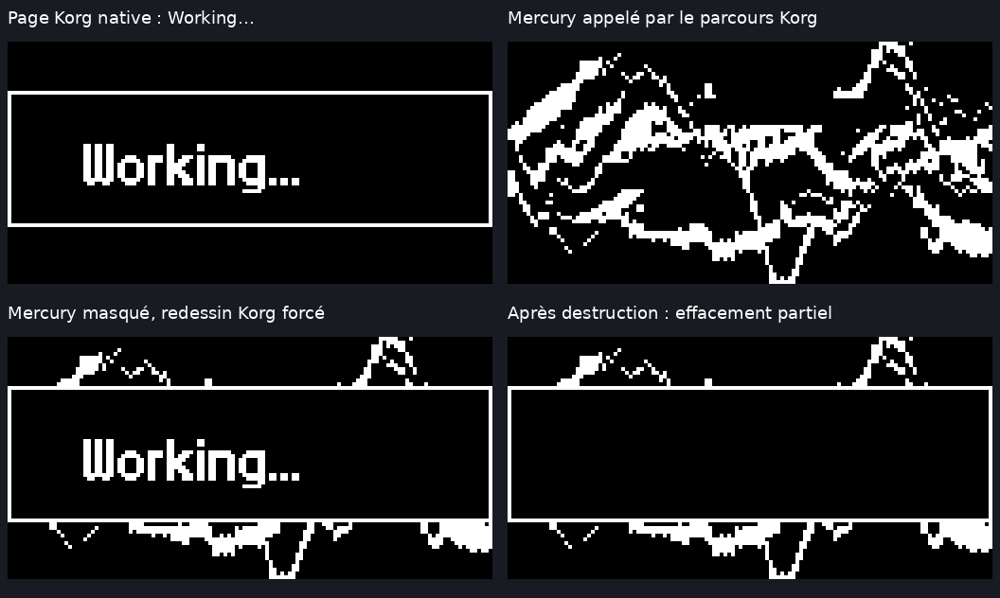

# Mercury Dust — R2 : cycle de vie UI natif

**2 novembre 2026 — RESEARCH_ONLY — QEMU ARM926, aucune validation sur instrument.**

Branche : `recovery/mercury-dust`. Base : R1 `2bdc19f`. Ni `main`, ni les VSB, ni `src/`, ni la référence artistique ne sont modifiés par cette mission. Au contrôle avant publication, le `main` distant est déjà à `6e9291d`, fusion externe de R1 via la PR #1 ; cette mission ne le fusionne pas et ne le réécrit pas.

## 1. Objectif et conclusion

Reprendre les questions MD80–MD83 : insérer un composant Mercury expérimental dans une liste graphique Korg, obtenir son appel par le code original, puis observer son nettoyage et sa destruction.

**Le cycle fonctionne dans la fixture ARM :** la fabrique native construit la page 25 « Working… » et ses deux composants ; l'insertion native ajoute Mercury ; les 96 octets originaux de parcours appellent sa table virtuelle ; 32 images V30 sont vérifiées sur les 1 024 octets ; la chaîne native de destruction appelle ses deux méthodes de sortie et de libération. Une variante positive fonctionne avec **malloc et free Korg originaux, sans substitution de code**, en fournissant leurs régions RAM et les pages de données initialisées.

Ce résultat ne valide ni une installation de Mercury, ni son enregistrement dans la fabrique, ni le cycle complet `C006F178`, ni un LCD physique. Le composant Mercury et sa table virtuelle restent expérimentaux, construits par le banc.

**17 scénarios par VSB, soit 34 exécutions bornées**, avec comparaison des événements et snapshots entre les deux originaux. Plusieurs scénarios doivent échouer ou boucler : leurs issues constituent les contrôles attendus, pas des succès fonctionnels.

## 2. Sources historiques et provenance

Le [dossier de récupération](documents/RECOVERY_DOSSIER_MD46_MD87_TRANSCRIPTION.md) est conservé comme transcription historique, pas comme archive des sources originales. SHA-256 du document joint avant normalisation des fins de ligne : `3c313683b224fd3a5ed60a0682edd266d0594c02b2f4c4e60b7f7781d8c9b69d`. La copie Git normalisée LF a pour SHA-256 `b5cf73973b6d6e1e573bc2328d680c3e08f994c04ac68c4b07499ff451398272`.

Les repères MD80–MD83 y décrivent une table virtuelle de fixture, l'insertion `C00614FC`, l'extrait `C006F240..C006F29F`, la destruction native de pages et un allocateur de laboratoire réutilisant ses blocs. R2 redémontre ces chemins ; aucune identité avec les anciens fichiers n'est revendiquée.

Les images proviennent du moteur MD45 inchangé et de la séquence déterministe R1 : huit presets, quatre instants par preset. Les notes et le temps sont synthétiques. Les douze commandes globales et les quatre mini-LFO ne sont pas modifiés ; aucune écriture audio, IFX ou pattern n'est effectuée. La coexistence sur instrument n'est pas validée.

## 3. Architecture et fonctions ARM

| Adresse | Contrat établi dans R2 |
|---|---|
| `C003F0D4` | Initialisation graphique native : police 0, couleur active, dimensions 128×64, dernier caractère -1, effacement via `C0015804` |
| `C006E664` | Fabrique ; pour l'identifiant 25, table `C00F9CD8` → `C006D5E4` |
| `C006D5E4` / `C006D518` | Allocation de la page de 36 octets, construction de deux composants et de leur liste |
| `C008B424` | Construction du composant de fond/cadre, 56 octets |
| `C008CCD4` | Construction du composant texte, allocation de 156 octets |
| `C00614FC` | Append : reçoit le vecteur et l'adresse du pointeur enfant |
| `C006144C` | Agrandissement, copie native `C0009950`, libération de l'ancien stockage |
| `C006F240..C006F29F` | Parcours graphique original : appel de l'entrée virtuelle `+0x08` de chaque enfant |
| `C006D484` → `C006D464` → `C0060F10` | Destructeur supprimant de la page 25, destruction de sa liste |
| `C0060F50` / `C0060F6C` | Chargement des méthodes enfant `+0x10`, puis `+0x04` |
| `C0060F3C` | Branche sur elle-même si la destruction est demandée pendant un parcours actif |
| `C008C9CC` / `C008CB08` | Thunks texte : soustraction de 16 à `this` avant nettoyage/libération |
| `C008C990` | Effacement du rectangle du texte avant sa destruction |
| `C0041B74` | Destruction de la partie de base et de son vecteur d'observateurs, vide dans ces fixtures |
| `C0028DCC` / `C0028DD4` | Relais d'allocation et libération |
| `C0008F30` / `C0008F50` | Entrées malloc/free ; corps notamment `C0008F70` / `C000EE6C` |
| `C002CEFC` | Extension de heap, pointeur courant `C03404AC`, bornes natives `C06A2940..C08A2940` |
| `C0015824` | Primitive pixel originale déjà étudiée en R1, utilisée par Mercury |

L'[audit statique](reports/recovery_r2/static_audit.json) compare **19 plages identiques entre les deux VSB** et cinq opcodes de contrat. Le [désassemblage borné](reports/recovery_r2/native_disassembly.txt) permet de vérifier les instructions citées. La fabrique n'est pas auditée en général : seule l'entrée 25 est utilisée.

### Disposition de la page et dispatch

| Décalage de la page | Contenu observé |
|---|---|
| `+0x00` | Table virtuelle native de la page 25 : `C00E3E08` |
| `+0x04..+0x0C` | Vecteur d'observateurs, vide ici |
| `+0x10`, `+0x14`, `+0x18` | Début, fin utilisée et fin de capacité du vecteur graphique |
| `+0x1C` | Octet de parcours actif |
| `+0x1D` | Octet de redessin forcé, propagé au `+0x14` des enfants |
| `+0x20` | Pointeur vers l'allocation complète du composant texte |

Le second pointeur du vecteur graphique est **l'allocation du texte +16**, et non son adresse de base. Le banc avec heap de laboratoire vérifie cette relation par ses événements d'allocation. Les thunks natifs rétablissent le pointeur de base pour les méthodes concernées. Mercury est ici un objet simple, sans sous-objet ajusté.



## 4. Hypothèses et méthode expérimentale

| Hypothèse | Expérience | Conclusion bornée |
|---|---|---|
| Un pointeur compatible suffit à rejoindre le parcours | Insertion Mercury dans une page construite par Korg | Confirmée dans cette liste ; aucun enregistrement global établi |
| La méthode `+0x10` est un simple nettoyage mémoire | Snapshots avant et pendant la destruction | Réfutée : le texte efface son rectangle |
| Le marqueur actif protège aussi l'append | Ajout depuis le callback graphique | Réfutée dans ce chemin : append accepté pendant le parcours |
| Un append devient visible immédiatement | Comptage des callbacks sur deux passages | Réfutée : la longueur initiale est conservée pendant le premier passage |
| La destruction peut attendre la fin du dessin | Appel avec marqueur actif, puis depuis le callback | Réfutée dans le chemin testé : boucle fixe sans relecture du marqueur |
| L'allocateur natif doit être remplacé | Matrice de régions RAM et permissions | Réfutée pour ces scénarios : les dépendances mémoire suffisent |
| Une RAM graphique nulle est un état initial acceptable | Avec/sans initialisation graphique native | Réfutée : cadre réduit au point `(0,0)` sans initialisation |

La séquence de tests conserve les cas défavorables et vérifie leurs issues. Les assertions portent sur les pointeurs, capacités, événements, canaris, snapshots et sorties des processus. Les captures sont issues des dumps ARM ; le contrôle des 32 images compare chaque octet à l'oracle R1, dans le code ARM puis indépendamment en Python.

### Portée de l'enveloppe de parcours

L'enveloppe sauvegarde `r4-r8,lr`, réserve huit octets, place la page dans `r5` et marque son parcours actif. Elle exécute **sans modification les 96 octets extraits à l'offset application `0x6F240`**, puis restaure son contexte. Les branches restent internes à cet extrait et l'appel enfant est indirect par `BLX`.

L'alignement de SP sur huit octets est vérifié dans le callback Mercury. Cela ne constitue pas un audit dynamique complet de tous les registres ni du contexte d'entrée matériel. Les parties amont et aval de `C006F178` ne sont pas exécutées.

## 5. Résultats détaillés

Les résultats ci-dessous sont identiques sur les deux VSB. Les identifiants correspondent à `case` dans [results.json](reports/recovery_r2/results.json).

| Cas | Scénario | Résultat attendu et observé |
|---:|---|---|
| 0 | Heap natif, fixture RAM minimale | SIGSEGV : écriture à `C06A293C`, région non mappée |
| 1 | Page 25 native, heap laboratoire | Deux composants ; 601 pixels allumés après dessin ; 5 allocations et 5 libérations ; aucun bloc de laboratoire restant |
| 2 | Page native + Mercury, heap laboratoire | 32 images exactes ; 35 callbacks Mercury, 33 rendus effectifs ; 270 336 appels pixel Mercury ; sortie et suppression appelées une fois ; 7 allocations/7 libérations |
| 3 | 16 Mercury, page de fixture | Capacités 1, 2, 4, 8, 16 ; 22 allocations/22 libérations ; 16 sorties et 16 suppressions |
| 4 | Même pointeur ajouté deux fois | Deux callbacks ; après la première suppression, la fixture détecte une sortie sur objet déjà libéré : code 84 |
| 5 | Destruction avec `+0x1C=1` | Processus arrêté après 2 s ; trace à `C0060F3C` |
| 6 | Append depuis le dessin | Premier passage : 1 callback malgré une liste devenue de taille 2 ; second passage : 2 callbacks ; deux enfants correctement détruits |
| 7 | Destruction depuis le dessin | Même boucle native ; processus arrêté après 2 s, sans libération préalable |
| 8 | Append d'un pointeur nul | Append accepté ; SIGSEGV au parcours ; ce n'est pas un rejet propre de l'insertion |
| 9 | Corruption d'un pixel puis redessin | Sans invalidation, corruption conservée ; avec redessin forcé, retour exact à la capture native précédente |
| 10 | Destructeur non supprimant | Enfants et stockage du vecteur libérés ; bloc parent conservé ; anciens pointeurs du vecteur non remis à zéro |
| 11 | Heap natif : 64 cycles de page | Même adresse parent `C06A2948` réutilisée ; break stable à `C06A3000` après le premier cycle |
| 12 | Page + Mercury, heap entièrement natif | Même séquence de 32 images exactes et mêmes effets visuels que le cas 2 ; aucune substitution de routine Korg |
| 13 | Suppression Mercury remplacée par un retour vide | Sortie appelée ; aucun appel de suppression ; un bloc Mercury de laboratoire reste alloué |
| 14 | Région heap présente, données malloc en lecture seule | SIGSEGV de protection à `C00F9268` |
| 15 | Données malloc accessibles en écriture, région heap absente | SIGSEGV à `C06A293C` |
| 16 | Pas d'initialisation graphique | 278 pixels au lieu de 601 ; après destruction, point résiduel `(0,0)` au lieu du cadre de 324 pixels |

Les codes 84, SIGSEGV et timeouts sont des **contre-exemples attendus**. Le test 4 conserve volontairement les octets des blocs libérés pour diagnostiquer l'alias ; il ne prédit pas l'issue exacte d'un doublon dans un vrai heap. Les tests de fuite laissent volontairement les allocations diagnostiquées jusqu'à la fin du processus de laboratoire.

### Rendu, invalidation et visibilité

Les deux variantes Mercury partent d'une liste native de taille/capacité 2 et passent à taille 3/capacité 4. Pour chacune :

- 32 appels avec image nouvelle : vérification des 1 024 octets, huit presets couverts ;
- un appel sans dirty : le callback est atteint, mais aucun pixel Mercury n'est réécrit ;
- un redessin forcé de la page : propagation native de dirty et 8 192 écritures Mercury supplémentaires ;
- Mercury invisible : son callback est encore atteint, mais il ne dessine pas ; les composants Korg, eux, sont redessinés.

Les 35 callbacks ne doivent donc pas être confondus avec 35 images effectivement produites. La visibilité est une politique du composant expérimental, pas un filtrage démontré du gestionnaire Korg.

### Destruction et effet sur l'image

Le composant texte quitte la page par `C008C9CC → C008C990`. Il efface **x=1..126 et y=22..41**. Un oracle Python efface exactement ce rectangle dans la capture précédente et exige l'identité des 1 024 octets avec la capture de sortie.

Après le redessin natif avec Mercury invisible : **1 086 pixels** sont allumés. La sortie du texte retire **277 pixels dans 79 octets**, laissant **809 pixels**. Les captures insérées dans le callback Mercury montrent que l'effacement a déjà eu lieu avant sa propre sortie ; son `free` ne modifie pas ensuite le framebuffer.

La page native seule conserve son cadre de **324 pixels** après destruction. Le scénario mixte en conserve 809, soit **485 supplémentaires** dans cette fixture. La destruction de la liste ne signifie donc pas un effacement complet ni une restauration de la page suivante. Aucune transition n'est exécutée ici.




[Planche des huit presets](reports/recovery_r2/native_heap_v30_presets.png) — captures de framebuffer sous QEMU, jamais photographies du LCD.

## 6. Échecs explorés et causes

### 6.1. Pourquoi la première tentative de malloc échouait

La trace mène à `C000A3B0`, dont l'écriture à `C06A293C` précède l'appel d'extension `C002CEFC`. Le désassemblage de cette dernière fournit la base `C06A2940`, la limite `C08A2940` et le pointeur courant `C03404AC`.

Mapper uniquement la région heap ne suffit pas : l'exécution suivante rencontre une écriture aux données initialisées de malloc à `C00F9268`, toujours protégées en lecture. Inversement, rendre ces données modifiables sans mapper la région heap conserve le premier échec. Les cas 0/14/15/11 forment ainsi une matrice de dépendances, et non un simple remplacement de l'allocateur pour obtenir un succès.

Avec les deux préconditions, les 64 cycles natifs aboutissent et réutilisent le parent sans croissance supplémentaire du break. **Cela ne prouve pas l'absence universelle de fuite, la validité de toutes les structures du heap ni sa sûreté en concurrence.** Les compteurs d'allocations de laboratoire valent zéro dans ces cas parce qu'ils ne sont pas utilisés : ils ne mesurent pas les allocations natives.

### 6.2. Pourquoi une première capture affichait le texte sans le bon cadre

La RAM anonyme initialise à zéro les dimensions lues par `C003F2B4`, le traceur de lignes. Les coordonnées du cadre sont alors rabattues sur `(0,0)`. Le texte utilise d'autres primitives et reste visible : une capture plausible cachait donc une fixture graphique incomplète.

La routine originale `C003F0D4` établit les dimensions et l'état graphique. R2 l'appelle dans les scénarios normaux et conserve expressément son omission dans le cas 16. Le cadre passe alors du point résiduel à ses 324 pixels. Aucun remplacement des primitives de dessin n'a été nécessaire.

### 6.3. Pourquoi l'ajout pendant dessin réussit, mais pas la destruction

L'append reçoit le sous-objet vecteur, sans consulter le marqueur de la page. Le parcours recharge le pointeur de stockage mais conserve sa longueur initiale, sauvegardée autour du callback. L'enfant ajouté devient visible au passage suivant.

La destruction inspecte le marqueur au début, puis branche sur elle-même. **La boucle ne relit pas le marqueur.** Ce chemin ne constitue donc pas une attente qui se résoudrait spontanément à la fin du parcours. Le comportement synchrone de l'append ne garantit aucune sûreté en préemption, IRQ ou avec des suppressions concurrentes.

## 7. États de fixture et substitutions

| Élément | Fourniture exacte du banc |
|---|---|
| Exécution | Linux user-mode `qemu-arm -cpu arm926`, démarrage ARM de R1 |
| Image native | VSB lu après vérification SHA, en-tête de 0x100 retiré ; copie privée de 2 Mio à `C0000000` |
| RAM graphique/globale | Mapping anonyme nul `C0300000..C0350000`, puis initialisation graphique native, sauf cas 16 |
| Heap natif, cas 11/12/14 | Mapping privé `C06A2000..C08A4000` ; bornes réellement utilisées conservées par le code natif |
| Données natives modifiables, cas 11/12/15 | Pages `C00F8000..C00FA000` rendues lecture/écriture ; instructions étudiées inchangées |
| Heap laboratoire | 64 blocs réutilisables, 512 octets utiles maximum, canaris avant/après, remplissage interne A5 ; contrôle des libérations |
| Substitutions de code, variantes laboratoire uniquement | Dans la copie RAM : deux trampolines de huit octets aux entrées `C0008F30` et `C0008F50` vers l'allocateur instrumenté |
| Objets Mercury | Structure et table virtuelle de fixture ; méthode de dessin C, sortie et suppression distinctes |
| Page de fixture, cas 3–8/13 | Allocation laboratoire, champs explicitement nuls, table native de base `C00E3160` ; aucun constructeur de page revendiqué pour ces cas |
| Musique/images | Séquence R1 synthétique ; moteur MD45 intact, aucun séquenceur Korg exécuté |
| Arrêt des boucles | Timeout externe Python à 2 s, aucun patch de la branche native |

**Cas 11 et 12 : aucun trampoline ni remplacement de routine Korg.** Modifier les permissions des pages de données de la copie RAM ne modifie pas les VSB. La RAM anonyme, le processus Linux, le composant Mercury et l'enveloppe de parcours restent néanmoins des états de laboratoire.

Dans les variantes instrumentées, les canaris de heap et de framebuffer sont contrôlés aux allocations, libérations et snapshots. Dans les variantes natives, seules les sentinelles de framebuffer et les vérifications fonctionnelles s'appliquent ; il n'y a pas de preuve exhaustive des limites de chaque allocation native.

## 8. Comparaison avec MD80–MD83 et découvertes

| Historique accessible | Preuve R2 |
|---|---|
| MD80 : callback via table de fixture | Toujours une table Mercury de fixture, mais appelée dans une page native construite par sa fabrique |
| MD81 : append et 96 octets originaux | Reconstitués, vérifiés dans les deux images ; mutation de liste pendant callback également étudiée |
| MD82 : destruction native de deux composants Korg | Reproduite avec la page 25 ; sous-objet texte +16, ordre des méthodes et effet graphique explicités |
| MD83 : page de fixture, Mercury et allocateur de laboratoire | Reproduits ; comparaison supplémentaire avec malloc/free natifs dans une fixture documentée |
| MD85, hors périmètre : 72 pixels supplémentaires après une transition | R2 mesure 485 supplémentaires après une destruction sans transition ; conditions différentes, aucune comparaison quantitative directe |

Les apports vérifiables de cette reprise, au-delà d'un banc minimal, sont :

1. La dépendance graphique masquée par une capture de texte plausible, isolée par le cas sans initialisation et corrigée par la routine native.
2. La matrice de dépendances du heap et les 64 cycles natifs, sans remplacement malloc/free dans les variantes positives concernées.
3. La longueur de parcours figée malgré un append accepté, démontrée sur deux passages.
4. La distinction entre sortie avec effacement partiel, destruction supprimante et durée de vie du parent.
5. Les contre-exemples de doublon, pointeur nul, suppression manquante et destruction synchrone pendant dessin.

Ce sont de nouvelles preuves dans le dépôt récupéré et des précisions par rapport au dossier disponible. Sans les rapports originaux complets, leur nouveauté absolue par rapport à toute l'ancienne recherche n'est pas affirmée.

## 9. Reproduction et traces

Dépendances identiques à R1 : Clang/LLD/LLVM, QEMU user-mode, Python 3 et Pillow. Versions enregistrées par la régression R1 : Clang/LLD 19.1.7 et QEMU 10.0.13.

```bash
# Chemin propre à cet environnement ; adapter pour une installation système.
export PATH=/workspace/mercury-tools/bin:$PATH
bash tests/run_recovery_r2.sh '/chemin/user_custom (2).VSB' '/chemin/user_backup.VSB'
```

Le lanceur rejoue MD45/R1, les 34 expériences R2, les visualisations et l'audit statique. Les issues négatives sont exigées par les assertions ; `--explore` sert au diagnostic et ne constitue pas une validation.

- [Journal de régression R1](reports/recovery_r2/r1_regression.log) ; journaux détaillés MD45/R1 sous `reports/recovery_r1/`.
- [Journal R2](reports/recovery_r2/validation.log), [événements et mesures JSON](reports/recovery_r2/results.json).
- [Traces](reports/recovery_r2/traces/) : instructions QEMU et flux d'enregistrements compressés, plus stderr. Les traces `in_asm` montrent les blocs traduits, pas un compteur de chaque exécution ; les comptes de callbacks proviennent des événements ARM.
- Format des records : seize entiers little-endian de 32 bits, suivis de 1 024 octets uniquement pour le type 100. Champs : magic, type, cas, a/b/c/d, allocations/frees/live de laboratoire, callbacks/sorties/suppressions/pixels Mercury, séquence, réservé.
- Types : 1 allocation, 2 libération, 3 callback, 4 sortie, 5 suppression, 6 page, 7 enfants, 8 append, 9 jalon, 10 cycle natif, 12 état après destructeur non supprimant, 99 assertion, 100 snapshot.

Les empreintes des sources utilisées sont enregistrées dans le JSON. Les deux SHA des VSB sont vérifiés avant et après les essais : custom `81b62467490fd25fd154ffe02298886bfdd6e9cf9bda897cde41ee65201ffd03`, backup `06becf76750f0dce7d3e40d476e4a78524a53730ba61b9b9752dfb170745b052`.

Les ELF et copies d'application restent dans `build/`, exclus de Git. Aucun firmware flashable, hook installé ou essai sur instrument n'est produit.

## 10. Limites et prochaine mission

Le gestionnaire complet, ses autres composants, les observateurs non vides, la file UI et les transitions n'ont pas été reconstruits dans R2. Aucun retrait individuel Mercury n'est établi. Après un destructeur non supprimant, l'objet ne doit pas être réutilisé comme une page vivante : sa table de classe a changé et ses anciens champs de vecteur subsistent.

Le banc ne valide pas le chargeur, une zone RAM libre sur instrument, les IRQ/FIQ, le DMA, le cache matériel, la récupération, la concurrence avec LCD2 ou la coexistence audio/IFX. La réussite du heap natif dans un processus privé n'est pas une validation du heap réel en fonctionnement.

**Une prochaine mission recommandée : R3, transition native page 25 → 29 via `C006E8BC`, avec le heap et l'initialisation graphique établis ici.** Comparer sans Mercury/avec Mercury, tracer destruction et reconstruction, puis vérifier l'ensemble du framebuffer de la page entrante et les pixels résiduels. Cette étape reprend MD84–MD85 ; elle ne commence pas MD88 et ne valide aucune commande physique.
