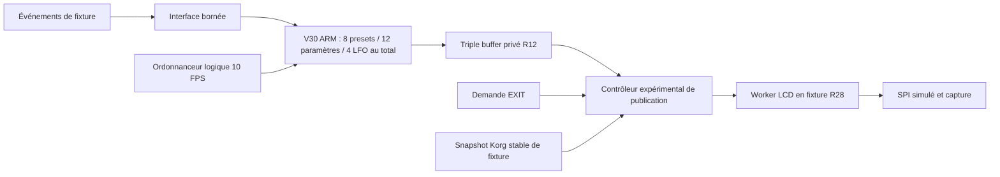

# R30 — audit d'intégration Mercury / Hacktribe

## Décision

**Un prototype de raccordement logiciel en laboratoire est défendable ; la
préparation d'un firmware installable doit rester suspendue.** R26–R29 prouvent
un parcours ARM en fixture, pas l'autorité de l'insérer dans Hacktribe ni une
réservation de RAM. Les obstacles centraux sont l'absence de point de contrôle
LCD couvrant tous les auteurs, de région mémoire réservée et de contrat de
drain/restauration ; l'audio et les sources musicales restent à qualifier.
Ces inconnues ne prouvent pas que toute intégration est impossible.

## Points d'intégration et mémoire

La [carte détaillée](documents/RECOVERY_R30_INTEGRATION_FR.md) couvre boutons,
UI, timer, dispatcher, worker et transition. Le scan R30 vérifie les 32 premiers
octets de huit entrées sur les deux VSB et leurs branches ARM directes
candidates. Il trouve notamment `C002A4DC → C002814C`, 12 candidats vers
`C0015DD0`, et `C0015E58/C0015F38 → C0015FA0`. Il ne résout ni les appels
indirects ni les données prises pour du code. `C002A71C` et `C00836E4` ont des
appelants par tables ; zéro branche directe ne veut pas dire sans appelant.

R6 relie une structure de bouton synthétique à l'UI, pas une touche physique
EXIT. Les sources Korg de BPM, notes et pas, leur PPQN et leur temporalité sont
**non démontrés**. R29 établit seulement l'EXIT différé dans sa fixture.

La [carte mémoire](documents/RECOVERY_R30_MEMOIRE_FR.md) distingue image de
code, piles, source et shadow LCD, rectangle adjacent, descripteur, heap et
globales. Aucune zone de RAM ou de code libre n'est démontrée ; la RAM audio,
les piles d'exception, le DMA et les attributs MMU/cache ne sont pas bornés.
Les mesures R26 ne sont ni un budget libre ni un coût complet d'intégration.

## Autorité LCD

Les 14 domaines de [R13](documents/RECOVERY_R13_GRAPHICS_ACCESS_MAP_FR.md)
incluent UI principale et alternative, pages secondaires, worker périodique,
progression, démarrage, diagnostic, comparateur direct, contrôles LCD, auteurs
et lecteurs de pixels, alias calculés et vidange UI. Les accès indirects,
IRQ/FIQ/DMA et tous les contextes ne sont pas fermés. Un callback Mercury ne
contrôle pas les accès des non-participants.

| Architecture | Classement | Ce qui échappe encore |
|---|---|---|
| Worker natif sérialisé en fixture R28/R29 | **VIABLE EN LABORATOIRE** | temps/GPIO/SPI simulés ; aucun ACK réel ni arbitrage global |
| A — point commun au worker | **À INVESTIGUER** | démarrage direct, accès shadow ou LCD alternatifs, worker déjà actif, alias et interruptions |
| B — contrôler les demandes | **À INVESTIGUER** | appels synchrones et directs, commandes non graphiques ; +5 coalesce, pas une file |
| C — fenêtre explicitement autorisée | **À INVESTIGUER** | aucune autorité native de fenêtre ni preuve de cessation globale |
| Copie directe sans propriété ni coordination | **REJETÉE pour intégration** | lecture Korg/SPI concurrente et shadow partiel démontrés comme risques |

Ces classements sont relatifs aux preuves actuelles, pas à l'existence
physique d'un futur mécanisme. Aucun de A–C n'est autorisé sur instrument.

## Architecture cible de recherche

Seuls les liens du banc sont démontrés. Les entrées réelles, l'ordonnanceur,
l'autorité du contrôleur et le snapshot Korg natif ne sont pas raccordés.
L'architecture n'exige aucun nouvel abonnement dans sa version privée, mais
elle ne possède pas pour autant une fenêtre de publication réelle.

## Audio, séquenceur et dégradation

La tâche 2 peut, selon les priorités initiales, préempter la composition UI en
tâche 4 ; c'est une possibilité du graphe R11, pas une préemption observée sur
l'instrument. Les chemins audio/MIDI, priorités dynamiques, IRQ/FIQ et temps
réel ne sont pas établis. L'ELF ARM R26 mesure 12 512 octets de texte et une
pile locale maximale déclarée de 328 octets, sans pile totale ; son temps QEMU
ne donne aucune marge audio. Les tests préservent les sources IFX, sans preuve
de coexistence en exécution réelle.

Dans le **futur contrôleur de fixture**, si une mesure fiable de disponibilité
est absente ou si une échéance est manquée, supprimer la frame graphique à
venir ou suspendre le rendu ; ne pas modifier l'horloge musicale ni bloquer une
tâche audio pour attendre le LCD. Cette politique n'est applicable sur
instrument qu'après preuve des contextes, priorités et moyens d'observation.

## EXIT et état inconnu

Une demande EXIT peut être mémorisée pendant un worker engagé ; R29 montre que
la fixture attend son retour puis émet huit pages Korg. Si le worker ne revient
pas, la fin de lecture, l'état physique et le shadow deviennent inconnus ; ni
libération de buffer ni restauration réussie ne doivent être déclarées. Un
timeout exige une horloge et un observateur indépendants, une autorité sur tous
les acteurs et une primitive d'annulation dont la sécurité n'est pas établie.
Le chemin d'erreur LCD peut lui-même utiliser le LCD. Aucun mécanisme de retour
matériel autonome n'est revendiqué.

## Plan vérifiable

| Étape | Acquis et test reproductible | Réussite / arrêt |
|---|---|---|
| 1 — conserver la base | `python3 tools/recovery_r29/verify.py` et vérificateur R30 | snapshots/flux et fichiers historiques identiques ; arrêt si divergence |
| 2 — événements de fixture | R6 et APIs Mercury ; injecter des messages horodatés, comparer ordres et pertes | valeurs copiées, aucune file non bornée ; arrêt si contexte ou origine physique prétendus prouvés |
| 3 — publication bornée | R28/R29 ; tester EXIT répété, fautes et non-retour avec source stable | aucun réemploi avant fin prouvée ; arrêt si acteur non participant ou attente non bornée |
| 4 — mesurer ressources ARM | ELF R26 ; profilage reproductible hors accès matériel | fournir pile cumulée, cycles et occupation, pas une marge supposée ; arrêt si lieu de stockage inconnu |
| 5 — contrats natifs | auditer origines, table de tâches, auteurs et voies d'erreur | domination et durée de vie prouvées pour tous ; arrêt si IRQ/FIQ/DMA ou alias hors couverture |
| 6 — preuves extérieures | documentation SoC/LCD, carte mémoire et méthodes indépendantes | caractérisation et autorisation distinctes ; aucun flash déduit de ces étapes |

La simulation actuelle ne peut pas déterminer seule la RAM effectivement libre,
la latence audio, les propriétés électriques ou l'ACK LCD. Ces points exigent
documentation et observations matérielles séparément autorisées.

## Vérification

`bash tests/run_recovery_r30.sh custom.VSB backup.VSB` compare les entrées et
branches aux octets des deux VSB, vérifie les captures R29 et les fichiers de la
tête R29. Les 2 936 fichiers suivis sont inchangés. Cette vérification est en
lecture seule ; aucun firmware installable, flash, hook ou essai matériel.
