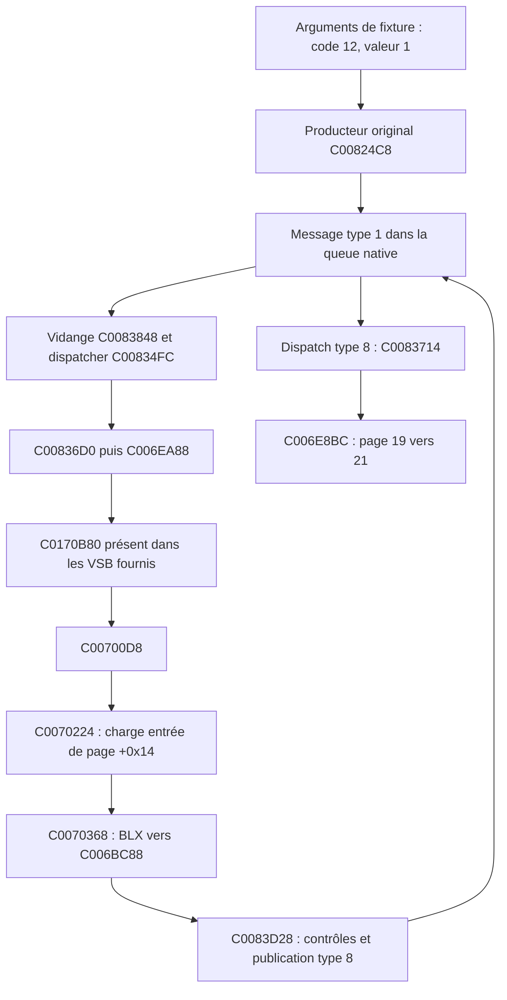

# Mercury Dust — R5 : appelant natif de la méthode de page 19

## Objectif et résultat

Après validation de R3 et R4, identifier un appelant réel de l'entrée virtuelle +0x14 de page 19, sans appeler directement cette méthode depuis le banc.

**Résultat : un appelant natif est identifié et exécuté.** Dans les deux VSB, `C0070224` charge l'entrée +0x14 de la page sélectionnée ; `C0070368` l'appelle par BLX. Avec la page 19 construite par sa fabrique, cette entrée vaut `C006BC88`. Le déclenchement provoque publication, dépilement et transition vers 21 sans appel direct du banc à cette méthode ni à la transition.

Neuf scénarios par VSB, soit dix-huit exécutions, aboutissent aux résultats attendus. Les flux ARM et les empreintes sont identiques entre les VSB.

## Chaîne confirmée



Deux messages sont consommés pendant la même vidange : le type 1 initial, puis le type 8 ajouté par le callback. Le manager n'est pas synthétiquement forcé à 21 après l'appel.

## Conditions précises

`C00700D8` est une méthode d'objet de navigation. Son champ +4 doit pointer sur le sous-gestionnaire graphique. Le banc construit cet objet par `C006F920` puis le relie par le setter natif `C006F95C`.

Pour le chemin observé :

1. Le pointeur objet+4 est non nul.
2. Le code reçu vaut **12**, la valeur vaut **1**.
3. L'octet **gestionnaire graphique+25 est non nul**. Il est fourni à 1 dans la fixture. Aucun nom sémantique de touche ou de mode ne lui est attribué.
4. `C006EA4C` retourne la page du premier emplacement, dont la vtable fournit le slot +0x14.
5. Le producteur `C0083D28` doit ensuite accepter ses propres états, comme testé en R4.

Sans le marqueur +25, le même événement emprunte une autre branche et n'atteint pas cette entrée. Avec valeur 0, il ne prend pas ce chemin non plus. Une autre page peut recevoir un slot de même décalage dont la méthode est sans effet : le numéro de slot n'identifie pas une commande universelle.

Le saut amont dans `C006EA88` mène à **C0170B80**, code présent dans les deux images fournies. Cette routine possède ses propres traitements et états avant le retour vers `C00700D8`. Il ne faut pas extrapoler cette chaîne aux firmwares Korg non identiques aux VSB étudiés. La trace du cas positif établit le passage dans ces instructions originales ; le banc ne les remplace pas.

## Méthode et états supplémentaires

Réutilisation inchangée du support R2, du heap natif, de la page 19 et de la file R4. Le même mapping de chaîne vide partagée est fourni. Un objet de navigation est construit nativement. Une zone de fixture nulle de 1 200 octets sert au stockage des états d'entrée utilisé par `C00824A0` ; ses champs sont alimentés par le code original, pas par un remplacement du logger d'événements.

Le gestionnaire UI conserve la table native. Les pointeurs de sous-objets de navigation et d'états d'entrée sont fournis explicitement aux offsets graphiques +40/+44. Le marqueur graphique +25 vaut 1 ou 0 selon le contrôle. Le banc enregistre aussi l'octet consulté à `C06A2AC1` par la route C0170B80 : sa valeur observée est un état de ce processus de laboratoire, pas un état matériel restauré.

La variante la plus en amont appelle `C00824C8` avec deux pointeurs vers les entiers code et valeur. Cette routine originale construit elle-même le type 1 et le copie dans la file du manager connu par C03404C0. Les arguments restent fournis par le banc ; leur origine panneau n'est pas établie.

## Expériences et contrôles

| Cas | Entrée | Résultat sur les deux VSB |
|---:|---|---|
| 0 | Message type 1 de fixture, code 12, valeur 1, marqueur +25=1 | Appelant natif atteint, deux messages consommés, page 21 |
| 1 | Même code, valeur 0 | Un message consommé ; page 19 inchangée ; C006BC88 absent de la trace |
| 2 | Valeur 1 mais marqueur +25=0 | Page 19 conservée, méthode +0x14 non atteinte |
| 3 | Chemin positif avec Mercury dans la page sortante | Image Mercury avant demande ; sortie et suppression une fois ; page 21 |
| 4 | Appel direct de C00700D8, objet natif relié au gestionnaire | Même appelant +0x14 ; un seul message, le type 8 produit nativement |
| 5 | Page 25 au lieu de 19 | Le chemin de navigation ne provoque pas de demande 21 ; page 25 conservée |
| 6 | Chemin positif mais blocage producteur C0345EC4=1 | Méthode de page appelée, producteur refuse, page 19 conservée |
| 7 | Producteur original C00824C8(code=12, valeur=1) | Chaîne complète native ; deux messages consommés ; page 21 |
| 8 | Même producteur, valeur 0 | Un message consommé, page 19 conservée |

Le contrôle de trace vérifie notamment `C0070224`, `C006BC88`, `C0083D28` et `C006E8BC` dans les chemins positifs. Les cas de valeur nulle, marqueur nul et autre page exigent l'absence de C006BC88. Les assertions C vérifient l'identifiant final ; les snapshots et événements sont comparés entre VSB.

## Échecs et corrections du banc

La première compilation a signalé un helper non utilisé hérité de R4 ; il a été retiré. Une initialisation locale volumineuse déclenchait une dépendance `__aeabi_memclr4` dans l'ELF freestanding ; la zone d'états a été placée en stockage statique nul, explicitement documenté. Aucune routine firmware n'a été remplacée pour résoudre ces erreurs de banc.

La difficulté conceptuelle était de distinguer le type de message (1), le code transporté (12), sa valeur (1) et le slot virtuel (+0x14). Confondre ces quatre niveaux aurait conduit à attribuer arbitrairement un bouton ou à injecter directement la demande finale de transition. Les variantes positives et négatives montrent qu'ils ne sont pas interchangeables.

## Niveau de preuve et comparaison historique

Le dossier MD87 conservait un appel direct du banc à la méthode de page. R4 retrouvait cette limite. **R5 la dépasse** : l'événement traverse maintenant le producteur d'entrée, la queue, le dispatcher et l'appelant de navigation avant d'atteindre la méthode native.

Décision au sens de l'ancienne mission MD88 : **A dans la fixture ARM documentée** — appelant natif identifié et chaîne complète exécutée sur les deux VSB, également avec Mercury sortant.

Niveaux à maintenir séparés :

- Événement de fixture : oui, code et valeur fournis par le banc.
- Événement construit et traité par le code original des VSB : oui, cas 7/8.
- Événement relié à un bouton physique par une trace correspondante : **non**.

Aucune correspondance avec une touche, aucune action physique et aucune navigation sur instrument n'est validée. Le marqueur +25 est une précondition expérimentale connue, pas une preuve que l'instrument la fournit dans une situation précise.

## Artefacts et reproduction

[Résultats](reports/recovery_r5/results.json), [journal](reports/recovery_r5/validation.log), flux de snapshots et traces compressés dans le même dossier. Les captures sont des états source expérimentaux ; aucun rendu final complet de page 21 n'est revendiqué.

```bash
export PATH=/workspace/mercury-tools/bin:$PATH
bash tests/run_recovery_r5.sh 'custom.VSB' 'backup.VSB'
```

Le lanceur rejoue les prérequis puis les cas R5. Les deux empreintes VSB sont vérifiées avant/après ; les fichiers originaux ne sont jamais ouverts en écriture. Le moteur, les presets, paramètres, mini-LFO et IFX sont préservés. Aucun binaire destiné au flash n'est généré.

## Régression finale

Le lanceur complet R5 a été exécuté avec succès depuis MD45/R1 : 34 scénarios R2, 16 R3, 32 R4 et 18 R5, en plus des tests hôte, audits ABI et rendus R1. Le [journal complet](reports/recovery_r5/full_regression.log) et les [empreintes de provenance](reports/recovery_r5/provenance.json) sont conservés. Les traces R2 régénérées, qui incluent des identifiants de processus variables, ne remplacent pas les archives déjà publiées de R2. Les orchestrateurs R3/R4/R5 exigent désormais exactement deux chemins VSB ; cette validation d’arguments ne change aucun scénario ARM.

## Questions ouvertes et prochaine mission

Origine du code 12 dans le décodeur panneau, provenance des valeurs, signification et cycle de vie de l'octet graphique +25, rôle des états C0170B80, restauration de la page 21 et interactions concurrentes restent ouverts. La propriété mémoire sur instrument, LCD2, IRQ/FIQ, DMA, cache, chargeur et récupération ne sont pas validés.

Une prochaine mission recommandée : **R6, remonter le producteur C00824C8 vers ses sources panneau et les producteurs du marqueur +25**, en lecture du code puis fixtures ARM bornées, sans nommer de touche tant que cette correspondance n'est pas prouvée.
