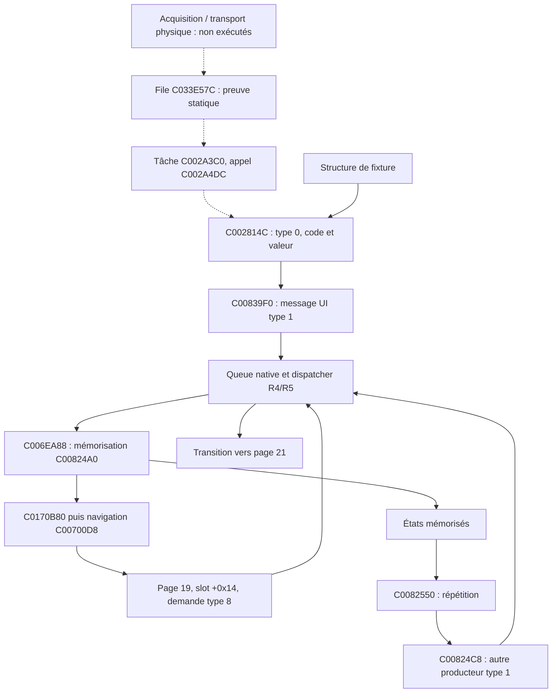

# Mercury Dust — R6 : voies d'entrée, répétition et sélection graphique

3 novembre 2026. Base distante vérifiée : `31033e5de3bb31bab9f7369304c11bcf73419cd9`, R5. Branche `recovery/mercury-dust`. **RESEARCH_ONLY : expériences Linux/QEMU ARM926 ; aucune validation sur instrument.**

## Résultat et frontière

R6 établit une distinction nouvelle et essentielle : **C00824C8 n'est pas l'unique producteur des messages UI de type 1.** Son unique appel direct ARM trouvé vient du moteur de répétition C0082550. La voie de décodage C002814C produit le même type de message par **C00839F0**, sans passer par C00824C8. Les deux voies convergent dans la queue native, puis dans la navigation R5.

Une structure d'entrée de laboratoire, avec type 0, code 12 et valeur non nulle, atteint nativement la page 21 depuis 19, également avec destruction de Mercury. Les valeurs 1 et 255 deviennent toutes deux 1 ; zéro reste zéro. **Cela ne relie toujours pas le code 12 à une touche physique.** Le banc entre dans une routine de décodage de structure, après réception et transport. Il n'exécute ni le panneau, ni ses échanges électriques, ni le worker/ordonnanceur complet.

La mission constitue une recherche R6 bornée validée, avec frontière explicitement conservée ; l'objectif d'une chaîne physique complète n'est pas atteint. R7 peut étudier indépendamment le cycle graphique à partir des objets déjà construits.

## Contexte et méthode

R1–R5, leurs sources et le dossier MD46–MD87 ont été examinés. La copie locale initiale était sur une branche `work` à la fusion R1 `6e9291d`. La branche distante était déjà à R5 : fetch puis création locale de `recovery/mercury-dust` sur cette révision, sans modification de `main` ni réécriture.

Le premier fetch dans le confinement échouait sur le proxy. Le connecteur GitHub a permis de vérifier la tête distante ; l'accès réseau autorisé du terminal a ensuite permis le fetch Git réel. La régression complète R5 a été rejouée : ses scénarios ARM passent, ainsi que les prérequis. Le premier lancement hôte échouait parce que LeakSanitizer ne fonctionne pas sous ptrace ; le lancement hors de ce confinement a passé, sans désactiver les sanitizers. Les archives antérieures régénérées ne remplacent pas les archives publiées.

Le nouveau lanceur prépare seulement les entrées déterministes et l'enveloppe R2 inchangée ; il ne rejoue pas inutilement R1–R5. Le SHA des 32 images générées est comparé à celui publié en R2. Deux VSB de taille 0x200100 sont exigés, avec les SHA originaux R1/R5 contrôlés avant/après. Aucun VSB n'est ouvert en écriture.

## Les trois niveaux d'événement

| Niveau | Format ou état établi | Preuve / limite |
|---|---|---|
| Transport/acquisition | C00282D8 assemble notamment cinq octets dans l'objet +4..+8 ; C00252AC les place dans une file | Lecture statique seulement ; trame physique complète et provenance électrique non démontrées |
| Structure décodée | C002814C lit type +12, code +13, valeur +14 pour le type 0 | Exécutée sur les deux VSB ; aucune validation de longueur dans ce chemin |
| Message UI | 16 octets, type 1 à +4, code u32 +8, valeur u32 +12 | Produit par C00839F0 puis copié dans la queue native |
| Commande de page | Code 12, valeur 1, sélection primaire et page 19 → slot +0x14 | Chaîne R5, producteur de navigation type 8, transition 19 → 21 |



Les flèches pointillées représentent des liens lus dans les instructions, pas une exécution intégrale. La tâche C002A3C0 attend des événements via C00010E4 ; son chemin de bit 2 dépile par C0024B6C vers l'objet +12, puis appelle C002814C à C002A4DC. L'autre chemin appelle C002837C, dont la branche type 0 passe par C0042BB8 avant C00839F0. Ce second chemin comporte d'autres contrôles et n'est pas déclaré exécuté par R6.

## Appelants de C00824C8 et répétition

Le scan des mots ARM alignés des 2 Mio trouve une branche directe à C0082600, dans C0082550 ; aucune référence littérale alignée vers C00824C8. Le scanner conserve sa limite : données pouvant ressembler à des branches, appels indirects, Thumb et adresses calculées non couverts exhaustivement. L'appel C0082600 est confirmé par le désassemblage du corps, pas seulement le scan.

C0082550 parcourt les codes **0..34 inclus**. Pour chaque code `i`, état à `objet+776+8*i`, compteur à `objet+780+8*i`. État 0 : rien. État 1 : incrémente le compteur, compare un seuil signé dans C00E4B1C, prépare la valeur 2. États 2/3 : autre seuil C00E4AF8, prépare 3. Autres états : compteur incrémenté, aucune publication.

**Les deux tables de 35 octets sont entièrement FF, donc -1 signé, dans les deux VSB.** Dans les états ordinaires testés, le compteur est remis à zéro, l'état devient 2 ou 3, puis la routine évite l'appel au producteur. Le seul appelant direct trouvé n'explique donc pas l'apparition de la valeur 1. La recherche de ce contre-exemple conduit à la voie C002814C → C00839F0.

C00824A0 mémorise la valeur et remet le compteur à zéro si la valeur est zéro. Il ne borne pas lui-même le code avant son écriture indexée ; l'origine et la validation amont des codes restent indispensables.

## Octet graphique +25 : sélection du second emplacement

Le contexte des lectures/écritures permet une interprétation plus précise qu'en R5 : cet octet décrit la disponibilité/sélection du **second emplacement graphique**, pas une touche.

| Instruction / routine | Effet établi |
|---|---|
| C006E890, constructeur C006E6EC | +25=1, second pointeur +20 nul ; identifiants +28/+32 initialement 46 |
| C006E9A0, écriture C006E9E0 | Construit/remplace le second emplacement, +25=0, demande de redessin +76=1 |
| C006EFD0, écriture C006EFFC | Détruit le second objet non nul, vide +20 et remet +25=1 ; identifiant +32=46 |
| C006EA54 | +25=0 sélectionne le second pointeur ; sinon premier pointeur si +24=0, sinon nul |
| C0070174 | Navigation valeur 1 : +25 non nul autorise les raccourcis de page primaire, dont code 12 → slot +0x14 |
| C006EB98 / C006ECEC | Autres routages vers premier ou second emplacement selon +25 |
| C006F178 | Parcourt deux emplacements avec les octets adjacents +24 et +25 |

La fixture 15 construit réellement une page 25 secondaire, observe +25=0, la retire par C006EFD0, observe +25=1, puis la voie de décodage déclenche 19 → 21. Le constructeur global complet du gestionnaire n'est pas exécuté ici : son écriture initiale reste une preuve statique.

## C0170B80 : dépendance et code non parcouru

L'entrée lit **C06A2AC1** (base C06A2A94 +45). Zéro : restaure les registres et branche vers C00700D8. Non nul : appelle C0170170, puis rejoint également la navigation si le service termine.

C0170170 appelle C01702CC puis C00405EC avec des paramètres et des données globales additionnels, notamment C06B76A8/C06C21EC et l'objet C0170E50. Le scénario activé atteint ce service mais échoue en écriture à **C0170EBC**, page de l'image protégée. Aucune modification de permission supplémentaire ou substitution n'a été faite pour forcer ce chemin à réussir. La navigation n'est pas atteinte dans ce contre-exemple.

**Attention au faux chemin :** la zone C0170B9C..C0170C90 contient des tests d'états et une table, mais le branchement inconditionnel C0170B98 saute directement à C0170C94. Depuis l'entrée étudiée avec les instructions originales, ces tests ne sont pas parcourus. Le cas 9 met l'octet de données intégré C0170CA1 à 1 dans la copie privée, sans changer d'instruction : la navigation reste possible et C0170B9C reste absent de la trace. Cette donnée ne doit pas être confondue avec C06A2AC1. Aucune sémantique de bouton n'est tirée des tables présentes dans cette zone.

## Matrice ARM : 17 cas par VSB, 34 exécutions

| Cas | Entrée / état | Résultat exigé et observé sur les deux VSB |
|---:|---|---|
| 0 | Structure type 0, code 12, valeur 1 | Message type 1, puis type 8 ; page 21 |
| 1 | Valeur 0 | Page 19 conservée |
| 2 | Valeur brute 255 | Normalisée à 1 ; page 21 |
| 3 | Type 127 | Aucun message, page 19 |
| 4 | Code 255 | Transporté sans rejet par le décodeur ; queue vérifiée, **pas de dispatch dangereux** |
| 5 | Valeur absente derrière une page PROT_NONE | SIGSEGV exactement 50001000, pas de validation de longueur |
| 6 | +25=0, second pointeur nul | Raccourci primaire non appelé, page 19 |
| 7 | +24=1, entrée graphique bloquée | Page 19, pas d'appel de méthode |
| 8 | C06A2AC1=1 | C0170170 atteint ; SIGSEGV C0170EBC ; dépendance non levée |
| 9 | Donnée intégrée C0170CA1=1 | Page 21 ; branche non parcourue C0170B9C absente |
| 10 | Répétition état 1, compteur initial zéro | État 2, compteur zéro, aucun message |
| 11 | Répétition état 2 | État 3, compteur zéro, aucun message |
| 12 | Répétition état 4 | État 4, compteur 1, aucun message |
| 13 | Producteur C00824C8, entrée R5 | Référence positive : page 21 |
| 14 | Manager UI inactif | C00839F0/publisher refuse ; page 19 |
| 15 | Construction puis retrait secondaire natifs | +25 : 0 puis 1 ; navigation primaire rétablie |
| 16 | Mercury ajouté à page 19, structure type 0 | Dessin avant entrée, destruction native de Mercury, page 21 |

Les cas 4/6/7 sont volontairement invalides ou contradictoires ; leur issue ne constitue pas un état instrument admissible. Les cas 5/8 sont des échecs attendus conservés. Pour 8, le diagnostic établit une frontière, pas une preuve d'un défaut de firmware réel.

## Preuves, reproduction et préservation

- [Journal de validation](reports/recovery_r6/validation.log), [résultats et événements ARM](reports/recovery_r6/results.json).
- [Audit statique](reports/recovery_r6/static_audit.json) : dix plages identiques entre les images, seuils et candidats d'appels.
- [Désassemblage borné](reports/recovery_r6/native_disassembly.txt).
- Traces `*.trace.gz`, records `*.records.gz` et stderr conservés. Les records contiennent les snapshots de 1 024 octets et les compteurs du support R2 ; comparaison exacte des flux entre VSB.
- [Animation avec Mercury](reports/recovery_r6/case16.gif) : états source, **pas le rendu final complet de page 21 ni une capture LCD**.

```bash
export PATH=/workspace/mercury-tools/bin:$PATH # adapter à l'installation
bash tests/run_recovery_r6.sh 'custom.VSB' 'backup.VSB'
```

Le support R2 cas 12 conserve malloc/free natifs, mappings RAM, chaîne vide et état des services de fixture. Le manager, la queue et les liens restent préparés comme en R5 ; aucun état d'exécution d'instrument n'est récupéré. Le seul octet d'image explicitement modifié par R6 est la **donnée** C0170CA1 du cas 9 dans la copie RAM privée, dont la page reçoit temporairement des permissions RWX ; aucune instruction Korg n'est remplacée. Les ELF Linux et copies d'image sont exclus de Git, jamais destinés au flash.

Les canaris framebuffer et queue sont contrôlés sur les chemins terminant normalement ; pas d'audit exhaustif du heap natif. Les chemins de faute s'arrêtent avant la validation finale. Les traces `in_asm` attestent des blocs traduits, pas du nombre d'exécutions de chaque instruction.

## Risques et prochaine étape

Restent inconnus : correspondance physique des codes, protocole complet acquisition → file, toutes les validations amont, cadence de répétition, état réel et propriétaires des services C0170170, concurrence UI/LCD/IRQ, mémoire instrument et récupération. Aucun verrou ni absence de réentrance n'est prouvé par ces exécutions séquentielles.

Le progrès est net dans l'architecture logicielle : on distingue maintenant réception, décodage, répétition, message UI et commande de page. Il ne lève pas les blocages matériels. R7 est recommandé pour exécuter le cycle graphique complet et examiner ses sorties LCD ; une recherche panneau supplémentaire devra instrumenter la réception et sa file avant toute attribution de touche.
