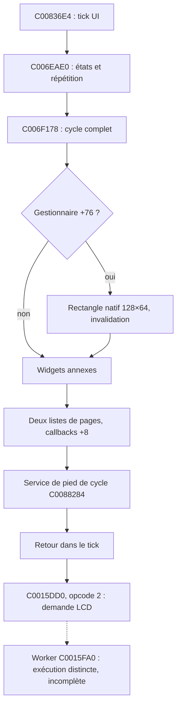

# Mercury Dust — R7 : exécution du cycle graphique complet

3 novembre 2026. Base : R6 `a7212def170420ab906e7237136a50f4483c91b8`. Branche `recovery/mercury-dust`. **RESEARCH_ONLY, Linux/QEMU ARM926 ; aucune validation matérielle.**

## Résultat

**C006F178 est appelé à son adresse originale et revient par son épilogue natif**, sur les deux VSB. Aucun extrait déplacé ne remplace ce cycle. Les trois composants annexes Korg sont construits par leurs constructeurs originaux ; Mercury est inséré dans une page 25 native avec malloc/free Korg.

Le cycle complet obtient les 32 images V30 exactement sur les 1 024 octets. Une transition 25 → 29 restaure l'image par le **redessin natif du gestionnaire**, sans effacement ajouté par Mercury ou le banc. Trente-deux cycles de retour sont vérifiés sur chaque VSB. Un contrôle supprimant seulement le marqueur de redessin conserve **47 octets différents** de la restauration suivante.

**Ce résultat ne signifie pas que tout le système UI est initialisé.** Le gestionnaire global demeure une fixture explicitement assemblée ; un essai de son constructeur complet échoue dans une dépendance de service. Les services de pied de cycle ont des états synthétiques bornés. Le worker LCD ne termine pas : le descripteur périphérique est incomplet. La distinction cycle de dessin / transmission LCD reste indispensable.

## Architecture intégrale de C006F178

| Zone | Comportement lu et/ou exécuté |
|---|---|
| C006F178..C006F1F4 | Si gestionnaire +76 non nul, sélectionne la couleur zéro et dessine le rectangle 128×64 par C003F55C ; consomme +76 ; marque la page primaire à +29 si +24=0 ; invalide des widgets annexes |
| C006F1F4..C006F1FC | Appelle C006EA10, qui appelle les trois slots graphiques +8 aux pointeurs gestionnaire +52/+56/+60 |
| C006F1FC..C006F2B8 | Parcourt les deux emplacements : pointeurs +16/+20, octets +24/+25. Ignore un emplacement bloqué ou nul. Marque la page active +28, propage dirty +29 vers enfant +20, appelle +8 de chaque enfant, remet les deux marqueurs de page à zéro |
| C006F2B8..C006F354 | Résout un service via C06912D8/C06912DC, lit son mode par C0047340, sélectionne l'argument du service C0088284 |
| C006F354..C006F35C | Appelle C0088284 puis restitue pile et registres ; retour natif complet |

Le second parcours peut recevoir un redessin forcé quand le premier emplacement a été traité. Le cycle ne dessine pas la méthode virtuelle de la page elle-même : il parcourt ses enfants. La longueur du vecteur est conservée autour de chaque callback, comme dans l'extrait R2.



C00836E4 est le seul appel ARM direct trouvé vers C006F178 dans le scan de cette image ; ce n'est pas une preuve exhaustive contre des appels indirects. Son appel à C0015DD0 passe **r0=descripteur C031BB2C, r1=opcode 2, r2=0**. L'opcode 2 positionne le descripteur +5 ; il n'appelle pas immédiatement le worker. L'opcode 3 appelle C0015FA0. Le cas 16 exécute réellement le tick, ses routines d'états, le cycle complet et l'opcode 2, puis vérifie +5=1 et l'absence du worker dans la trace.

## Construction progressive de l'environnement

Les états R2/R5 sont repris : image privée, heap natif, données malloc modifiables, RAM graphique et globale, chaîne vide C06A1BAC, manager/queue et services préparés. Les originaux VSB sont seulement lus ; les deux SHA et tailles sont exigés avant/après.

Les composants annexes sont alloués et construits nativement : C0084B3C (76 octets), C0084254 (88), C008C8B4 (76). Leurs liens d'observateurs utilisent les services de fixture préexistants. Leurs méthodes graphiques restent originales. Ils restent vivants jusqu'à la fin du processus ; R7 ne revendique pas leur destruction générale ni une absence de fuite universelle.

Dépendances supplémentaires explicitement fournies :

- C0691324 pointe sur un objet de service nul de 280 octets ; ses champs +36/+41 sont accessibles. Son constructeur général n'est pas exécuté.
- C06912D8 pointe sur le même objet ; C06912DC=1 évite son initialisation paresseuse, sans remplacer la fonction de lecture de mode.
- Mode du service +41=2 : C006F178 sélectionne l'argument zéro pour C0088284.
- Objet de pied de cycle nul de 3 000 octets, placé à gestionnaire +48 ; son octet +0xB98=1 provoque le retour anticipé prévu par son code original. **Ce n'est pas un objet construit par C0087BE8.**
- Le cas 10 remet +0xB98=0 : la branche originale avec argument zéro parcourt alors ses douze positions 76..87 et termine. La branche d'argument un, avec calculs et autres services, n'est pas validée.
- Une page RAM anonyme nulle C06A0000..C06A1000 fournit notamment la donnée C06A010C lue par les chaînes/formatage. Ce n'est pas une restauration de données instrument.
- +25=1 et second pointeur nul au départ, conformément à la sélection primaire étudiée en R6. Le cas secondaire construit ensuite une page 29 par C006E9A0.

Aucune instruction firmware, aucun allocateur ni aucune fonction graphique n'est remplacé. Les permissions des pages de données héritées R2 sont conservées. Les états permettant des sorties anticipées sont exposés ; ils ne sont pas présentés comme une initialisation matérielle complète.

## Matrice : 17 scénarios par VSB

| Cas | Expérience | Résultat attendu et observé |
|---:|---|---|
| 0 | Manager R5 minimal, sans composants annexes | SIGSEGV 0x48 lors de l'invalidation d'un pointeur nul |
| 1 | Constructeur complet C006E6EC | SIGSEGV NULL dans C0024C28 : dépendance de service/notification non initialisée ; le cycle n'est pas atteint |
| 2 | Trois constructeurs annexes natifs | SIGSEGV 0x24 dans C00472F0, service C0691324 nul |
| 3 | Service fourni, donnée de chaîne absente | SIGSEGV C06A010C dans le chemin de chaînes |
| 4 | Dépendances précédentes fournies | Retour complet, image Mercury exacte |
| 5 | Deux cycles, Mercury sans dirty au second | Callback atteint, aucun pixel Mercury supplémentaire, image exacte conservée |
| 6 | Corruption par pixel natif, puis cycle sans dirty ; ensuite +76=1 | Corruption conservée, puis réparation exacte par redessin global |
| 7 | Transition native 25 → 29 | Destruction Mercury, redessin natif et image stable identique au redessin de référence suivant |
| 8 | Page 29 dans second emplacement | Deux passages Mercury au total, page secondaire dessinée ensuite, +25=0 |
| 9 | Primaire +24=1 | Cycle revient, Mercury non dessiné ; aucune fausse exigence d'image V30 |
| 10 | Service de pied de cycle non inhibé, argument zéro | Douze positions natives traitées, retour et image exacte |
| 11 | Demande LCD opcode 2 puis opcode 3, descripteur actif | +5=1 vérifié ; worker atteint puis SIGSEGV 0xBC : dépendance du descripteur périphérique absente |
| 12 | Transition, marqueur +76 supprimé par le contrôle | 47 octets résiduels ; redessin natif rétabli les corrige |
| 13 | Primaire nul avec +24=0 et demande globale | SIGSEGV 0x1D : écriture du marqueur de page avant contrôle de pointeur |
| 14 | 32 images V30 dans le cycle complet | Toutes les images exactes sur 1 024 octets |
| 15 | 32 cycles Mercury → page 29 | Chaque image Mercury et chaque restauration identiques aux oracles, sans effacement du banc |
| 16 | Tick C00836E4 avec objets d'états natifs | Cycle complet puis demande LCD opcode 2 ; worker non exécuté |

Total : **34 exécutions**, issues et flux ARM comparés entre VSB. Les fautes sont conservées comme résultats attendus. Les scénarios de rendu vérifient aussi seize octets avant et seize après le framebuffer au premier cycle et à la fin des scénarios terminant normalement ; chaque snapshot contrôle les deux sentinelles R2. Aucun audit complet du heap ou de tout l'espace RAM n'est revendiqué.

## Comparaison avec R2 et R3

R2/R3 employaient seulement C006F240..C006F29F et ne consommaient pas le marqueur global de redessin. R7 exécute les phases avant/après cet extrait et le second emplacement. **L'effacement de la surface vient maintenant du code natif du gestionnaire**, via le rectangle de couleur zéro, et non d'une nouvelle politique de sortie Mercury.

Les 47 octets résiduels du contrôle 12 ne doivent pas être comparés numériquement aux 91 pixels supplémentaires de R3 : unité, séquence et dessin des composants annexes diffèrent. Les oracles comparent tous les octets à conditions identiques dans R7.

La restauration est établie pour 25 → 29, pas pour toutes les pages ni pour la page 21 de R6. La transmission LCD, les événements pendant dessin et les préemptions ne sont pas prouvés par une image exacte.

## LCD et limites

La bonne signature du dispatcher est établie par ses instructions et son appelant. Un premier appel exploratoire avec l'opcode seul était incorrect ; il a été corrigé avant validation. Le banc final prépare seulement actif +4 et demande +5, pas tous les handles, adresses et états du descripteur. L'échec 0xBC après entrée dans le worker est donc une dépendance de banc, pas un défaut de l'instrument ni un accès matériel reproduit.

Les routines originales plus bas dans le chemin d'envoi comportent des dépendances matérielles, dont l'attente C0015CDC → C00117C8. R7 n'a ni simulé leur achèvement, ni remplacé ces fonctions, ni mappé arbitrairement les registres pour obtenir un succès. DMA, IRQ/FIQ, cache, propriété du framebuffer et coexistence audio/IFX restent ouverts.

## Artefacts et reproduction

- [Résultats, événements et SHA de snapshots](reports/recovery_r7/results.json), [journal validé](reports/recovery_r7/validation.log).
- [Audit des dix plages identiques](reports/recovery_r7/static_audit.json) et [désassemblage](reports/recovery_r7/native_disassembly.txt), dont tout C006F178 et le dispatcher/worker LCD.
- Traces et records ARM compressés, régénérables. `in_asm` décrit les blocs traduits, pas un comptage exhaustif de leurs exécutions.
- [Réparation par invalidation](reports/recovery_r7/case6.gif), [transition et restauration natives](reports/recovery_r7/case7.gif), [second emplacement](reports/recovery_r7/case8.gif), [contrôle sans redessin](reports/recovery_r7/case12.gif). Captures de source graphique QEMU uniquement.

```bash
export PATH=/workspace/mercury-tools/bin:$PATH
bash tests/run_recovery_r7.sh 'custom.VSB' 'backup.VSB'
```

Le lanceur prépare les entrées déjà définies par R1/R2, sans rejouer les anciennes missions. Les sources artistiques, huit presets, douze paramètres, quatre mini-LFO et IFX restent inchangés ; aucun firmware flashable n'est produit.

## Décision pour R8

Les acquis sont suffisants pour étudier **des entrelacements déterministes et des protections expérimentales autour de ce cycle** : on dispose désormais d'un vrai appel complet et d'une restauration native vérifiable. Cela n'autorise aucune conclusion de sûreté concurrente ou matérielle. R8 devra préserver les contre-exemples de destruction active, de saturation et de réentrée, et distinguer clairement garde de laboratoire et verrou du firmware.
