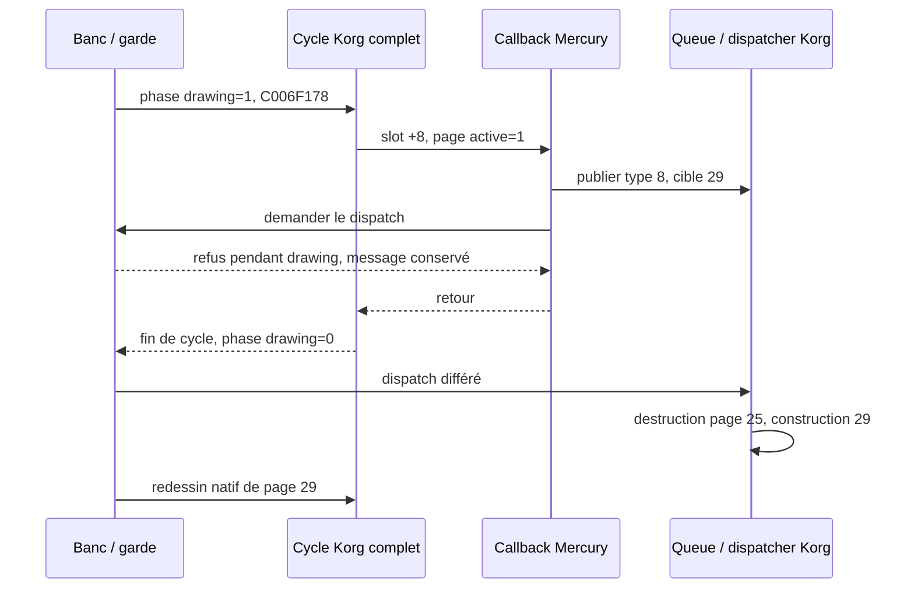

# Mercury Dust — R8 : entrelacements contrôlés et gardes expérimentales

3 novembre 2026. Base : R7 `0169a2d32c86814d776b2440a1c9e434ff2c5135`. Branche `recovery/mercury-dust`. **RESEARCH_ONLY. Aucun firmware modifié, aucun essai matériel.**

## Conclusion et portée

R8 est réalisée comme étude de risques dans la fixture R7. **18 exécutions ARM, neuf scénarios par VSB**, reproduisent la destruction pendant dessin, l'ajout pendant parcours, la saturation et une réentrée explicite du cycle complet. Les issues et enregistrements sont identiques entre les deux VSB.

Nouvelle découverte : **une réentrée de C006F178 peut effacer prématurément le marqueur actif de la page**. Le cycle intérieur le remet à zéro puis revient dans le callback du cycle extérieur, toujours actif. Ce marqueur n'est donc pas une protection suffisante contre la réentrée. Il ne faut pas confondre sa présence avec un verrou.

Trois petites gardes expérimentales, placées autour des appels du banc, évitent certains contre-exemples : différer le dispatch pendant dessin, refuser un second cycle imbriqué, limiter la file à 255 messages. **Ce sont des gardes coopératives séquentielles, pas des primitives atomiques, pas un patch du firmware, et pas une preuve de sûreté concurrente.**

## Cartographie des ressources

« Propriétaire » ci-dessous signifie responsabilité observée dans le banc ou responsabilité à imposer ; aucune propriété exclusive sur l'instrument n'est établie.

| Ressource | Producteurs / écritures | Lectures / libération | Situation et risque |
|---|---|---|---|
| Source graphique C031B310, 1 024 octets | Primitives Korg C0015804/C0015824/C0015988, rectangle C003F55C, widgets et Mercury via pixels | Comparateur LCD C0015AB4 ; snapshots du banc | Global partagé ; aucun propriétaire exclusif démontré, cache Mercury périmable |
| Shadow C031B710, 1 024 octets | Comparaison/copie native LCD C0015AB4 | Chemin d'envoi LCD | Pas de validation matérielle du transfert ni de cohérence cache/DMA |
| Page primaire et secondaire | Fabrique C006E664, transitions C006E8BC/C006E9A0 | Parcours C006F178 ; destructeurs de page | Le gestionnaire porte les pointeurs ; emprunts externes non recensés |
| Vecteur d'enfants | Append C00614FC, agrandissement C006144C | Parcours ; destruction C0060F10 | Ajout accepté pendant dessin ; longueur initiale mémorisée ; doublons dangereux selon R2 |
| Objet Mercury | Allocation native du banc, table expérimentale | Callback +8 ; sortie +16 et suppression +4 appelées nativement | Propriété de destruction déléguée à la page ; le pointeur local devient périmé après transition |
| Queue UI | Producteurs natifs C00839F0/C00824C8/C0083D28/C0083FE8, ring C0070978 | C0083848 et dispatcher C00834FC | 256 emplacements mais ambiguïté plein/vide ; aucune exclusion concurrente démontrée |
| Heap natif | malloc/free Korg, pointeur courant C03404AC et données d'allocateur | Pages, widgets, vecteurs | Réutilisation R2/R7, pas d'audit concurrent ou de toutes les références |
| Marqueurs UI +24/+25/+76 et page +28/+29 | Transitions, producteurs, cycle et fixtures | Navigation, destruction, redessin | Interactions d'ordre ; le marqueur actif n'est pas un compteur d'imbrication |
| Descripteur LCD C031BB2C et handles | Tick opcode 2, worker et autres routines natives | Services périphériques | Incomplet dans le banc ; R7 échoue au worker avant toute preuve d'envoi |
| Services/observateurs annexes | Constructeurs/widgets et états synthétiques R7 | Callbacks natifs | Durées de vie externes et ordonnanceur général non reconstruits |

Les lectures/écritures de framebuffer ci-dessus reposent sur les routines originales et les audits R1/R7. R8 ne prétend pas fournir un graphe exhaustif de tous leurs appelants. Les tests portent sur la mémoire privée Linux du banc.

## Méthode : événement pendant un vrai callback de dessin

Le support R7 et ses trois widgets natifs sont réutilisés. Mercury reçoit une méthode graphique expérimentale qui appelle d'abord son dessin R2, puis effectue **une seule injection contrôlée** avant de retourner au parcours Korg. Les événements sont construits par C0070AF0 et publiés par les routines originales. Aucun dispatcher, destructeur, pixel, allocateur ou instruction Korg n'est remplacé.

Les points d'injection sont des appels C séquentiels dans ce callback. Ils reproduisent un ordre d'opérations possible à étudier, **pas une interruption ARM, un thread concurrent, un scheduler ni une préemption matérielle**. Les désassemblages et traces R7 établissent le code natif concerné ; les traces R8 enregistrent les chemins nouvellement exercés.

L'événement de transition est de type 8, cible 29. Il s'agit d'une demande UI de fixture, pas d'un événement attribué à une touche. Le choix 25 → 29 réutilise la restauration native prouvée R7 et évite de prétendre avoir validé le rendu de page 21.



Sans la garde, le dispatch dans le callback détruit immédiatement la page marquée active et reste dans la boucle C0060F3C. Le timeout externe interrompt le processus ; aucune instruction n'est modifiée pour sortir de cette boucle.

## Scénarios et résultats

| Cas | Expérience | Issue sur chacun des deux VSB |
|---:|---|---|
| 0 | Message type 8 publié puis dispatch immédiat pendant dessin | Timeout attendu à 2 s ; C0060F3C dans la trace ; aucune destruction terminée |
| 1 | Même demande, dispatch différé par la phase du banc | Message conservé pendant dessin ; ensuite transition 25 → 29, une sortie et une suppression Mercury, rendu natif identique aux 1 024 octets de référence R7 |
| 2 | Ajout d'un second Mercury depuis le callback | Liste passe de 3 à 4 enfants ; premier passage : un callback Mercury ; second : deux, soit trois au total ; destruction finale native |
| 3 | 256 tentatives d'ajout, admission plafonnée à 255 | 255 admises, une refusée ; indices 255/0 avant vidange ; 255 consommées après le cycle |
| 4 | 256 ajouts sans plafond | Indices 0/0 ; la queue paraît vide ; aucune des 256 demandes ignorables n'est visible à la vidange |
| 5 | Producteur C0083D28 pendant dessin, manager inactif | +24 graphique passe à 1 mais aucun message ajouté ; la garde de phase ne résout pas ce problème d'acceptation |
| 6 | Appel récursif direct au cycle complet depuis le callback | Le cycle intérieur revient ; **page active=0 dans le callback extérieur**, tandis que drawing du banc vaut encore 1 |
| 7 | Même demande de réentrée, via la garde | Demande refusée ; page active reste 1 dans le callback extérieur ; revient normalement à 0 en fin de cycle |
| 8 | 64 lots : 255 admissions + une refusée, puis vidange | 16 320 messages ignorables consommés, 64 refus ; rebouclage des indices vérifié à chaque lot |

Chaque scénario terminant normalement compare les 1 024 octets de l'image Mercury à l'oracle R1 et contrôle les sentinelles du framebuffer et les quatre mots après la queue. Le scénario 1 compare aussi son image entrante au SHA du snapshot R7 cas 7. Ces contrôles n'équivalent pas à un audit de toutes les allocations natives. Le scénario de timeout ne passe pas par la vérification finale.

La réentrée du cas 6 ne provoque pas ici de corruption d'image : l'image reste exacte. **C'est précisément le contre-exemple utile : une capture correcte peut coexister avec un état de durée de vie devenu trompeur.** Aucun use-after-free effectif n'est revendiqué dans ce cas ; le défaut démontré concerne le marqueur et l'imbrication.

## Durée de vie, saturation et acceptation

Le cas 1 ne déréférence plus le pointeur Mercury après le dispatch : la page a appelé sa sortie et sa suppression, puis le pointeur `parent` est relu depuis le gestionnaire. La queue doit conserver ses propres copies de messages ; le message sur pile est construit et copié nativement. Ces propriétés ne recensent pas d'éventuels observateurs externes gardant une référence à Mercury.

Le cas 2 confirme que l'append ne consulte pas le marqueur actif. Le parcours recharge le stockage mais garde la longueur initiale. Cela explique le report du nouvel enfant au prochain passage ; **cela n'autorise pas une mutation concurrente ni des suppressions individuelles pendant parcours**. Les contre-exemples R2 de doublon, enfant nul et destruction active restent pertinents.

Le cas 4 confirme R4 dans le contexte du cycle complet. Le cas 3 borne l'occupation à `(écriture-lecture)&255 < 255`. Ce contrôle n'est valable que pour des indices normalisés et **si tous les producteurs et consommateurs concernés sont sérialisés et médiatisés**. Un producteur natif non contrôlé peut encore remplir la 256e place ; une préemption entre le test et l'écriture n'est pas protégée.

Le cas 5 conserve l'échec d'acceptation natif : un producteur peut modifier un indicateur puis le publisher refuser. `guarded_offer` donne seulement l'autorisation de tenter une publication selon l'occupation ; son retour ne garantit pas l'acceptation du publisher, notamment si le manager est inactif. Une future intégration devra définir une confirmation et une politique de reprise, sans supposer une transaction atomique inexistante.

## Protections expérimentales et coût

Les trois fonctions du banc sont `guarded_cycle`, `guarded_drain`, `guarded_offer`. Elles ne sont installées nulle part dans le firmware. La phase n'est ni volatile, ni atomique, ni un sémaphore : elle est volontairement étudiée dans un modèle à exécution unique. Ajouter `volatile` ne suffirait pas à en faire un verrou.

| Protection | Fonctionnement borné | Coût mesuré dans l'ELF du cas 8 |
|---|---|---|
| Cycle | Refuse si drawing non nul ; sinon marque, appelle C006F178, démarque | 96 octets de texte ; pile locale statique déclarée 16 octets |
| Dispatch | Refuse pendant drawing ; sinon appelle C0083848 et relit le parent | 96 octets ; pile locale 16 octets |
| Admission | Refuse occupation ≥255, sinon appelle C0083FE8 | 88 octets ; pile locale 8 octets |
| État | drawing, nombre de refus phase, nombre de refus de file | `sizeof(struct gate)=12` ; le compilateur sépare les champs en symboles, dont un booléen d'un octet avec alignement |

Total des trois fonctions : **280 octets de texte dans cette compilation Clang 19 ARM926 -O2**. Ce chiffre n'inclut pas le banc, les messages, les routines Korg, le compteur d'injection, les métadonnées ou un futur adaptateur de production. Les valeurs de pile viennent de `-fstack-usage`, **hors profondeur des appels Korg**, et ne constituent pas une borne de pile complète.

Aucune mesure de cycles ou temps CPU sur instrument n'est disponible. Un délai mural QEMU avec tracing inclurait émulation, démarrage et I/O ; il n'est pas présenté comme un coût matériel. Les mesures de mémoire ne prouvent pas qu'une zone RAM libre existe sur l'instrument.

## Blocages avant tout essai matériel

1. Identifier la provenance physique des codes et valider le protocole complet de réception, pas seulement le décodeur de structure R6.
2. Initialiser et comprendre le descripteur LCD et ses handles ; exécuter le worker et son protocole sans remplacement ; traiter les attentes périphériques non bornées.
3. Définir un propriétaire et une phase de publication du framebuffer avec les producteurs Korg et Mercury, la shadow et les autres voies LCD.
4. Établir les vraies tâches, IRQ/FIQ, priorités, possibilités de préemption et chemins de réentrée ; choisir des primitives adaptées à ARM926 et au noyau Korg.
5. Recenser les emprunts de pointeurs, observateurs et destructeurs ; interdire les alias de propriété et invalider les références après transition.
6. Établir une politique de file et de backpressure couvrant **tous** les producteurs, avec garantie d'acceptation ou reprise après refus.
7. Valider MMU, cache, ordre mémoire et DMA ; les appels Linux et mappings de ce banc ne les reproduisent pas.
8. Prouver l'occupation mémoire/piles, la coexistence audio/IFX et un mécanisme indépendant de récupération ; aucun chargeur réel n'est validé.

Ces points ne constituent pas une autorisation de flash. La session ne crée aucun firmware flashable et n'utilise aucun instrument.

## Preuves et reproduction

- [Résultats et événements ARM](reports/recovery_r8/results.json), [journal](reports/recovery_r8/validation.log).
- Traces `*.trace.gz` et snapshots `*.records.gz` : format R2, mêmes événements comparés entre VSB. Les traces `in_asm` ne comptent pas chaque répétition d'instruction.
- [Symboles des gardes](reports/recovery_r8/guard_symbols.txt) et fichiers `*.stack_usage.txt` pour les deux images et tous les cas.
- [Transition différée](reports/recovery_r8/case1.gif) : framebuffer QEMU avant/après, jamais une photographie LCD.

```bash
export PATH=/workspace/mercury-tools/bin:$PATH
bash tests/run_recovery_r8.sh 'custom.VSB' 'backup.VSB'
```

Le lanceur réutilise les préparations R6/R7 et l'oracle R7 publié, sans rejouer toutes les missions. Les VSB sont exigés par SHA et contrôlés avant/après. `src/`, la référence artistique, les huit presets, douze paramètres, quatre mini-LFO et IFX restent inchangés. Seuls des bancs, rapports et outils sont ajoutés.

## Progression et recommandation

L'intégration logicielle de laboratoire progresse : entrée décodée, navigation native, cycle graphique complet et restauration sont désormais distincts et testables. R8 ajoute une preuve que la fidélité de l'image ne suffit pas à garantir la validité de l'état mémoire et de durée de vie.

La priorité suivante recommandée est une **mission R9 sur les dépendances LCD et la propriété du framebuffer**, en conservant les erreurs de descripteur comme contrôles négatifs. Une seconde piste indépendante doit terminer la cartographie acquisition/panneau. Ni l'une ni l'autre ne doit commencer par un firmware à flasher.
