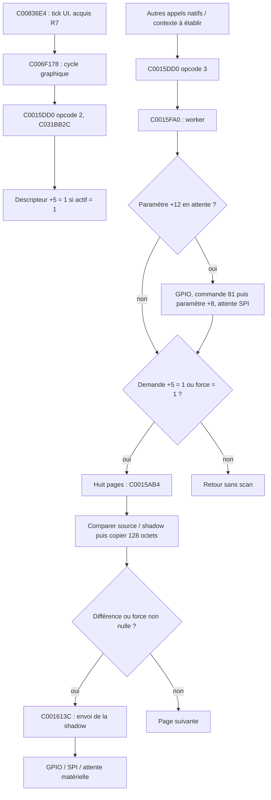

# Mercury Dust — R9 : LCD natif, cohérence et architecture d'intégration

3 novembre 2026. Branche exclusive : `recovery/mercury-dust`. Base distante synchronisée et vérifiée : **`2a81af1a1a869d73f2d71f7b3d43f6e7c36ee3b5`**, R8. **RESEARCH_ONLY : Linux/QEMU ARM926 et modèles déterministes ; aucun flash, aucun essai matériel, aucun firmware flashable.**

## 1. Résultat réellement obtenu

R9 précise la chaîne LCD jusqu'à ses dépendances matérielles et établit plusieurs contrats de cohérence. **Le worker peut terminer sans transmettre lorsque les huit pages source/shadow sont égales. Le chemin d'envoi reste non validé sur périphérique.** Les adresses matérielles ne sont ni mappées ni simulées dans le banc.

Nouvelles preuves :

1. L'échec R7 à **0xBC** vient de la base GPIO nulle dans le descripteur, pas d'un sémaphore ou d'une réponse LCD manquante. Les getters originaux donnent GPIO **01E26000**, SPI **01C41000** ; l'initialisation native atteint alors une faute contrôlée à **01E260BC**.
2. **C0015AB4 copie une page source dans la shadow avant C001613C**, même si la comparaison ne trouve aucune différence. La shadow n'est donc pas un journal de transmission confirmée.
3. Une faute avant le premier accès GPIO peut laisser la shadow égale à la nouvelle source. Dans un second appel **de diagnostic du banc**, le comparateur ne redemande plus l'envoi de cette page. Ce n'est pas une procédure de reprise native Korg démontrée.
4. L'octet de demande **descripteur +5 reste à 1 après un worker terminé** dans le chemin étudié. Il ne représente ni une image figée, ni une demande comptée, ni un accusé de réception.
5. Une copie native par pages peut produire une shadow mêlant deux versions si la source change entre les pages. Le contre-exemple ARM conserve exactement **128 octets** d'une ancienne version.
6. Le `lcd_source_mux` existant a lui aussi besoin d'une source immuable pendant le callback **et** la copie de validation qui suit. Un test de son code inchangé conserve le contre-exemple de mutation dans le callback.

**40 scénarios ARM validés, vingt par VSB**, plus modèles exhaustifs d'ordres de pages, test du mux existant sous UBSan et mesures de structures en ABI ARM 32 bits. Les 86 cas archivés R6–R8 ont été relus et vérifiés sans les rejouer. Leur code et leurs preuves restent inchangés.

L'[architecture candidate détaillée](documents/RECOVERY_R9_ARCHITECTURE_INTEGRATION_FR.md) sépare le moteur artistique, les composants, les événements, le cycle Korg, la demande LCD, les durées de vie et les services matériels. Elle donne les préconditions et tests manquants de chaque interface. **Ce document est un plan de recherche, pas une intégration installée.**

## 2. Récupération du contexte et méthode

La branche locale était propre à R8. Un fetch puis fast-forward ont confirmé qu'elle correspondait à la tête distante attendue. Aucun changement de `main`, force-push ou réécriture de commit.

Les rapports R6, R7 et R8 ont été lus intégralement, ainsi que leurs sources, lanceurs, audits et dépendances pertinentes. L'audit R9 décompresse entièrement leurs traces et records : il vérifie les 86 listes d'événements et SHA de snapshots, relève les adresses d'instructions et conserve notamment le contrôle R7/11 à 0xBC et la boucle R8/0 à C0060F3C. Les résultats antérieurs sont des acquis ; R9 ne reconstruit pas leurs scénarios.

Le nouveau banc LCD est minimal : il charge les 2 Mio d'application du VSB après l'en-tête de 0x100 octets, protège la copie en RX, mappe la RAM anonyme globale C0300000..C0350000, puis exécute les routines à leurs adresses originales. Il n'utilise ni heap, ni constructeur UI, ni substitut de fonction Korg. Les images d'entrée LCD sont **synthétiques**, indépendantes du moteur artistique.

Les deux originaux sont exigés par taille et SHA, contrôlés avant/après, uniquement ouverts en lecture :

- custom : `81b62467490fd25fd154ffe02298886bfdd6e9cf9bda897cde41ee65201ffd03` ;
- backup : `06becf76750f0dce7d3e40d476e4a78524a53730ba61b9b9752dfb170745b052`.

## 3. Chaîne native identifiée



### 3.1. Demande et appelant

L'appelant UI R7 passe r0=C031BB2C, r1=2, r2=0. C0015DD0 lit l'octet actif +4 ; il doit valoir **exactement 1** pour traiter les opcodes. L'opcode 2 écrit +5=1 ; l'opcode 3 appelle C0015FA0 avec force=0. Le dispatcher retourne zéro sur les chemins étudiés, y compris opcode inconnu : **ce zéro ne mesure ni les octets envoyés ni la réussite de l'affichage**.

Les appels directs ARM alignés ont été inventoriés. Le comparateur est appelé à C0016084 et le sender à C00160A0 dans le worker. Le démarrage autour de **C002AB80** appelle l'initialisation LCD C0015DA8, initialise le graphisme, puis utilise les opcodes 2 et 3 à C002AC4C/C002AC5C. Ce chemin global n'est pas exécuté par R9 : ses contextes de tâche, horaires et dépendances restent à reconstruire. Le scan n'est pas une preuve exhaustive contre des appels indirects, Thumb ou adresses calculées.

### 3.2. Comparaison, copie et envoi

Pour `page` entre 0 et 7 :

- source = C031B310 + page×128 ;
- shadow = C031B710 + page×128, obtenue par C0015A60 ;
- si force est nul, C00097A8 compare 128 octets ; sinon le résultat « changé » vaut 1 ;
- **C000985C copie toujours 128 octets source → shadow**, indépendamment du résultat ;
- le résultat calculé avant copie est retourné ; le worker appelle C001613C seulement s'il est non nul.

Un worker demandé sur huit pages égales termine donc sans sender, mais effectue les huit copies de 128 octets. C'est une propriété du code et de ses appels, pas une mesure de durée CPU. Ni la comparaison ni la copie d'une page ne sont atomiques ; le modèle de pages utilisé plus bas simplifie volontairement leur granularité.

C001613C positionne le contrôle GPIO, envoie des commandes dont `(page-80)&255`, 0x40, 0x10 et 0x00, attend l'état SPI, puis obtient le **pointeur de shadow** par C0015A60 et la longueur 128 par C0015A98. C0016100 transmet ces octets à C001851C. Le sender n'envoie donc pas une image privée Mercury directement. Il emploie la shadow globale préparée par le comparateur.

### 3.3. Demande persistante et paramètres

Dans C0015FA0, les écritures observées ne remettent pas +5 à zéro. Les cas 2 et 10 vérifient que la demande reste active après un retour sans changement, puis permet de détecter une modification ultérieure. **Cela ne prouve pas qu'aucun autre chemin du firmware ne l'écrit.** Sa sémantique exacte à l'échelle du système reste à préciser ; « autorisation/demande persistante de scan » est plus prudent que « événement consommé ».

Le paramètre +8 est envoyé après la commande 0x81 lorsque +12 est non nul. L'appellation « contraste » est une interprétation de ce protocole, cohérente avec les recherches précédentes ; le contrat démontré porte sur l'octet transmis et l'indicateur d'attente. Cette branche précède le test de +5. **Pas de demande graphique ne signifie donc pas aucun accès matériel**, si un paramètre est en attente.

Les booléens ne sont pas interchangeables : actif=2 est rejeté ; force=2 avec demande=0 ne lance pas le scan, mais force=2 avec demande=1 est ensuite non nul pour le comparateur et force l'envoi. Les cas 17/18 évitent de généraliser abusivement la convention C « tout non-zéro est vrai ».

## 4. Descripteur LCD C031BB2C : champs et frontière

| Offset | Largeur | Initialisation / utilisation établies | Niveau de preuve et inconnues |
|---:|---:|---|---|
| +0x00 | u32 | Table C00A3E20, constructeur C0015D14 | Initialisation ARM vérifiée ; pas d'audit général du dispatch virtuel |
| +0x04 | u8 | Actif, initialement 0 ; initialisation C0015EB8 le met à 1 | Tests de zéro, un et deux ; état réel au démarrage complet non reproduit |
| +0x05 | u8 | Initialement 0 ; opcode 2 le met à 1 ; consulté par le worker | Persistant dans les chemins testés ; autres écrivains possibles non exclus |
| +0x06..07 | 2 octets | Non initialisés par le constructeur étudié | Poison A5 conservé dans le test ; aucune sémantique attribuée |
| +0x08 | u32 | Initialement 128 ; opcode 4 y place l'octet pointé par son argument | Paramètre émis après 0x81 ; validation générale des valeurs non établie |
| +0x0C | u8 | Paramètre en attente ; initialement 0, opcode 4 →1 ; effacé après le chemin d'envoi/attente | Test négatif avant effacement ; pas de confirmation matérielle |
| +0x0D..0F | 3 octets | Non initialisés par le constructeur | Poison conservé ; pas de champ inventé |
| +0x10 | u32 | Compteur initial 0 ; opcode 6 incrémente et reboucle au-delà de 7 ; opcode 5 sans effet dans cette routine | Test de rebouclage ; le worker utilise son propre compteur local 0..7, pas ce champ |
| +0x14 | u32 | C0015EB8 stocke C001198C() = C031BB20 | Contexte matériel global ; initialisation interne générale de cet objet non validée |
| +0x18 | u32 | Getter C0016568 → **01E26000** | Base GPIO obtenue sans remplacement ; première écriture worker/sender à base+BC bloque sur adresse non mappée |
| +0x1C | u32 | Getter C0016654 → **01C41000** | Base SPI ; disponibilité lue à +10, écritures de transmission à +3C ; configuration/attributs MMIO inconnus dans le banc |

**La base GPIO n'est pas un pointeur de service logiciel à remplir par un objet nul.** Les getters retournent des constantes d'adresse de périphérique. Les remplacer par de la RAM dont les bits prendraient les bonnes valeurs aurait transformé la frontière matérielle en succès artificiel ; R9 ne le fait pas.

C0015EB8 obtient les trois pointeurs, remet la shadow à zéro par C0015A40, appelle C00162A8 (retour sans travail dans les images étudiées), marque actif=1, efface la source par C0015F84/C0015804, puis appelle le worker forcé. Le cas 5 atteint la faute GPIO avec ces champs natifs et les deux surfaces remises à zéro. Il **ne termine pas l'initialisation LCD**.

## 5. Services et synchronisation : ce qui bloque vraiment

| Dépendance | Preuve par les instructions | Exécution R9 / frontière |
|---|---|---|
| GPIO | C0016C18 appelle C0016BB4, qui appelle C0016B10 pour écrire le contrôle de banque 4 ; calcul d'adresse +0x18 +4×40 +4 = **+0xBC** | Avec base nulle : faute 0xBC, reproduisant R7. Avec getter natif : **01E260BC**, aucun registre mappé |
| Disponibilité SPI | C00117C8 lit base+0x10 et teste **0x200** | Appel natif C0015CDC avec getter SPI : faute **01C41010** |
| Attente SPI | C0015CDC répète C00117C8 jusqu'à disponibilité | Boucle sans borne propre dans les instructions étudiées ; aucune réponse périphérique simulée |
| Écriture SPI | C00183CC écrit des commandes et C001851C lit les octets de shadow vers le registre +0x3C | Analyse statique ; non validé avec un périphérique ou un bus émulé |
| Délai / horloge | C001673C appelle le getter C0016538 retournant **01F0D000**, puis lit le mot à +0x10 et accumule une progression | Dépendance matérielle supplémentaire ; pas un mutex RTOS démontré ; chemin non mené à terme |
| Configuration SPI | Fonctions d'écriture vérifient notamment le mot base+0x40 par C0018398 | Valeur et ordre d'initialisation matériels à établir |
| Erreurs | C00183CC/C001851C peuvent appeler C00298BC ; ce chemin d'erreur utilise lui-même le LCD, dont opcodes 1/2/3 | Graphe statique avec cycle d'appels potentiel ; politique d'arrêt/récupération non validée, aucune reprise sûre revendiquée |
| Verrouillage graphique | C003F104 et C003F108 sont des retours immédiats dans ces VSB | Aucune exclusion graphique établie par ces points d'entrée |

Les écritures SPI ont des boucles locales avec compteur 1000 avant leur chemin d'erreur. Cela ne rend pas le pipeline entier borné : C0015CDC et les délais matériels introduisent d'autres dépendances. Les caches, attributs MMU, horloges, broches, IRQ/FIQ, DMA et ordonnancement restent inconnus ou non validés.

## 6. Expériences ARM et contrôles négatifs

Tous les appels sont aux routines originales des deux VSB. Le seed source/shadow est `(i×37+13) mod 256`. Le changement isolé est le bit 7 de l'octet **401**, page 3. Les conditions contradictoires servent à tester les contrats, pas à représenter un état instrument légitime.

| Cas | Expérience | Résultat exigé et observé sur les deux VSB |
|---:|---|---|
| 0 | Constructeur C0015D14 sur 32 octets empoisonnés | Champs connus initialisés ; cinq octets de padding restent A5 |
| 1 | Descripteur inactif ; opcode 2 puis worker forcé | Demande ignorée, worker sans scan |
| 2 | Actif=1, source=shadow, demande puis deux workers | Retour sans sender ; demande +5 toujours 1 |
| 3 | Source modifiée, aucune demande, aucune force | Pas de scan ; shadow conserve l'ancienne valeur |
| 4 | Demande et une modification page 3, bases nulles | **Faute 0xBC ; shadow contient déjà la modification** |
| 5 | Initialisation native C0015EB8 | Pointeurs natifs ; source/shadow effacées ; faute **01E260BC** |
| 6 | Inactif, force=1 | La force ne contourne pas l'état inactif |
| 7 | Actif, force=1, source=shadow | Comparateur force un sender ; faute 0xBC |
| 8 | Actif=2 | Dispatcher et worker ne traitent pas l'état comme 1 |
| 9 | Opcode 4, paramètre 42, pas de demande graphique | Paramètre en attente ; worker tente le contrôle GPIO avant scan ; faute 0xBC |
| 10 | Worker sans différence, puis source modifiée sans nouvelle demande | Le +5 persistant autorise le second scan ; copie puis faute 0xBC |
| 11 | Sender par worker, bases obtenues des getters natifs | Faute **01E260BC**, pas de faux périphérique fourni |
| 12 | Attente native C0015CDC avec base SPI native | Faute **01C41010** sur le bit de disponibilité |
| 13 | Chaque page : égale, modifiée, répétée, forcée | Retours du comparateur respectivement 0,1,0,1 ; copies exactes |
| 14 | Copier page 0 depuis source=11 ; passer source à EE ; copier pages 1..7 | Shadow=11 sur 128 octets puis EE sur 896 ; source=EE partout |
| 15 | Faute après copie page 3 ; comparer puis appeler de nouveau le worker depuis le diagnostic | Shadow=source ; comparateur retourne 0 ; second worker termine sans nouveau sender |
| 16 | Opcode 6 depuis compteur 7, puis de nouveau, puis opcode 5 | Compteur 0, puis 1, puis inchangé |
| 17 | Force=2, demande=0 | Aucun scan |
| 18 | Force=2, demande=1, surfaces égales | Le comparateur voit force non nulle ; sender et faute 0xBC |
| 19 | Opcode inconnu 99, puis worker sans demande | Retour zéro du dispatcher ; aucun scan ni envoi |

Bilan : **40 exécutions ; 22 retours normaux et 18 arrêts diagnostiques attendus après faute**. Les derniers ne sont pas des transmissions réussies. Les tables de résultats exigent les adresses exactes, les marqueurs de trace, les snapshots complets et l'égalité des événements entre les deux VSB.

### 6.1. Observation des fautes sans les masquer

Un gestionnaire **Linux SIGSEGV de laboratoire** enregistre le siginfo, les 32 octets du descripteur et les deux surfaces, puis termine avec le code 88. Il n'est pas une fonction du firmware et ne reprend pas l'instruction fautive. Le cas 15 effectue explicitement un nouvel appel de diagnostic depuis ce handler, puis termine ; **cette récupération n'existe pas dans le Korg démontré**. Aucun retour de périphérique n'est fabriqué et aucune instruction Korg n'est modifiée.

Le cas 4 prouve l'ordre copie/échec à l'intérieur du vrai worker : une seule page diffère, elle est copiée, puis l'écriture GPIO nulle échoue avant l'envoi. Le cas 15 montre ce que verrait un prochain scan dans cet état mémoire. Il ne démontre ni une politique native de reprise, ni un défaut silencieux observé sur instrument. Le chemin d'erreur Korg peut arrêter ou modifier le système ; il reste à étudier.

### 6.2. Format des preuves et mémoire adjacente

Chaque record fait 2 112 octets : en-tête de seize u32 little-endian, source complète de 1 024 octets, shadow complète de 1 024 octets. L'en-tête contient cas, étape, résultat/adresse de faute, séquence, deux gardes et huit mots du descripteur. Les archives sont reparsées indépendamment et leurs SHA vérifiés par `verify.py`.

La source et la shadow sont contiguës. **Aucun canari n'est placé entre elles** : l'octet suivant la source est un octet légitime de shadow. Les gardes sont à source−1 et shadow+1024 ; elles restent intactes dans tous les records, y compris après faute. Il ne s'agit pas d'un audit de toute la RAM.

## 7. Hypothèses confirmées, rejetées et non résolues

| Hypothèse | Verdict et preuve |
|---|---|
| 0xBC est un service RTOS qu'on peut initialiser par une fixture logicielle | **Rejetée** pour ce chemin : calcul d'adresse GPIO, getters et faute 01E260BC |
| Copier la shadow signifie « transmis » | **Rejetée** : cas 4/15, copie avant sender ; aucun affichage confirmé |
| Le worker consomme forcément la demande +5 | **Rejetée** dans le périmètre étudié : cas 2/10 |
| Sans demande graphique, aucun accès matériel n'est possible | **Rejetée** : paramètre +12 traité avant +5, cas 9 |
| Le worker peut terminer sans périphérique si rien n'a changé | **Confirmée**, sous actif=1, paramètre non pending et surfaces égales : cas 2 |
| Le comparateur copie seulement lorsqu'une différence est trouvée | **Rejetée** : copie inconditionnelle après comparaison, ou après force |
| Une source cohérente à chaque instant garantit une shadow cohérente par image | **Rejetée** : changement complet entre pages, cas 14 |
| La source d'un callback `const` est nécessairement figée | **Rejetée** pour le mux : propriétaire mutable, contre-exemple hôte |
| Un pointeur publié suffit à rendre un double buffer sûr | **Rejetée** dans le modèle : ancien lecteur écrasé après réutilisation du slot |
| Un arbitre de phases couvrant tous les acteurs évite le mélange | **Confirmée uniquement dans le modèle séquentiel**, sous son hypothèse d'exclusion complète |
| Transmission complète, contexte de tâche réel, sûreté IRQ/FIQ/DMA | **Non établis** ; aucune simulation de matériel ne remplace ces preuves |

## 8. Propriété des images et architectures comparées

Responsabilités connues : le moteur possède ses images privées ; le composant emprunte une image pour dessiner ; les pages Korg possèdent les listes et la destruction de leurs enfants ; les primitives Korg et Mercury écrivent la source ; le worker compare/copie vers la shadow puis le sender la lit. **Aucune exclusivité globale sur instrument n'est déduite de ces relations.**

Les fenêtres critiques comprennent : rendu privé ; composition de pages Korg/Mercury ; intervalle entre `memcmp` et `memcpy` d'une page ; passage entre pages ; lecture de shadow par le sender ; transition/destruction et retrait d'observateurs. Le marqueur actif R8 ne protège pas contre toutes les réentrées. Le dirty/cache Mercury doit être invalidé après toute modification indépendante de la source.

### 8.1. Modèles déterministes

`models.py` énumère les **12 870 entrelacements** de huit écritures et huit lectures ordonnées par pages. Chaque page est supposée atomique dans ce modèle abstrait ; ce n'est pas une propriété de l'ARM. Résultats :

- source partagée : **10 010 résultats mélangés**, 2 860 cohérents ; ces nombres ne sont pas des probabilités de fonctionnement réel ;
- arbitre de phases : toutes les tentatives sont ramenées aux **deux ordres légaux sérialisés**, aucun mélange ; le modèle suppose que tous les acteurs passent par lui ;
- copie de staging avec version paire stable : deux ordres acceptés, cohérents ; **12 868 rejetés** ; progression/famine non garanties ;
- double buffer sans emprunt : contre-exemple de lecteur écrasé après changement de publication ; avec emprunts, deux configurations de rôles n'offrent plus de slot libre ;
- triple buffer, un lecteur et un auteur : aucune écriture dans les slots publié/lu ; le lecteur ancien reste intact pendant **128 publications** ; ni lecteurs multiples, ni DMA, ni ordre mémoire ARM validés ;
- compteur de version borné : exemple ABA sur 8 bits après 128 écritures ; analogue arithmétique sur u32 après 2³¹ écritures. Le compteur seul ne suffit pas sans borne de durée et règle de rebouclage ;
- durée de vie : les huit états draw/scan/transition autorisent une destruction seulement sans emprunt ; un handle adresse+génération rejette une adresse recyclée dans le modèle.

Un contre-exemple additionnel modélise le créneau `memcmp égal → écriture concurrente → copie nouvelle → retour changé=false`. La séparation est visible dans les instructions, mais **cette interruption interne du comparateur n'a pas été exécutée sous QEMU**. Elle n'est pas confondue avec le cas 14 natif, qui intervient entre deux appels complets.

Les buffers privés ne résolvent pas seuls la publication finale : le comparateur lit la source à une adresse fixe. Leur copie vers cette source doit rester protégée. Une validation versionnée après que le worker a déjà envoyé des pages ne permet pas d'annuler ces effets.

### 8.2. Test du mux de simulation existant

Le code `src/lcd_source_mux.c` reste inchangé. Son contrat diffère de celui du LCD natif : il copie sa shadow après un callback retournant succès. Le test hôte construit un **transport logique**, sans instrument :

1. Callback en échec : shadow non avancée, page réessayable, comportement attendu.
2. Callback copiant 0x11 dans une surface logique puis modifiant la source à EE avant de retourner succès : le mux copie EE dans sa shadow, alors que les octets logiquement envoyés valent 0x11. Le prochain passage ne voit plus de différence.
3. Source de publication privée figée : le callback modifie une autre image vivante ; source empruntée, shadow et surface logique restent égales.

Ce test sous **UndefinedBehaviorSanitizer** prouve un besoin de durée de vie dans la simulation existante. Il ne crée aucun accusé de réception matériel. Le retour constant zéro de C0015DD0 ne doit pas être branché arbitrairement sur `mux_tx_page`, dont le succès est défini par 1.

### 8.3. Coûts mémoire ARM926

Les tailles sont compilées pour ARM 32 bits et lues dans le fichier objet, indépendamment de l'ABI hôte :

| Structure / option | Octets | Portée |
|---|---:|---|
| `md15_bridge` existant | 4 348 | Inclut son mux et deux images privées ; ne pas ajouter encore la taille du mux au total |
| `lcd_source_mux` existant | 1 060 | Simulation logicielle, pas descripteur natif |
| Métadonnées de phase candidates | 24 | Six u32 ; contrat proposé, pas verrou implanté |
| Deux images + métadonnées candidates | 2 072 | Payload 2 048 ; copie vers source fixe toujours nécessaire |
| Trois images + métadonnées candidates | 3 096 | Payload 3 072 ; hypothèses de rôles bornées |
| Staging + version u32 | 1 028 | Ne comprend pas une éventuelle image de producteur supplémentaire |

Ces coûts excluent code, pile, heap, alignements externes, objets Korg et régions source/shadow natives. Les options sont alternatives et des buffers existants pourraient être réutilisés **uniquement après preuve de leurs emprunts**. Aucune région RAM libre n'est déclarée sur l'instrument ; aucun temps CPU matériel n'est mesuré.

## 9. Architecture d'intégration : proposition et tests manquants

Voir le [document d'architecture](documents/RECOVERY_R9_ARCHITECTURE_INTEGRATION_FR.md) pour les douze interfaces, préconditions, responsabilités, risques et critères de passage. La proposition préférée pour le prochain banc est :

- préserver le moteur V30 et ses états artistiques, en mémoire privée ;
- publier une image immuable qualifiée par génération ;
- dessiner Mercury uniquement comme composant appelé par le cycle natif, sans dispatch, destruction ou démarrage LCD dans son callback ;
- sérialiser événements, dessin, scan/envoi et retrait dans un propriétaire logique à établir ; conserver les requêtes différées avec une capacité bornée ;
- séparer **image source**, **image préparée dans la shadow** et **image réellement confirmée** ; le troisième état reste inconnu tant qu'aucune preuve appropriée n'existe ;
- maintenir le descripteur, la configuration et le transport sous responsabilité native ; ne pas substituer le mux de simulation à cette chaîne.

ARM926 ne fournit pas automatiquement les primitives ARMv7. Aucune instruction `DMB` ou `LDREX` n'est ajoutée. Les besoins CP15/cache/write buffer, les attributs MMU et le contexte privilégié doivent être étudiés. `volatile`, le syscall Linux cacheflush ou le masquage d'une seule IRQ ne prouvent pas l'exclusion face à FIQ, DMA, tâches et réentrance.

## 10. Preuves reproductibles et préservation

```bash
export PATH=/workspace/mercury-tools/bin:$PATH # adapter si outils système
bash tests/run_recovery_r9.sh 'custom.VSB' 'backup.VSB'
```

Le lanceur exécute seulement R9 et vérifie les archives antérieures ; il ne rejoue pas R6–R8. Dépendances : Clang/LLD/LLVM, QEMU user-mode, Python 3 et Pillow, déjà utilisés dans les missions précédentes. Le test hôte utilise UBSan ; les ELF ARM sont freestanding Linux/QEMU, pas des binaires destinés au flash.

- [Journal validé](reports/recovery_r9/validation.log), [résultats LCD](reports/recovery_r9/lcd_results.json).
- [Audit statique](reports/recovery_r9/static_audit.json) : **treize plages identiques** entre les VSB, getters/opcodes et candidats d'appels ; contrôle des 86 archives antérieures.
- [Désassemblage borné](reports/recovery_r9/native_disassembly.txt), traces `*.trace.gz` et records `*.records.gz`.
- [Modèles et contre-exemples](reports/recovery_r9/publication_models.json), [contrat du mux](reports/recovery_r9/mux_contract.log), [coûts ARM](reports/recovery_r9/arm_layout_costs.json), [provenance](reports/recovery_r9/provenance.json).
- [Shadow mélangée : preuve native](reports/recovery_r9/native_page_interleave.png).
- [Copie avant l'échec d'envoi : animation](reports/recovery_r9/shadow_before_send.gif). Les images représentent source/shadow QEMU et leur XOR ; **aucun affichage physique n'est dessiné ou supposé**.

Les traces `in_asm` montrent les blocs traduits, pas un comptage de toutes leurs exécutions. Les assertions sur mémoire portent sur les dumps et oracles complets. La validation indépendante reparcourt les 40 archives et contrôle les deux gardes. Les source/paramètres/presets/mini-LFO/IFX sont préservés par l'absence de modification de `src/`, de la référence et des VSB ; leur coexistence physique n'est pas testée.

## 11. Limites, blocages et suite recommandée

Le périmètre de recherche R9 est achevé ; **le LCD matériel n'est pas validé**. Restent bloquants : initialisation GPIO/SPI/horloge, calendrier réel des appels, politique d'erreur et progression des attentes, confirmation du transport, propriété globale des images, références externes et observateurs, RAM/piles disponibles, concurrence IRQ/FIQ/DMA/cache, coexistence audio/IFX et récupération indépendante.

R10 recommandé : remonter l'initialisation native des blocs GPIO/SPI et le contexte qui appelle le worker, étudier les chemins d'erreur utilisant le LCD, puis définir des critères observables de fin de lecture/transmission sans réponse périphérique inventée. Une recherche distincte reste nécessaire pour relier les codes décodés au panneau physique. Aucun de ces travaux ne commence par un flash.

## 12. Explication simple

Aujourd'hui, Mercury sait produire ses images, être appelé dans des pages Korg, traverser plusieurs chemins de navigation et retrouver une page native dans le laboratoire. Nous savons aussi comment l'image est préparée pour le LCD : Korg la copie par petits blocs dans une mémoire intermédiaire avant de tenter l'envoi.

Ce qui manque, c'est la preuve que cet envoi aboutit sur une vraie Electribe, et que personne ne change les images ou ne détruit leurs objets au mauvais moment. La mémoire intermédiaire peut être correcte alors que rien n'a été confirmé sur l'écran. Pour avancer, il faut comprendre les périphériques, les tâches et les durées de vie, puis prouver la transmission et la récupération de façon indépendante. Les résultats QEMU rendent ces questions plus précises ; ils ne remplacent pas ces preuves.
