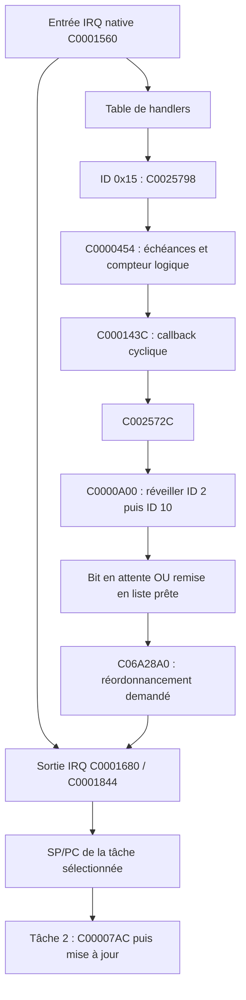
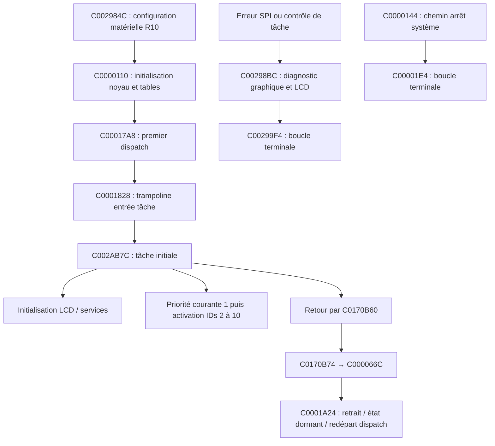

# Mercury Dust — carte native des tâches après R11

3 novembre 2026. Base R10 `2d58ac8a5df4528c052fa287d5d792b34e981a11`. RESEARCH_ONLY ; adresses des deux VSB de référence. [Rapport et expériences](../RECOVERY_R11_RAPPORT_FR.md).

## 1. Table des tâches et signification des champs

La table C00A37A8 contient dix enregistrements de 32 octets. C00002B4 utilise `(id−1)*32` pour sélectionner le bloc de contrôle (TCB) à C06A24E4 et l'enregistrement de configuration. Le nombre dix est à C00A38E8. Les identifiants de l'ordre d'initialisation sont lus depuis C00A3780 et suivants ; ne pas confondre l'ordre de création avec une priorité.

| ID | Entrée | Priorité initiale | Base de pile | Taille en octets | Rôle établi / limite |
|---:|---|---:|---|---:|---|
| 1 | C002AB7C | 8 | C0200000 | 0x23A8 | Démarrage de services/LCD, activation des autres tâches, changement de priorité puis retour |
| 2 | C002AA34 | 1 | C02023A8 | 0x2400 | Gestionnaire des mises à jour ; compteurs UI/LCD ; boucle avec attente |
| 3 | C002A3C0 | 3 | C02047A8 | 0x4800 | Entrée recensée ; corps non qualifié intégralement R11 |
| 4 | C002B144 | 4 | C0208FA8 | 0x2400 | Sélection du gestionnaire UI ; attente temporisée puis consommation virtuelle |
| 5 | C002A598 | 6 | C020B3A8 | 0x100000 | Signale l'événement de démarrage attendu par la tâche 4 ; boucle temporisée vers C002D844 |
| 6 | C00245F0 | 0 | C030B3A8 | 0x2400 | Entrée recensée ; pas déclarée audio, IRQ ou propriétaire UI sans preuve supplémentaire |
| 7 | C002C980 | 0 | C030D7A8 | 0x2400 | Entrée recensée ; même réserve |
| 8 | C001DA9C | 5 | C030FBA8 | 0x2400 | Entrée recensée ; analyse complète différée |
| 9 | C002B220 | 7 | C0311FA8 | 0x2400 | Attente événementielle et consommation de paquets C033E5A8, services C003B904/C003BB00 ; ne pas assimiler à la queue UI |
| 10 | C002AACC | 2 | C03143A8 | 0x2400 | Attente C00007AC, C0057734, service C003C004 ; réveillée par le même callback cyclique que la tâche 2 |

Les huit mots de configuration sont : attributs, argument initial, entrée, priorité initiale (octet bas), taille de pile, base de pile, deux mots non qualifiés ici. C00003B0 copie l'octet configuration+0xC vers TCB+0xD. C00003D8 calcule `base+taille`, prépare argument/entrée sur pile, installe C0001828 comme reprise puis insère la tâche prête. Cela justifie les noms priorité et pile, contrairement aux seules constantes R10. L'attribut initial 2 démarre la tâche 1 pendant l'initialisation.

Ce tableau prouve des **réservations natives**, pas des marges de pile, de la RAM libre ni les attributs MMU. Les priorités peuvent changer via C00006A0. Au démarrage, la tâche 1 appelle précisément cette fonction avec ID 0 et priorité 1 avant d'activer les IDs 2..10. Les valeurs du tableau ne sont donc pas un ordonnanceur immuable.

## 2. TCB et données de noyau utiles

| Champ / global | Sémantique établie dans les instructions | Limite |
|---|---|---|
| TCB +0 / +4 | Liens de liste doublement chaînée | Doivent être cohérents avant retrait/insertion |
| TCB +8 | Pointeur configuration 32 octets | Assigné par C00002B4 |
| TCB +0xC | État ; 0 dormant, 1 prêt ; 10 écrit avant attente de réveil | Les bits ont d'autres combinaisons ; pas un enum exhaustif |
| TCB +0xD | Rang de priorité | Rang inférieur sélectionné avant un rang supérieur |
| TCB +0xE | Flags : bit 1 (valeur 2) = réveil en attente ; bit 0 activation différée ; autres bits existent | Ce bit ne compte pas tous les réveils |
| TCB +0x10 | État additionnel utilisé à la reprise/termination | Non qualifié complètement |
| TCB +0x14 | Pointeur vers résultat/contexte d'attente sur pile | Pendant certaines attentes, le mot pointé contient aussi un handle de temporisation |
| TCB +0x18 / +0x1C | SP / PC sauvegardés | Changement de contexte privilégié, non exécuté comme scheduler Linux |
| C06A2894 | Indicateur de contexte non tâche/idle, consulté par les services | Son rôle ne se réduit pas à « IRQ activées » |
| C06A2898 | Bitmap des rangs prêts | Sélection par C0002114 |
| C06A289C | TCB courant | C0001480 en dérive l'ID |
| C06A28A4 + rang×8 | Tête de liste de prêts | 16 têtes initialisées par C00002B4 |
| C06A28A0 | Demande de réordonnancement différé | Consultée à la sortie d'IRQ |
| C06A2924 | TCB sélectionné pour exécution | Peut différer du courant |
| C06A2928 | Autorisation/état de dispatch | Nécessaire à plusieurs attentes ; valeur exacte générale non reconstruite |
| C06A292C / 2930 | Compteurs logiques de temps | Pas d'unité physique prouvée |

C00018F0 insère une tâche prête dans sa liste, met à jour le bitmap et compare les priorités. Les cas R11 25/26 vérifient le remplacement d'un sélectionné de rang 7 par un rang 4, et son refus face au rang 1. Cela n'établit ni équité, ni latence, ni exclusion contre FIQ/DMA.

## 3. Réveil et temps logique



Le raccordement est statique : l'enregistrement IRQ C00A3668 vaut `[0x15,0,C0025798]`, installé par C0001504/C00001EC. Le record cyclique unique C00A36C0 vaut `[2,0,C002572C,2,0]` ; C0001394 le prépare, C000143C réarme depuis période+0xC et appelle le callback+8 avec argument+4. Premier décalage 0, période logique 2. Les appels de configuration et les accès matériels du handler empêchent de rejouer cette chaîne complète ici.

C00007AC refuse avec −25 si contexte interdit, bit I du CPSR positionné ou dispatch nul. Sinon il consomme un réveil en attente et retourne 0 ; sans réveil il écrit état 10, retire la tâche des prêts (C0001978), installe son résultat sur pile et appelle C0001760.

C000085C ajoute une durée logique : −2 est refusé (−17), 0 sans réveil donne −50, 4 sans réveil prépare une échéance. −1 suit le chemin sans échéance positive. C0001BC8 ajoute une durée positive au compteur C06A292C ; le callback C0001C7C écrit −50 dans le résultat d'attente puis rend éventuellement la tâche prête. **Il ne prouve pas qu'elle ait repris.**

C0000928 est la voie de réveil depuis un contexte tâche ; C0000A00 est la voie utilisée dans le contexte non tâche (tests explicites avec C06A2894=1). La seconde demande le réordonnancement au lieu de commuter immédiatement. Un deuxième réveil déjà mémorisé renvoie −43. C002572C ignore ces retours. Les boucles C002A7AC/C002A7CC ignorent également le retour de l'attente : si elle refuse, elles appellent tout de même la méthode de mise à jour.

**Conséquence :** vingt appels du compteur R10 ne signifient pas vingt interruptions ni une durée constante. Les réveils peuvent fusionner ; aucun débit ou taux de rafraîchissement matériel n'est déduit.

## 4. Consommateur UI et publication LCD

```mermaid
sequenceDiagram
 participant IRQ as Échéance logique
 participant T2 as Tâche 2, priorité initiale 1
 participant Q as Queue UI native
 participant T4 as Tâche 4, priorité initiale 4
 participant F as Source / shadow
 participant LCD as GPIO / SPI
 IRQ->>T2: Réveil (bit ou passage prêt)
 T2->>Q: Compteur UI : message type 0
 T2->>T2: Compteur LCD : C002A71C / opcode 3
 T2->>F: Worker si demande active : comparaison et copie
 T2->>LCD: Envoi synchrone, attentes possibles
 Note over T2,T4: Priorités et préemption à considérer ; aucune barrière de publication
 T2->>T2: Retour à C00007AC
 T4->>T4: C000085C(4), retour ou échéance
 T4->>Q: C002D030 → vtable +0xC
 Q->>T4: C0083848 dépile puis dispatch
 T4->>F: Type 0 : C00836E4 → C006F178
 T4->>T4: Opcode 2 après le dessin
 Note over F,LCD: Source cohérente et shadow préparée ne prouvent pas une réception LCD
```

C002B144 attend d'abord C00010E4(3,1,1,…), puis choisit un mode. C002A598 signale C0000E9C(3,1) après C002D988. Le corps complet de ces services événementiels n'est pas validé R11.

C002D1B8 construit un wrapper, C002D07C choisit un gestionnaire ; modes UI 0,3,4 reprennent C03404C0, mode 5 un dérivé, modes 1 et 2 d'autres gestionnaires. Pour le gestionnaire C00E4C50 étudié depuis R4, le slot +0xC vaut C0083848. C002D030 charge wrapper+4 puis ce slot. C002B144 l'appelle après C000085C(4) et recommence. **4 est une durée d'attente logique, pas un identifiant de signal ni une preuve de 4 ms.** Le wrapper/gestionnaire est fourni directement dans les cas 20..23 ; son constructeur complet n'est pas rejoué.

C0083848 dépile tant qu'un message existe, si ui+112 est non nul. Un type 0 dessine ; un type 8 déclenche une transition/destruction ; un type inconnu peut être consommé sans graphisme. La vidange n'a pas de quota observé dans ce corps. Le publisher copie un message de 16 octets et retourne ; il n'appelle pas ce consommateur.

À priorités initiales inchangées et sans blocage supplémentaire, la tâche 4 de rang 4 ne préempte pas la tâche 2 de rang 1. L'inverse est permis : une tâche 2 réveillée peut interrompre le dessin en tâche 4 et lire une source incomplète. **C'est un risque permis par le graphe, pas une préemption de dessin observée sur Electribe.** Le contexte audio, les modifications ultérieures de priorité et les autres lecteurs restent ouverts.

## 5. Démarrage, sortie et arrêts



Le trampoline prépare son LR de retour à C000066C. La tâche 1 termine par C0170B60, dont C0170B74 branche vers ce même point. C0001A24 retire le courant, appelle C00003B0, traite une activation différée éventuelle via C00003D8 puis rejoint le dispatch. Il n'appelle pas de destructeur de page Mercury dans le corps étudié et n'est pas un mécanisme d'unwind C++ ou de restauration UI démontré.

C0000144 coupe le dispatch, appelle les fonctions d'arrêt système C00000AC, restaure des vecteurs via C0000284, passe par un hook nul dans l'image, puis C00001E4 tourne sur place. C00001FC et C0000214..228 sont aussi des boucles locales. Les vecteurs initiaux hors reset pointent C000007C, qui boucle ; les handlers effectivement remplacés au démarrage doivent être étudiés séparément. **Ni boucle terminale ni sortie de tâche ne sont qualifiées de reset matériel.** Aucun watchdog matériel indépendant n'a été identifié/validé dans ces plages ; cela ne démontre pas son absence dans tout le firmware.

## 6. Contrats imposés à un futur banc Mercury

| Interface | Précondition et responsabilité | Risque / preuve manquante |
|---|---|---|
| Événement → UI | Copier les valeurs ; admission bornée ; un consommateur propriétaire | Producteurs multiples, refus silencieux, boucle de vidange sans quota ; aucune exclusion noyau prouvée |
| UI → objet Mercury | Un seul emprunt actif, pas de dispatch récursif dans draw | R8 démontre destruction active bloquée et marqueur trompé par réentrée |
| Dessin → worker | Exclure les lectures sur toute la composition et stabiliser la source pendant les huit pages | Priorité 2 supérieure à 4 ; une garde locale UI ne couvre pas le worker |
| Worker → progression système | Appel borné ou capacité de reprise indépendante prouvée | C0015CDC non borné ; diagnostic peut redescendre dans le LCD |
| Fermeture → destruction | Rejeter nouvelles commandes, attendre fin des emprunts/callbacks, retirer observateurs, invalider références | Quitter une tâche ne fait pas ces opérations automatiquement |
| Erreur → retour Korg | Autorité indépendante de l'appel bloqué, état de transport connu, restauration déclenchable sans LCD | Aucun mécanisme natif complet prouvé ; NO GO récupération sûre |

La carte complète l'architecture R9 sans installer ses contrats. Les générations, doubles buffers ou phases proposés restent des modèles ; la source fixe C031B310 et tous ses producteurs natifs doivent être couverts. Sur ARM926, ni `volatile`, ni le marqueur page+28, ni le passage dans un syscall Linux ne constituent une primitive d'exclusion native.
