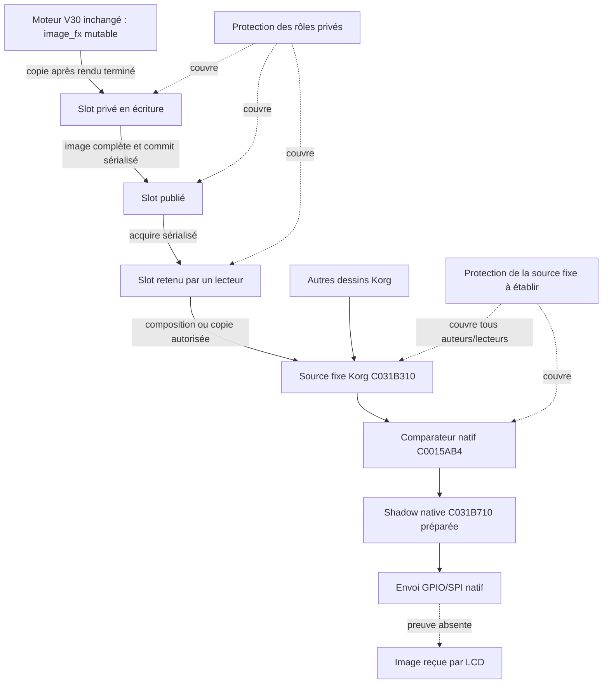

# Mercury Dust — triple buffer R12 et raccordement Korg candidat

3 novembre 2026. RESEARCH_ONLY, base R11 `f565a58`. [Rapport R12](../RECOVERY_R12_RAPPORT_FR.md). Aucun hook installé, aucune routine native modifiée. Cette architecture distingue un contrat de laboratoire exercé d'une synchronisation sur Electribe encore à prouver.

## 1. Origine réelle des éléments

MD53/MD54 sont décrits dans la transcription `documents/RECOVERY_DOSSIER_MD46_MD87_TRANSCRIPTION.md`. Leurs fichiers historiques `research/md53_frames.c`, `research/md54_scan.c`, tests et rapports ne sont pas retrouvés. Le commit `4c1ec01` n'est pas un objet local disponible. Il serait incorrect d'appeler le nouveau banc « code MD53 restauré ».

La base réutilisée est concrète : `tools/recovery_r9/models.py` sépare déjà publié/lecteur/écriture, interdit la réutilisation d'un lecteur retenu et montre que trois slots permettent de continuer avec un ancien lecteur retenu. Ses coûts de structure sont dans `tests/recovery_r9/layout.c`. R12 réutilise son helper `shared` et porte sa règle de sélection des rôles dans `tests/recovery_r12/pool.h`, uniquement pour le banc ARM. Les 32 images restent celles du générateur R1, avec les sources V30 inchangées.

Les adaptateurs présents `lcd_source_mux`, `md18_lcd_abi`, `md30_lcd_gate` et `md31_lcd_comparator` fournissent des contrats historiques et des limites à conserver, pas une synchronisation native acquise. Le mux possède une shadow de simulation ; elle n'est pas C031B710. Le comparateur alternatif md18 peut copier directement une image Mercury vers la shadow : ce chemin ne change pas les lectures du comparateur original tant qu'aucune interception n'est installée. R12 n'en installe aucune.

## 2. Deux protections différentes



La première protection interdit à l'artiste d'écraser une image que Mercury lit encore. La seconde doit empêcher le worker de lire une composition Korg incomplète. **La première n'implique pas la seconde.** Copier une image privée complète n'est pas une opération atomique de 1 024 octets.

Les primitives Korg dessinent directement dans C031B310, parfois par lecture/modification/écriture. Le triple buffer Mercury ne déplace pas automatiquement toute la composition UI dans les slots privés. Une copie plein écran Mercury peut aussi recouvrir des widgets ou une page secondaire Korg. Les essais R12 de copie entière testent la cohérence des octets ; ils ne définissent pas l'ordre de composition du produit.

## 3. Contrat privé du banc

Chaque slot contient 1 024 octets. Un seul producteur et un seul emprunt lecteur simultané sont supportés. `count` vaut 2 ou 3 ; le banc physique réserve toujours trois images, même en mode logique double. Les opérations de métadonnées supposent une sérialisation extérieure : ce n'est pas une bibliothèque C concurrente.

| Opération | Préconditions / résultat | Responsabilité et limite |
|---|---|---|
| Initialiser | Stockage neuf, aucun emprunt ni ancien handle encore utilisable ; image initiale complète | Ne pas réinitialiser pour effacer un lecteur bloqué ; une nouvelle session doit invalider tous les anciens handles |
| Begin | Pas de fermeture ni autre écrivain ; compteur non épuisé ; slot distinct du publié et du lecteur | Retourne slot/génération ; refuse si aucune place. Pas de vol de lecteur |
| Write | Handle écrivain courant ; nombre d'octets restant suffisant ; pas de fermeture | Remplit séquentiellement ; pas de publication des données partielles |
| Commit | Exactement 1 024 octets écrits ; handle courant ; pas de fermeture | Rend publié le slot complet, retire l'écrivain ; ne touche pas C031B310 |
| Acquire | Pas de fermeture ni lecteur déjà actif | Retient publié+génération dans une transaction de métadonnées supposée sérialisée |
| Release | Handle du lecteur actif et génération correspondante | Retire l'emprunt ; ne confirme aucun transfert LCD |
| Abort | Handle écrivain courant | Abandonne le travail privé ; ne modifie pas l'image publiée |
| Close | Sérialiser le passage en fermeture ; refuser nouvelles opérations | Abort/release restent permis ; stockage libérable seulement après disparition de tous les emprunts recensés |

Un nouvel écrivain incrémente une génération u32 ; au maximum u32, le banc refuse de commencer au lieu de reboucler. C'est une politique d'épuisement, pas une preuve de reprise automatique. Un handle ancien ne peut pas libérer l'emprunt d'un slot réutilisé. Le système ne recense pas des pointeurs bruts cachés dans des observateurs externes.

Le test d'acquire interrompu montre la limite : si le lecteur charge publié=0, est interrompu avant de retenir ce slot, puis l'écrivain publie 1 et réutilise 0, le lecteur revient trop tard. L'assignation d'un pointeur `const` ne résout pas cela. **Les tests de refus de réentrée ne rendent pas la séquence de plusieurs accès atomique sous IRQ.**

## 4. Raccordement fixe : contrat exigé, pas installé

```mermaid
sequenceDiagram
 participant Art as Artiste V30
 participant Priv as Triple buffer privé
 participant UI as UI tâche 4
 participant Guard as Médiation globale candidate
 participant Fix as Source fixe
 participant LCD as Worker tâche 2
 Art->>Priv: Remplir slot puis publier image complète
 UI->>Priv: Retenir une génération
 UI->>Guard: Entrer phase composition (protection à prouver)
 UI->>Fix: Dessin Korg + composant Mercury dans l'ordre natif
 UI->>Guard: Composition terminée
 UI->>Priv: Fin d'emprunt de l'image privée
 UI->>LCD: Opcode 2 : demande seulement
 LCD->>Guard: Entrer intervalle lecteur (protection à prouver)
 LCD->>Fix: Comparer/copier huit pages
 Note over Guard,LCD: Envoi intercalé entre pages ; attente périphérique possible
 LCD->>Guard: Fin de lecture native, si le worker revient
 Note over Priv,LCD: Aucune confirmation physique disponible
```

Le worker original lit la source page par page et transmet entre les pages. Sans modifier ses routines, un wrapper extérieur qui veut garantir la stabilité de l'ensemble doit couvrir l'intervalle complet de lecture et tous les producteurs. Relâcher une protection après la seule copie de publication laisse le scan suivant vulnérable à la publication d'après. Verrouiller une page à la fois ne garantit pas une génération unique sur les huit pages.

Un appel extérieur pourrait préserver les instructions natives en encadrant leurs appels. **Il faut encore identifier des points d'interposition couvrant toutes les voies**, et leur ajout constitue une future intégration distincte. L'actuel firmware ne participe pas au protocole privé R12. Les appels de progression C006038C et le diagnostic C00298BC ne doivent pas être masqués par un contrôleur qui ne connaît que le compteur périodique.

La composition elle-même doit être protégée, pas seulement sa dernière copie : Korg écrit déjà dans la source fixe pendant draw. Une capture finale de cette source vers un slot privé ne supprime pas la fenêtre pendant laquelle le worker pouvait observer le dessin partiel.

## 5. Primitives natives candidates et limites

| Primitive | Preuve native / test R12 | Usage envisageable et obstacle |
|---|---|---|
| C0000D80 prendre, C0000CA8 signaler | Sept sémaphores configurés, objets de 16 octets à C06A2474. Prise libre/libération testées ; saturation −43, contexte −25 et ID invalide −18 | Pour des participants coopératifs seulement. Aucun ID libre prouvé. ID1 est déjà employé autour C0012794/C00127A4, ID2 autour C0029A8C/C0029AAC |
| Attente de sémaphore C0001D14 | Écrit état50, retire des prêts, ordonne les attentes selon configuration/priorité ; dépend ensuite du scheduler | Aucun propriétaire récursif, héritage de priorité ou délai borné établi dans ces chemins ; ne pas tenir ce verrou à travers un appel LCD non borné en prétendant assurer la progression |
| C0000040 / C0000050 | Sauvegarde/restauration du bit I ; employées dans certaines routines natives avec un sémaphore | Pas d'exclusion FIQ/DMA ni validation user-mode du masquage. Pas de mesure de latence audio pour une copie ou un cycle entier |
| C00006A0 | Conversion API priorité1 vers rang interne0, API0 restaure la configuration ; cas25 | Un plafond pourrait limiter certaines préemptions de tâches, pas IRQ/FIQ/DMA ou réentrée ; ordre de priorités dynamique, restauration et appels bloquants à qualifier |
| C003F104 / C003F108 | `BX LR` dans les deux originaux ; appelées aussi pendant la prise de sémaphore dans le banc | Aucun verrou graphique natif effectif dans ces deux stubs |
| Flags de réveil / queue UI | R11 : réveils fusionnés ; R4/R8 : copie de messages et capacité ambiguë à 256 | Signalement et admission, pas exclusion du framebuffer ni accusé de transmission |

Les sémaphores configurés ont `[attribut=1, initial=1, maximum=1]`. Le modèle de ressource ressemble à un sémaphore binaire ; cela ne prouve pas toutes les propriétés d'un mutex. Réutiliser arbitrairement un de ces sept IDs pourrait bloquer un service existant. Une création dynamique de sémaphore supplémentaire n'est pas démontrée.

R12 prouve un contournement concret : prendre le sémaphore1 de fixture, puis appeler le vrai comparateur ou C0015988, n'empêche ni lecture ni écriture de la source. Les routines n'acquièrent pas ce sémaphore. Ce n'est pas une défaillance du service noyau : le protocole n'est simplement pas partagé.

## 6. Choix d'architecture

| Option | Gain prouvé / conditionnel | Coût ARM mesuré | Limite déterminante |
|---|---|---:|---|
| Double privé avec emprunt | Image publiée complète ; refuse un nouvel écrivain si ancien lecteur et nouveau publié occupent les deux slots | 2 088 octets, métadonnées R12 incluses | Backpressure ; même raccordement fixe nécessaire |
| Triple privé avec emprunt | Le producteur peut continuer à remplacer le publié pendant qu'un ancien lecteur reste retenu | 3 112 octets | Un seul lecteur/écrivain, métadonnées sérialisées ; aucune protection automatique de Korg |
| Copie de publication avec staging | Évite de lire une image artistique en mutation si le staging est figé | 1 040 octets pour la structure candidate | La copie vers C031B310 et tout son intervalle lecteur doivent encore être protégés ; coût mesuré, adaptateur global absent |
| Phase propriétaire unique | Peut ordonner composition et scan dans un banc maîtrisant tous les appels | Métadonnées à définir selon couverture | L'UI et le LCD sont deux tâches natives ; pas un simple changement de variable locale. Un scan bloquant nuit à la progression |
| Comparateur substitué historique md18/md31 | Code présent et comportement de laboratoire antérieur | Structures historiques distinctes | Change la source logique du comparateur ; ne constitue pas le raccordement au comparateur original inchangé exigé ici |

R9 mesurait 24 octets de métadonnées candidates, 2 072/3 096 octets pour double/triple. R12 ajoute 16 octets à ces layouts : rôles, fermeture, génération et progression de remplissage explicités. Il ne s'agit pas d'une augmentation mesurée de MD53, dont le code reste absent.

Le `md15_bridge` existant mesure 4 348 octets et contient déjà le mux de 1 060 octets et deux images artistiques. Additionner une nouvelle structure triple distincte donnerait 7 460 octets pour ces deux structures, **hors piles, gardes, autres services, source/shadow natives et allocations**. Réemployer directement `image_raw`/`image_fx` comme slots n'est pas acquis : le moteur les réécrit et violerait un emprunt prolongé. Le banc conserve le moteur et copie ses images terminées.

Une publication avec copie artiste→slot puis slot→source écrit 2×1 024 octets, avant comparaison/copie LCD et composition Korg. C'est un volume logique de données, pas un temps d'exécution. Le banc réserve en plus des tableaux de diagnostic et des oracles ; ils ne sont pas inclus dans le coût candidat. Aucune zone RAM ni marge de pile de l'instrument n'est déclarée disponible.

**Choix recommandé pour le prochain banc :** conserver le triple privé comme option testée, et comparer avec le double à backpressure ; travailler d'abord sur la couverture de protection du framebuffer fixe. Installer un triple buffer avant d'avoir cette couverture ne résout pas R11.

## 7. ARM926 et récupération

Le pool est du C séquentiel, sans primitives atomiques. `volatile` ne suffit pas. ARM926 est ARMv5TE : ne pas importer `LDREX`/`STREX` ou `DMB` d'une génération ultérieure. La cohérence exige de qualifier alignement, permissions, write buffer, caches/MMU et primitives noyau réelles ; le syscall cacheflush du banc Linux n'en est pas la preuve.

Trois états doivent rester distincts : **image publiée privée**, **source composée / shadow préparée**, **image reçue physiquement**. Le dernier demeure inconnu. Le cas19 copie la première page dans la shadow puis faute en GPIO ; une comparaison diagnostique suivante trouve la page inchangée. Aucune réception n'a été démontrée.

Une fermeture ne peut libérer un slot tant que son lecteur n'a pas terminé. Tenir une protection sur tout le worker expose à une attente GPIO/SPI sans retour ; relâcher de force depuis un superviseur sans annulation prouvée expose à une lecture d'un objet libéré. Un watchdog coopératif dans cette même tâche ne progresse pas pendant la boucle. Le chemin fatal utilise lui-même le LCD et peut masquer IRQ. Aucun mécanisme indépendant de confinement, d'annulation ou de reset sûr n'est ajouté par les sémaphores ou le triple buffer.

**GO recherche logicielle ; NO GO garantie globale d'image cohérente sur Electribe, récupération indépendante et installation matérielle.** Les preuves privées sont utilisables, mais conditionnelles à leurs contrats ; elles ne satisfont pas encore les exigences de couverture et de progression du système complet.
