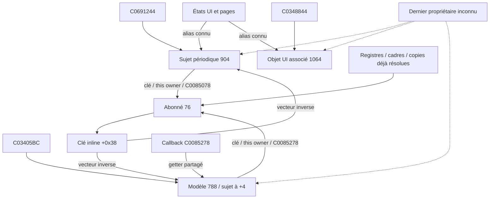

# R20 — graphe natif complété après l'audit de phase 1

Le commit `a220be8` est conservé. Ce complément corrige une limite du périmètre
initial sans modifier ses archives : l'abonné possède **deux inscriptions**.

| Objet / relation | Preuve locale | Limite |
|---|---|---|
| Allocation extérieure de l'abonné : 76 octets | `C0065298` charge 76, allocation puis constructeur `C00852B0` à `C00652A4` | Taille de ce site, pas mémoire profonde d'une page |
| Clé intégrée à +0x38 ; inverse +0x3C/+0x40/+0x44 | Constructeur, deux appels d'inscription, destructeurs | Clé et contexte exigent la même allocation extérieure |
| Première inscription | Sujet `*C0691244`, clé owner+0x38, contexte owner, méthode `C0085078`, ajustement0, période10 | Ce callback ignore fermeture/vtables ; modifie +0x49 et +0x14 si +0x48 actif |
| Deuxième inscription | Sujet `(*C03405BC)+4`, même clé/contexte, méthode `C0085278`, ajustement0, période0 | Racine du modèle distincte de `C0348844` ; callback relit le modèle et peut modifier +0x48/+0x14 |
| Modèle de 788 octets | Getter `C0030D28`, constructeur `C0082848`, sujet intégré à +4 | Fixture précréée ; pas d'allocation native complète qualifiée |
| Nettoyage inverse | `C0041B74` parcourt les deux sujets, appelle `C00705DC`, puis tente free du vecteur | Ne remet pas les anciennes copies CPU à zéro ; champs inverse encore présents avant free |
| Destructeur supprimant | `C00851F4` appelle le corps puis tente free de l'objet | Il faut prouver séparément la cessation du vecteur et celle de l'allocation extérieure |

Le constructeur natif complet initialise son inverse à zéro. L'expérience de
retour complet injecte explicitement une capacité de fixture permanente **avant**
son premier appel d'inscription. Aucun allocateur n'est remplacé. Cette opération
ne valide pas une allocation/réallocation native. Un contrôle sans cet apport
atteint la frontière de heap non mappée `C06A293C`, conservée comme faute attendue.

Les affectations et appels locaux sont PROUVÉS. La couverture de tous les alias,
remplacements de racines, appels indirects et derniers propriétaires demeure
INCONNUE. Les fenêtres de l'audit de phase1 sont des candidats linéaires, pas une
analyse exhaustive de flot de données. Une page détruite ne donne aucun droit de
free sur S, A ou M. Le corps de base d'état ne libérant pas ses alias n'établit
pas l'immortalité de ces objets.
