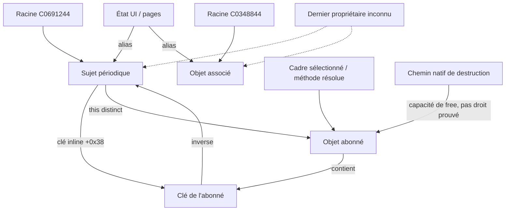

# R20 — autorité sur les sujets partagés

| Référence / droit | Statut | Conséquence |
|---|---|---|
| Racines C0691244 et C0348844, copie vers état+0x24/+0x2C | PROUVÉ localement par R19 et nouvelles plages | Références partagées, pas propriété exclusive d'une page |
| Création paresseuse et publication dans ces racines | PROUVÉ dans les corps inspectés | Pas d'initialisation atomique globale démontrée |
| Écritures/remplacements via les littéraux directs | PARTIEL | 16 fenêtres ; effets candidats conservés avec instructions |
| Écritures par alias calculé ou échappé | INCONNU | Une absence dans les fenêtres ne prouve pas l'absence globale |
| Abonné possède une clé inline et nettoie son inverse | PROUVÉ localement | Cela ne donne pas le droit de détruire le sujet |
| Page/gestionnaire emprunte le sujet partagé | PROUVÉ pour affectations connues | Disparition de page ne cesse pas les autres emprunts |
| Variante native capable de free d'un sujet | PROUVÉ statiquement | Une capacité d'appel n'est pas une autorisation de dernier propriétaire |
| Dernier propriétaire, tous alias recensés, fin CPU et périphérique | INCONNU | NO GO pour libération des deux sujets |

L'audit publie32 lectures de racine,16 écritures candidates et5 publications d'alias candidates dans les fenêtres linéaires retenues. Il suppose la préservation ABI des registres callee-saved et ne résout pas la faisabilité des branches. Il ne généralise pas ces effets à tout le firmware. Les déréférencements calculés, Thumb, IRQ/FIQ et DMA restent hors preuve.

Le sujet possède une référence d'observateur vers clé/contexte ; la clé possède une liste inverse de sujets. Ni cette relation bidirectionnelle ni une racine globale ne démontre une propriété unique. Une méthode déjà chargée et un sous-objet conservé sont encore des racines CPU, même si le slot a été effacé.

Dans le prototype, même le retrait du dernier emprunteur **connu** ne fournit aucune autorisation de free des sujets : les racines globales et les alias externes restent non qualifiés.
