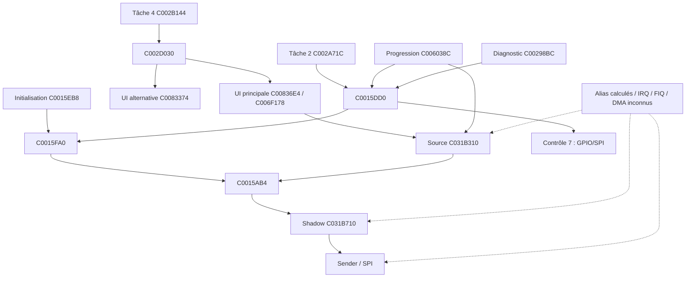

# R31 — graphe borné et matrice de couverture

Cette représentation reprend les chemins de R13, dont certains sont
conditionnels et dont les appelants ne sont pas tous qualifiés. Le fichier
`reports/recovery_r31/coverage.json` énumère douze chemins sélectionnés,
19 points et huit ensembles minimaux de six points au sens strict d'un
problème de couverture de ces listes. Un exemple : `C002D030`, `C0015AB4`,
`C0015DD0`, `C0015824`, `C0015988`, `C0015900`.

| Point dans cet exemple | Chemins représentés | Limite |
|---|---|---|
| `C002D030` | UI principale, alternative, secondaire | ne couvre pas progression, démarrage ou diagnostic |
| `C0015AB4` | lecture/copieur du worker et appel direct sélectionné | ne couvre pas l'envoi de commande sans scan ; scan peut ne pas avoir lieu |
| `C0015DD0` | dispatcher et contrôle 7 sélectionné | init appelle aussi le worker directement ; opcodes distincts |
| `C0015824` | chemin pixel sélectionné | autres auteurs et aliases restent possibles |
| `C0015988` | chemin de rectangle sélectionné | autres écritures possibles |
| `C0015900` | chemin de lecture pixel sélectionné | autres lecteurs possibles |

Ces six points **intersectent des listes**, ils ne démontrent pas qu'une garde
à chacun domine toutes les variantes ni couvre la durée d'une transaction.
En particulier le chemin diagnostic peut dessiner avant son appel au
comparateur ; une interception tardive du comparateur ne protège pas la source.
Un ensemble qui couvre les 14 domaines, leurs aliases et leurs intervalles
d'accès ne peut pas être déduit de ce modèle. Le résultat minimal vaut
uniquement pour le graphe encodé et dépend du choix des chemins.

Le témoin non participant est explicite : une écriture directe pendant une
lecture franchit l'arbitre de fixture et modifie les octets lus. Aucun résultat
R31 ne supprime la nécessité de prouver les auteurs indirects, IRQ/FIQ/DMA,
la durée des emprunts, la gestion d'erreur et le transport physique.
