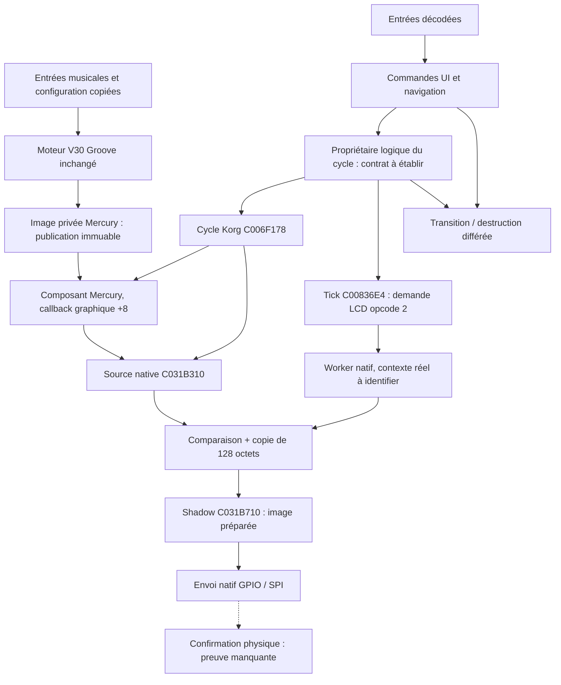

# Mercury Dust — architecture candidate après R9

3 novembre 2026 — RESEARCH_ONLY. Cette architecture décrit des contrats et des expériences futures. **Elle n'est ni installée dans le firmware, ni déclarée sûre sur instrument.** Référence : [rapport R9](../RECOVERY_R9_RAPPORT_FR.md), base de recherche R8 `2a81af1`.

## 1. Décision technique proposée

Privilégier pour le prochain banc **un seul propriétaire logique du cycle UI et de la publication graphique**, avec refus de réentrée et destruction différée. Mercury reste un composant du parcours Korg. Le moteur artistique produit en mémoire privée ; le composant emprunte une image immuable et la dessine au point autorisé, par les primitives déjà étudiées. Le code Korg conserve la composition des pages et la demande LCD. Aucun composant ne démarre lui-même le worker, ne remplace la shadow ou n'écrit un registre périphérique.

Cette préférence minimise les nouvelles dépendances. Elle est conditionnée à l'identification du véritable contexte de tâches et à la preuve que les autres producteurs respectent l'exclusion nécessaire. Si ces conditions échouent, il faut réviser l'architecture, pas supposer qu'une variable de phase bloque les IRQ.

La source native reste à C031B310 et la shadow à C031B710 dans les VSB étudiés. Les routines originales y accèdent directement. **Échanger un pointeur privé ne redirige pas le comparateur natif.** Toute architecture avec buffers privés conserve un point de copie/composition vers cette source fixe, à protéger lui aussi.

## 2. Séparation des responsabilités

La shadow native et `lcd_source_mux.shadow` sont deux objets différents, avec deux sémantiques différentes. La première est copiée **avant** l'envoi. Le mux de simulation copie la sienne après un callback réussi, sous hypothèse d'une source stable. Aucun des deux objets ne constitue seul une preuve que le LCD physique affiche l'image.

## 3. Interfaces candidates

Les contrats suivants sont normatifs pour les futurs bancs. Les noms sont descriptifs ; aucune nouvelle ABI firmware n'est promise.

| Interface | Préconditions | Responsabilité / durée de vie | Risques et preuves manquantes |
|---|---|---|---|
| Entrées musicales → V30 | Valeurs copiées, horloge et reset explicitement définis ; aucun pointeur vers une structure Korg susceptible de disparaître | L'adaptateur possède les copies ; le moteur lit des données cohérentes | La musique R1 est synthétique ; les observations musicales physiques et leur contexte restent à établir |
| Configuration → moteur | Huit presets, douze paramètres et quatre mini-LFO au total préservés ; transaction de configuration cohérente | Le moteur possède son état artistique ; aucune écriture audio/IFX | Pas de preuve d'application concurrente de paramètres ; aucune autorisation d'accès à des paramètres Korg |
| Moteur → image publiée | Rendu terminé, taille 1 024 octets, format monochrome de référence | Le producteur peut réutiliser une image seulement après fin de tous ses emprunts | `md15_frame` réécrit `image_raw`/`image_fx` ; un pointeur `const` ne fige pas leur propriétaire |
| Image → composant Mercury | Emprunt avec génération valide ; image immuable pendant dessin et tout callback susceptible de la consulter | Le composant emprunte ; il ne libère pas le moteur ni son image globale | Tests de réutilisation de slot, génération périmée, fermeture et erreurs d'allocation manquants en contexte natif complet |
| Composant → source native | Callback natif +8 pendant une phase de dessin autorisée ; pas de scan/source concurrent établi | Dessin par primitives Korg ; respect de l'ordre de composition des deux emplacements | Une page secondaire peut dessiner après Mercury ; sa présence ne doit pas être effacée arbitrairement. Le cache différentiel doit être invalidé après toute écriture indépendante |
| Entrée → commande UI | Type de message, code et valeur distingués ; format et limites contrôlés avant indexation | Message copié ; commandes mises en attente pendant dessin/emprunt | Code 12 sans correspondance physique ; validation amont incomplète ; code invalide ne doit pas atteindre C00824A0 |
| Commande → queue native | Admission et consommation sérialisées dans le modèle ; occupation <255 pour la garde expérimentale | La queue possède la copie des 16 octets | Tous les producteurs doivent respecter le contrat ; le retour du publisher ou du dispatcher n'est pas un accusé de navigation. Le refus après modification d'indicateur R4/R8 reste ouvert |
| Propriétaire UI → cycle Korg | Aucune réentrée ; objets et sous-objets valides ; pas de destruction/append arbitraire pendant emprunt | Le gestionnaire appelle le parcours complet et les widgets annexes | Le marqueur page +28 n'est pas un compteur d'imbrication ; la garde R8 n'est pas atomique ; le constructeur complet du manager reste incomplet |
| Source → comparateur/shadow | Source cohérente et stable sur les huit pages ; un seul auteur de shadow et aucun lecteur incompatible | Le worker prépare chaque page shadow ; protection maintenue pendant ses lectures | `memcmp` puis `memcpy` sont séparés ; même une page n'est pas atomique. Les sources externes et la préemption ne sont pas recensées exhaustivement |
| Tick → demande LCD | Descripteur correctement initialisé et actif=1 ; dessin/publication terminés | Opcode 2 demande/autorise le scan par le code natif | Flag +5 non consommé dans le worker observé ; pas de snapshot ni de barrière ni d'accusé de réception |
| Worker → matériel | Bases GPIO/SPI, horloges, mux de broches, permissions et états périphériques natifs établis | Le code natif garde la configuration et les transferts | Initialisation complète, attentes, politique d'erreur et terminaison ne sont pas validées ; ne pas appeler depuis le callback graphique |
| Transition → destruction | Aucun emprunt graphique/scan actif ; références externes et observateurs retirés ; propriétaire unique | La page libère ses enfants une seule fois via les destructeurs natifs ; les références Mercury sont invalidées | Les listes natives acceptent des doublons ; les emprunts externes ne sont pas tous connus ; les générations peuvent reboucler |

## 4. Phases et invariants

États proposés du contrôleur expérimental : `IDLE`, `EVENTS`, `DRAW`, `SCAN_SEND`, `RETIRE`, `FAULT`. Un refus de réentrée laisse l'état inchangé et mémorise la demande, sous limite de capacité explicite. Aucune transition UI ni destruction n'a lieu dans un callback de dessin. Une fermeture demandée pendant un emprunt est traitée après le retour et après réexamen des références.

Invariants à vérifier avant de parler d'intégration :

1. Un seul contexte écrit la source pendant `DRAW`; aucun lecteur de scan ne l'observe avant la fin d'une image cohérente.
2. Pendant `SCAN_SEND`, aucun producteur ne modifie la source sur les huit pages ; la shadow ne change pas sous un lecteur d'envoi.
3. L'image privée publiée n'est jamais réutilisée tant qu'un emprunt la référence. Le changement d'adresse publiée ne libère pas un ancien slot emprunté.
4. Une commande ne détruit aucun objet dont un callback, observateur ou lecteur conserve un emprunt valide.
5. La capacité de file est gérée avant l'ajout et couvre tous les producteurs ; un refus reste observable et réessayable selon une politique définie.
6. `source_epoch`, `prepared_epoch` et `confirmed_epoch` ne sont jamais confondus. Sans preuve d'envoi, le dernier reste inconnu.
7. Un échec de transport ne supprime pas une demande logique de restauration ou de republication ; la politique native réelle doit être comprise avant d'ajouter un adaptateur.

Cette machine est une proposition de responsabilité, pas un service natif découvert. Si le worker peut attendre indéfiniment, conserver toute l'UI en `SCAN_SEND` peut bloquer la navigation. La garde seule ne rend pas cet appel borné. Une future solution nécessite une politique native d'erreur et une preuve de récupération indépendante.

## 5. Comparaison des architectures étudiées

| Option | Résultat déterministe R9 | Coût brut ARM candidat au-delà de source/shadow natives | Limites pratiques |
|---|---|---:|---|
| Source partagée sans médiation | Images mélangées dans 10 010 des 12 870 ordres abstraits de pages ; contre-exemple natif R9 également | 0 | Résultat du modèle, pas fréquence sur instrument ; aucune publication cohérente garantie |
| Propriétaire unique / phases | Les tentatives sont sérialisées en deux ordres légaux ; aucun mélange dans ce modèle | 24 octets de métadonnées proposées ; images artistiques à comptabiliser séparément | Exige couverture de tous les acteurs ; ne protège pas automatiquement IRQ/FIQ/DMA ; risque de latence si attente périphérique |
| Deux images privées + emprunts | Évite la réutilisation d'un slot lu ; peut bloquer le producteur si ancien lecteur et nouvelle publication occupent les deux slots | 2 072 octets : 2×1 024 +24 | Sans emprunt, le lecteur ancien est écrasé ; copie vers source fixe toujours à protéger |
| Trois images privées + emprunts | Un lecteur ancien conservé pendant 128 publications, sans écrasement dans le modèle à un lecteur/un auteur | 3 096 octets : 3×1 024 +24 | Pas une preuve avec lecteurs multiples ou DMA ; politique de remplacement et ordre mémoire à définir ; RAM libre inconnue |
| Copie de staging + version | Version stable et paire : deux ordres acceptés, cohérents ; 12 868 autres rejetés dans ce scénario | 1 028 octets : 1 024 + compteur u32 | Risque de famine et ABA ; nécessite une copie privée avant tout effet visible. Ne peut pas annuler une page déjà transmise par le worker natif |

La granularité des modèles est une page de 128 octets **supposée atomique pour l'énumération**. Le comparateur ARM n'offre pas cette atomicité : ses propres lectures/copies comportent plus de points d'interruption. Le modèle est donc une borne simplifiée, pas une simulation fidèle des instructions ni du noyau.

Ces options ne sont pas toutes additives. Le moteur existant possède déjà des buffers pouvant éventuellement servir à une publication, mais leur réutilisation exige un contrat de durée de vie et pourrait bloquer son rendu. Il ne faut ni les compter deux fois, ni les déclarer libres sans preuve.

Mesure de structures existantes en ABI ARM 32 bits : `sizeof(md15_bridge)=4 348`, `sizeof(lcd_source_mux)=1 060`. Le premier contient déjà le second, `image_raw` et `image_fx`. Ces nombres sont des coûts de structure, hors piles, allocations, autres services et métadonnées de heap. Ils ne définissent aucune adresse libre sur Electribe.

## 6. ARM926 et matériel

Le processeur cible est ARMv5TE/ARM926. Les modèles supposent que l'assignation logique d'un rôle est indivisible ; ils ne fournissent pas son implémentation en concurrence. Il faut établir l'alignement, les accès exclusifs ou primitives noyau disponibles, les règles de cache, la visibilité des écritures et les contextes privilégiés.

Ne pas transposer des primitives ARMv7 comme `DMB`/`LDREX` sans vérifier leur disponibilité : ce n'est pas le jeu d'instructions ARM926. Les opérations CP15 d'ordre mémoire, de maintenance de cache et de write buffer nécessitent une étude du contexte, des permissions et de la configuration MMU ; elles ne sont pas ajoutées par R9. Un compteur `volatile` ne remplace aucune de ces garanties.

Masquer une IRQ ne prouve pas l'exclusion contre FIQ, autre tâche, appel réentrant ou DMA. Le syscall Linux `cacheflush` du banc ne reproduit pas l'entretien des caches ni les attributs I/O de l'instrument. Aucun budget CPU, aucune latence d'IRQ et aucune région RAM libre ne sont établis.

## 7. Plan de validation avant installation

| Lot futur | Critère de passage |
|---|---|
| Initialisation LCD | Provenance de chaque base/champ, contexte de tâches, séquence GPIO/SPI/horloge et frontière des accès matériels clairement établis |
| Politique d'erreur | Comprendre les appels vers C00298BC et leur usage du LCD ; éviter une hypothèse de reprise fondée sur un signal Linux inexistant dans Korg |
| Propriété / calendrier | Énumérer les producteurs et consommateurs réels, leurs contextes et les zones protégées ; démontrer l'exclusion et la progression |
| Durée de vie | Emprunts qualifiés par génération, fermeture différée, refus des doublons, retrait des observateurs et absence de référence périmée |
| Publication | Oracle complet source/shadow et preuve indépendante de ce qui a été transmis ; scénario d'échec après copie et restauration forcée |
| Budget | Carte RAM, piles maximales, charge CPU et comportement sous activité audio/IFX représentative |
| Récupération | Mécanisme indépendant dont le fonctionnement ne dépend pas de l'écran ou du chemin testé |

R10 proposé : remonter l'initialisation GPIO/SPI et le calendrier d'appel du worker, puis approfondir le cycle d'erreur LCD. Les parties purement logicielles peuvent continuer en QEMU ; les preuves matérielles demandent une validation distincte et ne sont pas autorisées par ce document.
